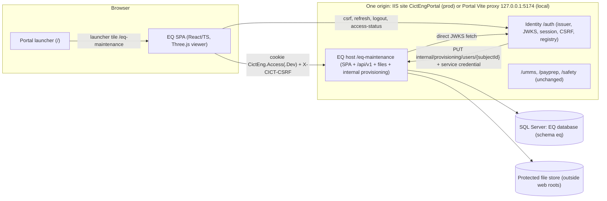
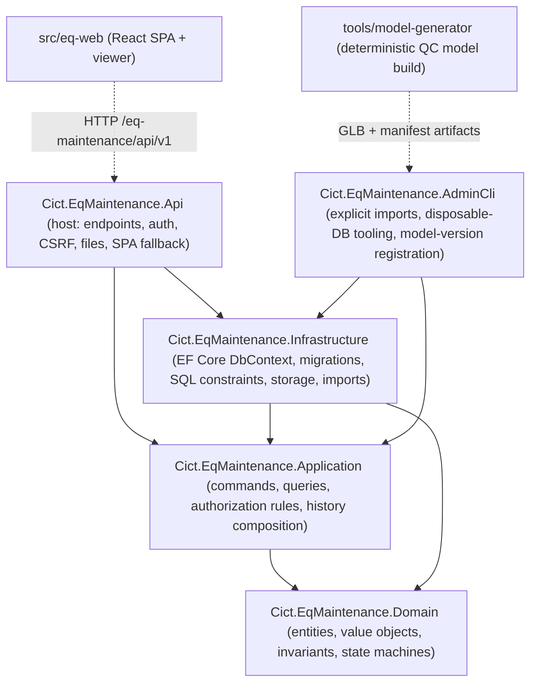
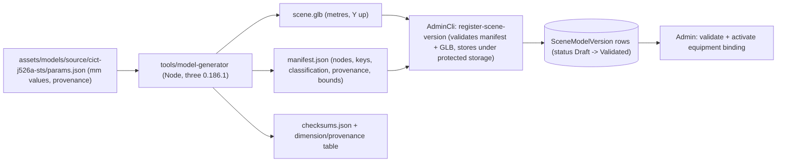

# Architecture

Prepared in P01 on 21 October 2026. Status: **design contract for R01 review**. No application code exists yet. The P01 documents work as one set:

| Document | Contents |
| --- | --- |
| `docs/ARCHITECTURE.md` (this file) | Deployment unit, modules, runtime/package set, request pipeline, frontend and viewer structure, storage, local development plan, technical defaults, tradeoffs, and the S01-S17 ownership map |
| `docs/DATA_CONTRACT.md` | Entities, invariants, lifecycles, role matrix, profile contract, completion/correction rules, history semantics, the 3D model contract, stable keys and deletion rules |
| `docs/API_CONTRACT.md` | Endpoints, authorization, shapes, pagination, errors, concurrency and idempotency |
| `docs/PORTAL_INTEGRATION_PLAN.md` | Portal touchpoints, token-compatibility analysis, regression cases and rollout/rollback order |

Authorities: `documents/prompt-pack/APPROVED_REQUIREMENTS.md` (S01-S17, roles, lifecycle, s8 technical defaults), `QC_3D_MODELLING_BRIEF.md`, `ACCEPTANCE_CHECKLIST.md`, the Master control, and `docs/DECISIONS.md` (B-xx confirmed choices, D-xx defaults, U-xx open source facts). New P01 defaults are D-19 to D-41 in section 13 and in `docs/DECISIONS.md`.

## 1 Shape of the system

One independently deployable EQ application: a single ASP.NET Core host that serves the React single-page application, the JSON API, the protected file/model endpoints and the server-to-server provisioning endpoint, all under `/eq-maintenance`. It has its own SQL Server database and its own protected file store. It relies on the existing Portal Identity service for sign-in and roles. It is not split into services.



What the EQ host does not do: issue tokens, store passwords, show a login form, call UMMS/PayPrep/Safety, call EAM/Maximo, read PLC/SCADA data, or push updates (polling only).

## 2 Deployment unit and paths

| Item | Value | Source |
| --- | --- | --- |
| Application code | `eq-maintenance` | APPROVED_REQUIREMENTS s8; D-07 |
| Browser base path | `/eq-maintenance` (SPA routes below it) | s8 |
| Public API base | `/eq-maintenance/api`; stage 1 contract at `/eq-maintenance/api/v1` | s8; D-19 |
| Protected files/models | `/eq-maintenance/api/v1/documents/...`, `/eq-maintenance/api/v1/scene-model-versions/...` (same authorization pipeline as the API) | Master control |
| Server-to-server provisioning | `/eq-maintenance/internal/provisioning/users/{subjectId}` (service credential, not browser session) | Portal pattern (`HttpAppConvergenceConnector`) |
| Health | `/eq-maintenance/health/live` (process), `/eq-maintenance/health/ready` (database + storage reachable; no detail leakage) | Safety pattern |
| Token audience | `urn:cict-eng:eq-maintenance` | s8 |
| Roles | `eq-maintenance:admin`, `eq-maintenance:eq-team`, `eq-maintenance:management` | s8 |
| Binding claim | `cict:binding:eq-maintenance:local_user_id` | s8; required because the Portal pattern for role-backed apps uses a ledger binding |
| IIS (proposal for P12) | Child application `/eq-maintenance` in site `CictEngPortal`, folder `C:\inetpub\CictEngPortal\eq-maintenance`, pool `CictEngPortal_EqMaintenance`, no managed code (ASP.NET Core Module v2, in-process) | Matches existing child apps in the Portal deploy scripts; target facts unverified (U-14) |
| Production database (proposal for P12) | `CictEqMaintenance` | Distinct from every existing database name |

The host refuses requests outside its path base (the Safety host pattern) and calls `UsePathBase("/eq-maintenance")` so it works both behind IIS (where the module already sets PathBase) and behind the local Portal proxy (where the prefix is still in the path).

## 3 Internal structure



Dependency rule: Domain has no framework dependencies; Application depends on Domain and defines repository/storage/clock interfaces; Infrastructure implements them; Api wires everything. An architecture test (pattern from the Portal's `CictEng.Architecture.Tests`) enforces the direction.

Repository layout (created from P02/P03/P04 onward; P01 creates none of it):

```text
F:\CODEX\EQ_MAINTENANCE
  Cict.EqMaintenance.sln
  Directory.Build.props            net10.0, nullable, warnings as errors
  NuGet.config                     nuget.org + local ./packages (CictEng.Auth .nupkg from P05)
  packages/                        CictEng.Auth.0.3.0.nupkg (checksum recorded), nothing else
  src/
    Cict.EqMaintenance.Domain/
    Cict.EqMaintenance.Application/
    Cict.EqMaintenance.Infrastructure/   Persistence/Migrations, Storage, Imports
    Cict.EqMaintenance.Api/              Program.cs, Endpoints/, Security/, wwwroot/ (built SPA only)
    Cict.EqMaintenance.AdminCli/
    eq-web/                              Vite app (src/app, src/features/*, src/viewer, src/api)
  tools/
    model-generator/                     TypeScript generator (Node), parameter file, exporter
    p00/, p01/                           phase helper scripts (existing)
  assets/models/source/                  generator inputs: dimension/provenance parameter files
  artifacts/models/<model>/<version>/    generated GLB, manifest, checksums (not served from wwwroot)
  artifacts/prototypes/                  P02 prototype build
  tests/
    Cict.EqMaintenance.Domain.Tests/
    Cict.EqMaintenance.Application.Tests/
    Cict.EqMaintenance.Api.IntegrationTests/   WebApplicationFactory + disposable SQL Server
    Cict.EqMaintenance.Architecture.Tests/
    eq-web: vitest unit tests beside sources; e2e/ Playwright suites
```

## 4 Runtime and package compatibility

Facts were gathered in P00 (DECISIONS D-01 to D-05, evidence `docs/evidence/P00/P00_EVIDENCE.md` s5-s6) and rechecked in P01 where noted. P04 pins exact versions with lockfiles after a clean restore; a newer patch is acceptable if it is at least 14 days old (D-13) and passes the compatibility checks below.

| Layer | Selected | Compatibility rule / evidence | Status |
| --- | --- | --- | --- |
| .NET runtime / SDK | .NET 10 LTS (`net10.0`), runtime 10.0.13 or later patch | .NET 10 support to 14 Nov 2028; .NET 8/9 end 10 Nov 2026 (P00 s6). P01 recheck: `dotnet --list-sdks` still shows only 8.0.426 | **SDK install is a P04 prerequisite (D-02)** |
| ASP.NET Core | 10.0.x shared framework | In-process IIS hosting needs the ASP.NET Core 10 Hosting Bundle on the target (U-14) | target unverified |
| EF Core | `Microsoft.EntityFrameworkCore.SqlServer` / `.Design` / `.Tools` 10.0.13 | SQL Server Express 2022 16.0.4305.5 locally (P00) | to pin in P04 |
| Shared auth | `CictEng.Auth` 0.3.0 (net8.0 library) as a PackageReference from the local `packages/` feed | Must be produced in P05 (0.2.1 has no EQ audience: `SharedAuthOptions` validation refuses an unregistered audience at startup). EQ references `Microsoft.AspNetCore.Authentication.JwtBearer` 10.0.x directly so NuGet unifies upward; P05 proves validation tests under ASP.NET Core 10 (D-03) | P05 |
| Testing (.NET) | xUnit, `Microsoft.AspNetCore.Mvc.Testing` 10.0.x | Test-only authentication handler lives in the test project, never in `Cict.EqMaintenance.Api` | P04 |
| Node / npm | Node 24.15.0, npm 11.12.1 (installed) | Vite 8 engines `^20.19 || >=22.12` | ready |
| Frontend core | react / react-dom 19.3.0; react-router 7.18.4; @tanstack/react-query 5.104.1; typescript 6.0.3 | TypeScript 7 is excluded because typescript-eslint 8.x peers `typescript <6.1.0` | to pin in P04 |
| 3D | three 0.186.1; @types/three 0.186.0; @react-three/fiber 9.8.1 (peers react >=19 <19.4, three >=0.156); @react-three/drei 10.7.9 (peers react ^19, fiber ^9) | Fiber and React majors match, as the R3F installation guide requires | to pin in P03/P04 |
| Build / quality | vite 8.3.3; @vitejs/plugin-react 6.1.2; eslint 10.12.0; typescript-eslint 8.71.1; vitest 5.0.3; @playwright/test 1.63.0 | | to pin in P04 |
| Model generator | Node + three 0.186.1 `GLTFExporter` (same three version as the viewer) | Blender/CAD not installed (D-10) | P03 |

The Portal, Identity, UMMS, PayPrep and Safety stay on their current runtimes. EQ does not share a frontend package with the Portal (the Portal web has none), so React 19 is independent of the Portal's React 18.3.1.

## 5 Request pipeline (host)

Order of middleware and endpoint groups in `Cict.EqMaintenance.Api`:

1. Startup validation: options for path base (`/eq-maintenance`, fixed), canonical origin, shared auth, storage root (must be absolute, outside `ContentRootPath` and `WebRootPath`), provisioning credential (>= 32 chars when enabled), database connection present. Missing or unsafe configuration stops the host. **No startup migration and no startup seeding exist in the EQ host** (D-08, Master control).
2. Path-base guard: requests not under `/eq-maintenance` return 404.
3. Exception handler returning RFC 7807 problem details with a correlation ID and no stack traces, connection strings or storage paths.
4. Security headers: `X-Content-Type-Options: nosniff`, `Referrer-Policy: same-origin`, `X-Frame-Options: SAMEORIGIN`, CSP for the SPA document (`default-src 'self'; script-src 'self'; style-src 'self'; img-src 'self' data: blob:; connect-src 'self'; worker-src 'self' blob:; object-src 'none'; frame-ancestors 'self'; base-uri 'self'`). API and file responses are `Cache-Control: no-store` unless section 9 says otherwise.
5. Static SPA assets from `wwwroot` (hashed bundle files `immutable`; `index.html` `no-cache`). `wwwroot` contains only the built SPA, fonts and icons; never drawings, photos, evidence or model GLBs.
6. Authentication: `AddCictEngSharedJwtValidation` (cookie-only shared JWT, direct JWKS, fail-closed profile validator) with `SharedAuth:Audience = urn:cict-eng:eq-maintenance`.
7. Browser request verification for every authenticated unsafe method (POST/PUT/PATCH/DELETE): canonical `Origin` (or `Referer`) and `X-CICT-CSRF` checked against the token's `cict:csrf_digest` via `SharedBrowserRequestSecurity`; failure is 403 with `X-CICT-CSRF-Invalid: true`. Only `/eq-maintenance/internal/provisioning` is exempt, because it is guarded by its own service-credential filter and never accepts a browser session. Path tests are case-insensitive (lesson recorded in the Safety middleware).
8. Authorization: endpoint policies `EqRead`, `EqWrite`, `EqAdmin` plus resource rules in the Application layer (DATA_CONTRACT s6, API_CONTRACT s2). Every endpoint has an explicit policy; the fallback policy denies.
9. Endpoint groups: `/api/v1/*` (JSON), `/internal/provisioning/*`, `/health/*`, and the SPA fallback for any other GET under `/eq-maintenance` that accepts `text/html` (returns `index.html`). Unknown `/api/*` routes return JSON 404, never `index.html`.

## 6 Frontend architecture (`src/eq-web`)

- Built by Vite with `base: '/eq-maintenance/'`; React Router data router with `basename="/eq-maintenance"`; the production bundle is copied into the host's `wwwroot` during release.
- Routes (all deep-linkable; restored after sign-in):

| Route | View |
| --- | --- |
| `/eq-maintenance/` and `/eq-maintenance/fleet?type=&status=&lifecycle=` | Fleet overview (S02/S03) |
| `/eq-maintenance/equipment/{equipmentId}?main=&sub=&part=&mode=overall|technical&panel=history|technical|jobs` | Equipment detail with tree, viewer or fallback, right panel (S04-S07, S14) |
| `/eq-maintenance/jobs?status=&equipment=&type=&kind=&from=&to=&dateField=&includeCancelled=` | Jobs workspace (S08/S09) |
| `/eq-maintenance/jobs/{jobId}` | Job record, completion, evidence (S09/S13) |
| `/eq-maintenance/admin/...` (`equipment`, `models`, `catalog`, `positions`, `parameters`, `scene-bindings`) | Admin workspace (S10); hidden for other roles and denied by the API |

- **Deep-link character rule (D-20):** the Portal's `IdentityReturnUrlValidator` rejects any return URL containing `%`, `#`, `\` or `//`. Every query value the app needs to restore after sign-in therefore uses only `[A-Za-z0-9_-]` (GUIDs, enum tokens, ISO dates). Selection uses separate `main`, `sub`, `part` parameters (never a `part:<id>` value, which `URLSearchParams` would encode as `%3A`). Free-text search is not restored across a sign-in redirect.
- **Server state:** TanStack Query with `AbortSignal` on every request. Query keys always include `equipmentId` and the selection scope, and every history response echoes `equipmentId`, `scope` and `targetId`; the panel renders a response only when the echo matches the current selection (HIS05).
- **Selection state:** the URL is the single source of truth for equipment and `main`/`sub`/`part`. The tree, the breadcrumb and the 3D scene all dispatch the same `select(...)` navigation; the viewer only reads it. Back/forward reproduce the selection.
- **Session client (pattern copied from the Safety web client):** CSRF token kept in memory only (never `localStorage`/`sessionStorage`); fetched from `/auth/csrf`; on 401 a single shared refresh (`/auth/session/csrf` then `POST /auth/session/refresh`) and one retry; if recovery fails, call `/auth/applications/eq-maintenance/access-status` and show the actionable state (signed out, password change required, no EQ access, provisioning pending) with a link to `/login?returnUrl=<current path>`. No credential or token is ever readable by the SPA (HttpOnly cookies).
- **Polling and freshness:** fleet data polls every 60 s by default (configurable, D-15), refetches after successful writes, uses `If-None-Match`/ETag for cheap 304s, and on failure keeps the last good data with a visible "stale since hh:mm" indicator. Nothing is ever defaulted to Ready.
- **Role-aware UI:** writer actions render only for `eq-team`/`admin` capabilities returned by `GET /session`; Management sees a persistent "Read-only access" indicator without losing navigation. The API enforces permissions independently.
- **Fixture isolation (D-21):** synthetic fixtures and the prototype data adapter live in `src/eq-web/prototype/` and are only reachable from a separate Vite mode/entry (`vite --mode prototype`, `build:prototype`). The production entry imports only `src/api` (real HTTP client). P12 adds a bundle check that fails if any prototype module is present in the production build.
- **Accessibility:** tree implemented as an ARIA tree with roving tab index and type-ahead; status shown as text + icon + colour; visible focus; labelled form controls with server validation errors mapped to fields; drawers for tree/panel below 1280 px; phone width prioritises fleet, job forms and the text hierarchy with the 3D view optional.

## 7 QC viewer architecture

The viewer is a lazily loaded module inside `eq-web` (`src/viewer`). The contract it implements is DATA_CONTRACT s10; this section covers runtime structure only.

- **One canvas per equipment detail view, none on the fleet page.** The fleet uses static thumbnails/silhouettes (SVG/PNG, same-origin).
- React Three Fiber `<Canvas frameloop="demand">`; frames are requested only for camera transitions, control input, selection/overlay changes and mode changes. No per-frame React state updates.
- Camera: drei `CameraControls` (camera-controls) because it provides interruptible, promise-based `fitToBox`/`setLookAt` transitions. A newer selection or a user drag cancels the running transition. `prefers-reduced-motion` makes transitions instant.
- Asset loading: `GLTFLoader` fetches `scene.glb` and `manifest.json` from the protected endpoints with credentials; no Draco/meshopt decoders are used in stage 1 (D-22), so no decoder files are needed. If a later version needs compression, its decoder is bundled same-origin.
- Identity resolution: scene object -> `userData.nodeKey` (written by the generator) or, for instanced meshes, `instanceId` -> manifest `instanceMap` -> node key; node key -> equipment binding -> `positionId` / `subInstanceId`. Nothing else (mesh name, UUID, array index) is used as an identity.
- Highlighting uses an overlay pass (outline + emissive tint on a cloned material reference) with a separate legend, so normal CICT red paint never reads as Breakdown.
- Resource management: geometries/materials shared per model version and cached by version ID; on equipment change the scene graph is detached and unshared resources and listeners are disposed; the renderer is kept and reused. `webglcontextlost` switches to the fallback panel; restoring is attempted once.
- Fallback states (WebGL unavailable, context lost, asset 401/403/404, invalid manifest, no verified model, RTG/ES stage 1): the viewer region shows a clear message and the tree, history and permitted work stay fully usable.

## 8 Model asset pipeline



Generated outputs go to `artifacts/models/<modelCode>/<version>/`; the registered copy lives in protected storage. The generator is deterministic for the same inputs and tool versions; P03 documents any byte-level nondeterminism (VIS09).

## 9 Protected storage

- `IFileStore` abstraction with a filesystem implementation rooted at `EqStorage:RootPath` (absolute; validated to be outside the content root, `wwwroot`, and any IIS virtual directory the app exposes). The IIS app-pool identity needs modify rights on that folder only.
- Layout: `sources/<sha256[0..2]>/<sha256>` for imported drawings/photos (content-addressed, de-duplicated), `evidence/<yyyy>/<documentId>` for job evidence, `models/<sceneModelVersionId>/scene.glb|manifest.json` for registered model versions. Storage keys are generated by the server; client-supplied names are display metadata only.
- Streaming: authenticated `GET` endpoints with `Content-Disposition` (inline for PDF/images, attachment otherwise), sanitized filenames, `X-Content-Type-Options: nosniff`, range processing for PDFs, and `Cache-Control: private, no-cache` plus a strong ETag (sha256) for model assets so every load revalidates through authentication (cheap 304) but never bypasses it.
- Missing or unreadable files return 404/503 problem `file_unavailable` without revealing paths (FILE05).

## 10 Persistence

- SQL Server, EF Core 10 code-first migrations in `Cict.EqMaintenance.Infrastructure`, schema `eq`, `READ_COMMITTED_SNAPSHOT ON` (readers do not block writers). Commands that must serialize use explicit `UPDLOCK, HOLDLOCK` reads inside a transaction (DATA_CONTRACT s5, s8). EF Core execution strategy with retry wraps every explicit transaction (Safety lesson).
- Migrations are applied only by explicit commands: `AdminCli migrate` for disposable databases and reviewed idempotent SQL scripts (`dotnet ef migrations script --idempotent`) for any later authorized environment (P12).
- **Disposable database guard (D-08, refined D-23):** `AdminCli` refuses `migrate`, `import-*`, `seed-fixtures` and `drop` unless the target database name matches `^EqMaintenanceDisposable_[A-Za-z0-9_]+$` **and** (for an existing database) the table `eq.__DisposableMarker` exists with the matching database name and a creation stamp written by `AdminCli create-disposable`. Production-style imports (`import-mechanisms`, `import-parameters`, `import-drawings`) are allowed against a non-disposable target only with an explicit `--target-confirmation <database name>` argument that must match, and they never run fixtures. `seed-fixtures` never runs against a non-disposable target under any flag.
- Reference imports vs fixtures: reference data (catalogue, parameter observations, drawing registrations, scene model versions) comes from versioned files under `documents/prompt-pack/reference` or `artifacts/models`; synthetic fixtures (`QC-DEMO-01`, `QC-DEMO-02`, `RTG-DEMO-01`, `ES-DEMO-01`, demo jobs/status) live in a separate fixture set marked `DataOrigin = DevelopmentFixture` and are excluded from release migrations and packages.

## 11 Local development plan (same origin)

Ports (D-09): EQ host **5310**, EQ Vite dev server **5311**. Portal runner ports 5174, 5180, 5190, 5091, 5173, 5088, 5280 are not reused.

| Mode | Used by | How it runs | Authentication |
| --- | --- | --- | --- |
| A. Prototype | P02, P03 | `npm run dev:prototype` in `src/eq-web` on 5311, base `/eq-maintenance/`, prototype data adapter with labelled synthetic fixtures | None; every screen shows a "Prototype - synthetic data" banner. Not a production build |
| B. Foundation | P04 | EQ host on `http://127.0.0.1:5310/eq-maintenance` against a disposable database; Vite on 5311 proxies `/eq-maintenance/api` to 5310 | Until P05 the host has no working shared-auth scheme (CictEng.Auth 0.3.0 does not exist yet) and returns 401 to all API calls: fail closed. Automated tests use a test authentication handler registered only by `WebApplicationFactory` in the test project |
| C. Integrated same origin | P05 onward | Portal Vite proxy on `http://127.0.0.1:5174` adds `/eq-maintenance/api` -> 5310 and `/eq-maintenance` -> 5311 (HMR) or -> 5310 (built SPA). Identity (5180) provisions EQ directly at `http://127.0.0.1:5310/eq-maintenance` with a generated local-only credential. Browser opens `http://127.0.0.1:5174/eq-maintenance` | Real local Identity with an **isolated** Identity database and synthetic users (PORTAL_INTEGRATION_PLAN s7). Cookie `CictEng.Access.Dev` on one host |

The Portal proxy does not route `/eq-maintenance/internal`; the provisioning endpoint is called server to server. EQ provides `tools/eq-local.ps1` (P04) to start/stop only its own processes and to create/drop disposable databases; it never starts or seeds other apps.

## 12 Security and operations summary

| Concern | Design |
| --- | --- |
| Credentials | Central Identity only; EQ has no password store, login screen or local accounts. No credential, connection string, provisioning secret or token in source, logs, evidence or packages; placeholders only in `appsettings.Example.json` |
| Token handling | HttpOnly shared cookie validated by `CictEng.Auth`; tokens never logged; `SaveToken=false`; the SPA never sees tokens |
| Authorization | Three roles, union of permissions, enforced server-side on every endpoint including files and model assets; local profile must be active, bound to the token subject and hold exactly the token's EQ roles (DATA_CONTRACT s7) |
| CSRF/Origin | Portal synchronizer-token + canonical-origin contract, no development bypass (AUTH06) |
| Provisioning | Fixed-time credential comparison, default disabled, credential >= 32 chars from runtime configuration |
| Uploads | Allow-list by extension and signature, size limits, server-generated keys, no client paths, no URL fetches (FILE03) |
| Logging | JSON console/structured logs with correlation ID, actor profile ID, route template, status; never request bodies of uploads, tokens, cookies or provisioning headers |
| Time | Audit instants UTC `datetime2`; business dates `date`; UI displays Asia/Colombo (UTC+05:30, no DST) (D-14) |

## 13 Technical defaults decided in P01

These are routine implementation choices (revisable with a recorded reason). They are also appended to `docs/DECISIONS.md` s2.

| ID | Default |
| --- | --- |
| D-19 | Versioned API at `/eq-maintenance/api/v1` under the approved `/eq-maintenance/api` base. Breaking changes would add `/v2`; stage 1 has only v1 |
| D-20 | Deep-link query values restricted to `[A-Za-z0-9_-]`; selection uses separate `main`/`sub`/`part` parameters (Portal return-URL validator rejects `%`) |
| D-21 | Prototype adapter and fixtures confined to a separate Vite mode/entry; production bundle check in P12 |
| D-22 | No Draco/meshopt compression in stage 1; uncompressed GLB served via the protected endpoint; revisit only if the 8 MiB overview budget is exceeded |
| D-23 | Disposable-database guard: name pattern `EqMaintenanceDisposable_*` plus `eq.__DisposableMarker`; explicit `--target-confirmation` for non-disposable reference imports; fixtures never outside disposable targets |
| D-24 | Solution naming `Cict.EqMaintenance.*` (mirrors `Cict.Safety.*`); four layers plus AdminCli; architecture test enforces direction |
| D-25 | `CictEng.Auth` consumed as a PackageReference (0.3.0) from a checksummed local `packages/` feed, not a cross-repo ProjectReference |
| D-26 | Concurrency tokens are SQL Server `rowversion`, exposed as an opaque base64 `version` string; stale writes return 409 `version_conflict` with the current representation |
| D-27 | Every POST command that creates or changes records requires an `Idempotency-Key` (UUID) header; records are kept 30 days (configurable) and completion is additionally protected by job state |
| D-28 | Job completion, status change, correction and provisioning run in one transaction with `UPDLOCK, HOLDLOCK` on the affected job/equipment/position rows, inside the EF execution strategy |
| D-29 | Two position kinds: `serialized` (quantity 1, one open installation) and `quantityLot` (open lots with quantity/UOM, full or partial replacement) |
| D-30 | Replacement lines are entered at completion only (no draft line state); Repair jobs carry no replacement lines |
| D-31 | Replacement-line positions must lie inside the job's target subtree (an equipment-level job may replace any active position of that equipment) |
| D-32 | A new installation event's business date must be on or after the latest non-voided event at that position; otherwise 409 `out_of_order_installation` (inserting into the past would overwrite later history) |
| D-33 | Operational status changes are effective at server time (no back-dating); a change to the current status value is refused (`status_unchanged`) |
| D-34 | Cancellation is terminal in stage 1 (no un-cancel); a cancelled job can be copied into a new job by the UI |
| D-35 | Retiring equipment is refused while it has uncompleted, uncancelled jobs; retired equipment accepts no new jobs or status changes |
| D-36 | Admin may record a "known existing installation" baseline at a position (kind `baselineRecorded`, no job, explicit source note, date may be unknown); it is never generated automatically |
| D-37 | Delegated EQ role administration is **not** enabled in stage 1: EQ roles are granted by PortalAdmin through the existing central contract (`IsDelegatedGrantAllowed = false`, no `DelegatedAdministratorRoles` entry), matching the Safety onboarding |
| D-38 | Portal launcher icon: registry `IconKey = "maintenance"`; P05 adds a dedicated icon mapping in `portal-web` rather than reusing the UMMS wrench |
| D-39 | Model asset caching `private, no-cache` + sha256 ETag (always revalidated through authentication) |
| D-40 | History responses are sectioned (open jobs, completed jobs, installation events, status changes) rather than one mixed timeline; each section has its own stable sort and cursor |
| D-41 | The `eq-maintenance` Identity registry row is committed **disabled** (seeder and the new Identity registry migration); enabling it is the audited rollout step after gate G1 (PORTAL_INTEGRATION_PLAN s6) |

## 14 Tradeoffs considered

| Choice | Alternative | Why this choice |
| --- | --- | --- |
| Single host serving SPA + API | Separate SPA app + API app (UMMS pattern) | One IIS application, one pool, one release unit, no extra path routing; Safety already proves the single-host pattern on the same site |
| Explicit relational ancestor chain on jobs/positions (composite foreign keys including `EquipmentId`) | Validate equipment consistency only in code | Cross-equipment relationships become impossible at the database level (ADM03); descendant history queries become simple indexed predicates |
| Lots for quantity positions | Treat every position as serialized; or free-text quantities | Rope sets and similar multi-item positions need consistent quantity math without inventing serial numbers (JOB10) |
| Append-only installation events with "void" corrections limited to the latest event | Editable installation table | History is never rewritten; a correction can never overwrite a later physical replacement (JOB09) |
| Exact semantic-key bindings with explicit Admin remapping | Automatic name/index matching on model upgrade | Prevents silent history transfer between components (VIS05) |
| Procedural generator -> GLB | Hand-authored Blender asset | No Blender/CAD installed; generator is reproducible and reviewable; still produces a GLB so a later authored asset can replace it under the same manifest contract |
| Polling (60 s + after writes) | SignalR/WebSockets | Stage 1 requirement; no push infrastructure on IIS to operate |
| Package reference to `CictEng.Auth` 0.3.0 | Project reference into the Portal repo | Pins an exact contract version, records a checksum, avoids path coupling; matches Safety |
| Sectioned history | One mixed timeline | Mixed date-only business dates and UTC instants sort ambiguously; sections keep each ordering truthful |
| Lines entered at completion | Draft/planned lines | Fewer states and edit paths; nothing in stage 1 requires planned lines |

## 15 Requirement ownership map (S01-S17)

Components: **Api** (host endpoints/security), **App** (Application services), **Dom** (Domain), **Inf** (persistence/storage/imports), **Cli** (AdminCli), **Web** (SPA), **Viewer** (QC viewer), **Gen** (model generator), **Portal** (Portal-repo changes in P05), **Tests**.

| ID | Owning components (contract section) | Build phases | Acceptance cases |
| --- | --- | --- | --- |
| S01 | Dom/Inf equipment types, equipment models, equipment, lifecycle (DATA s3.2-s3.3); Cli reference import; Web admin register; App admin services | P06, P09 | ADM01, ADM04, SRC04, SRC06, VIS07 |
| S02 | App fleet query (API s4.2); Web fleet view with polling/stale state; static thumbnails | P02, P09 | OPS01, OPS02, VIS10, JOB13 |
| S03 | Dom operational status rules (DATA s3.7, s4.2); App status command; Web badges/legend | P07, P09 | JOB02, JOB13, OPS01 |
| S04 | Gen QC model; Viewer; Api protected model assets (API s4.11); Web fallback | P03, P10 | VIS01, VIS02, VIS04, VIS05, VIS06, VIS08, VIS09, VIS10, OPS03 |
| S05 | Dom catalogue/instances/positions (DATA s3.1, s3.4); App hierarchy query (API s4.4); Web tree; Viewer selection | P06, P10 | SRC01, SRC02, SRC03, ADM02, ADM03, VIS03, VIS05 |
| S06 | Viewer overall/technical modes (DATA s10.6); App parameters (API s4.10) | P03, P10 | VIS03, VIS04 |
| S07 | App history composition (DATA s9, API s4.6); Web right panel with response-echo guard; Viewer focus | P08, P10 | HIS01, HIS02, HIS03, HIS04, HIS05, VIS03 |
| S08 | App job queries (API s4.7); Web jobs workspace/board | P02, P07 | JOB01, JOB03, JOB12, OPS02 |
| S09 | Dom job state machine (DATA s4.1); App job/completion/status commands; Api policies | P07 | JOB01-JOB13, AUTH03 |
| S10 | App admin services; Dom definitions/templates/bindings; Web admin; Cli imports | P06, P07 | ADM01-ADM06, JOB09, SRC04 |
| S11 | Api policies/fallback-deny; App resource rules; Web read-only presentation | P04, P05, P07, P08 | AUTH02, AUTH03, FILE02 |
| S12 | Dom positions/installations/events (DATA s3.4-s3.5, s5); App completion/correction | P06, P07, P10 | ADM02, JOB04, JOB05, JOB06, JOB09, JOB10, HIS01, HIS03, VIS05 |
| S13 | Dom audit/idempotency/concurrency (DATA s3.12, s8); Inf transactions/locks; Api CSRF | P07 | JOB05, JOB06, JOB07, JOB08, JOB09, JOB11, JOB12, JOB13, AUTH06, ADM05 |
| S14 | Dom parameters/documents (DATA s3.8-s3.9); Cli drawing/parameter import; Api file streaming; Web technical sheet | P06, P08 | SRC05, ADM06, FILE01, FILE02, FILE03, FILE04, FILE05 |
| S15 | Portal touchpoints; Api shared auth + provisioning endpoint + profile authorization (DATA s7, PORTAL plan); Web session client | P05 | AUTH01-AUTH07, OPS04 |
| S16 | Web responsive/accessible layouts; Viewer fallback; tree alternative | P02, P09, P10, P11 | OPS02, OPS04, VIS07, VIS08 |
| S17 | Tests; Gen reproducibility; performance measurement; release packaging; Cli explicit migrations | P03, P11, P12 | VIS09, VIS10, OPS03, OPS05, OPS06, AUTH07 |

Every acceptance case in `ACCEPTANCE_CHECKLIST.md` appears at least once above (checked by `tools/p01/check_contract_coverage.py`, P01 evidence). All cases remain **NOT RUN**.

## 16 Open items affecting the architecture

| ID | Item | Impact | Handling |
| --- | --- | --- | --- |
| D-02 | .NET 10 SDK not installed | Blocks P04 build, not P01-P03 | Install before P04 |
| U-13 | Deployed `CictEng.Auth` versions per consumer unknown | Rollout gate (PORTAL plan s6) | Target check before enabling EQ issuance |
| U-14 | ASP.NET Core 10 Hosting Bundle on target | P12 prerequisite | Listed, not assumed |
| P-01 | Identity registry rows for a new app have no production delivery path today (the catalog seeder runs only in tests, local seeding and the one-time production bootstrap) | P05 must add a reviewed Identity migration (PORTAL plan s3, item I-5) | Planned |
| P-02 | Portal root deploy scripts mirror-delete unknown child folders | A later Portal root release would delete `/eq-maintenance` unless `eq-maintenance` is added to the child-application exclusions | P05 adds it (PORTAL plan s3, item R-1/R-2) |
