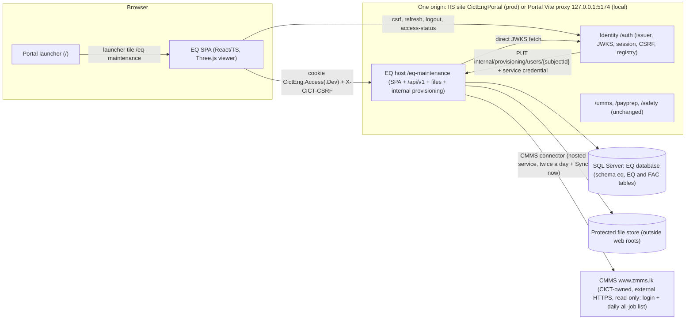
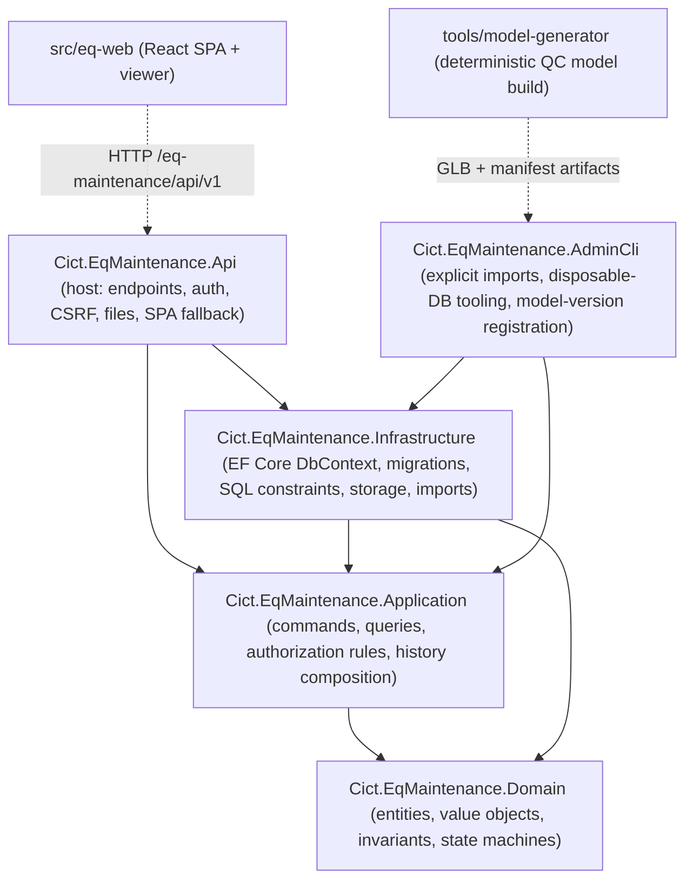
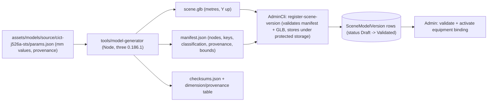
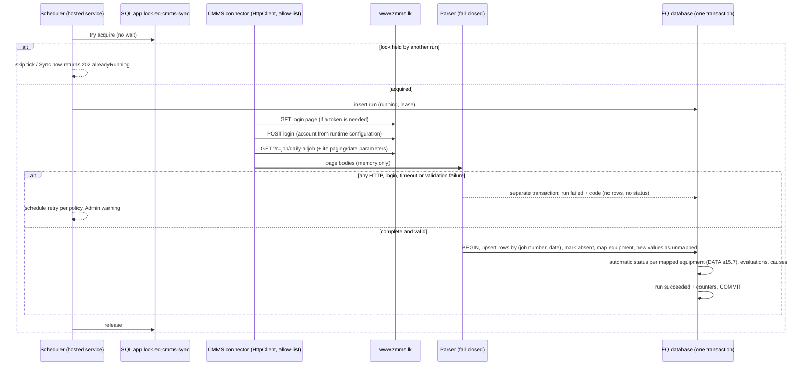

# Architecture

24 October 2026 temporary presentation addendum: SOW V2 revision 6 section 2A and `documents/prompt-pack/TEMP_MANAGEMENT_WALKTHROUGH.md` specify an isolated local Portal-style login/launcher before the existing prototype. It creates no identity, authenticated session, API, database or production architecture change. Portal appearance is read-only reference material. Remove the temporary layer before U1 approval (TD07-TD08). The initial reference is `8303f8b8a55f41983bdcc77363ddbf13d2892383`; retain all accepted EQ/FAC U1 refinements and remove only temporary wrapper edits. Verify the cleaned app against that initial commit plus accepted changes, then record its exact commit/tree for U1. Login/Portal feedback is deferred to P05 actual integration. BUILD is Not started; permanent architecture and P05 contracts below still apply.

Prepared in P01 on 21 October 2026. Status: **design contract for R01 review**. No application code exists yet. The P01 documents work as one set:

| Document | Contents |
| --- | --- |
| `docs/ARCHITECTURE.md` (this file) | Deployment unit, modules, runtime/package set, request pipeline, frontend and viewer structure, storage, local development plan, technical defaults, tradeoffs, the S01-S29 ownership map (P01B) and the CMMS connector runtime |
| `docs/DATA_CONTRACT.md` | Entities, invariants, lifecycles, role matrix, profile contract, completion/correction rules, history semantics, the 3D model contract, stable keys and deletion rules; V2 Access matrix, CMMS, spare parts, FAC, read models, exports (s14-s20) |
| `docs/API_CONTRACT.md` | Endpoints, authorization, shapes, pagination, errors, concurrency and idempotency |
| `docs/PORTAL_INTEGRATION_PLAN.md` | Portal touchpoints, token-compatibility analysis, regression cases and rollout/rollback order |

Authorities: `documents/prompt-pack/APPROVED_REQUIREMENTS.md` (version 2.0: S01-S29, roles and Access matrix, lifecycle, CMMS, spare parts, FAC, s8 technical defaults), `QC_3D_MODELLING_BRIEF.md`, `ACCEPTANCE_CHECKLIST.md`, the Master control, and `docs/DECISIONS.md` (B-xx confirmed choices, D-xx defaults, U-xx open source facts). New P01 defaults are D-19 to D-41 in section 13 and in `docs/DECISIONS.md`.

**P01B addendum (22 October 2026).** Extended for SOW V2 revision 4 and requirements v2.0 (S01-S29): display name "EQ & FAC Maintenance", EQ and FAC sections, four roles with the in-app Access matrix, the read-only CMMS connector with automatic status, the spare-part condition register, the FAC section and Excel exports. Changed sections: s1, s2, s3, s4, s5, s6, s7, s9, s10, s11, s12, s13 (D-89 to D-128), s14, s15 (S01-S29), s16; new s17 (CMMS connector runtime). Contract details: `docs/DATA_CONTRACT.md` s14-s20 and `docs/API_CONTRACT.md` s4.16-s4.27. Superseded P01 rules are listed in `docs/DECISIONS.md` "P01B supersessions".

## 1 Shape of the system

One independently deployable EQ application: a single ASP.NET Core host that serves the React single-page application, the JSON API, the protected file/model endpoints and the server-to-server provisioning endpoint, all under `/eq-maintenance`. It has its own SQL Server database and its own protected file store. It relies on the existing Portal Identity service for sign-in and roles. It is not split into services.



What the EQ host does not do: issue tokens, store passwords, show a login form, call UMMS/PayPrep/Safety, call EAM/Maximo, read PLC/SCADA data, or push updates (polling only). V2: its only outbound call is the read-only CMMS connector (s17), which signs in with an account from runtime configuration and reads only the daily all-job list; it never writes to CMMS (B-17).

## 2 Deployment unit and paths

| Item | Value | Source |
| --- | --- | --- |
| Application code | `eq-maintenance` | APPROVED_REQUIREMENTS s8; D-07 |
| Browser base path | `/eq-maintenance` (SPA routes below it) | s8 |
| Public API base | `/eq-maintenance/api`; stage 1 contract at `/eq-maintenance/api/v1` | s8; D-19 |
| Protected files/models | `/eq-maintenance/api/v1/documents/...`, `/eq-maintenance/api/v1/scene-model-versions/...` (same authorization pipeline as the API) | Master control |
| Server-to-server provisioning | `/eq-maintenance/internal/provisioning/users/{subjectId}` (service credential, not browser session) | Portal pattern (`HttpAppConvergenceConnector`) |
| Health | `/eq-maintenance/health/live` (process), `/eq-maintenance/health/ready` (database + storage reachable; no detail leakage) | Safety pattern |
| Token audience | `urn:cict-eng:eq-maintenance` | s8 |
| Display name | **EQ & FAC Maintenance** (V2, B-14); technical identifiers in this table unchanged | SOW V2 s2, Q1 |
| Roles | `eq-maintenance:admin`, `eq-maintenance:management`, `eq-maintenance:eq-team`, `eq-maintenance:fac-team` (V2 adds FAC Team, B-15) | s8 |
| Sections (V2) | EQ (`/eq-maintenance/eq/...`), FAC (`/eq-maintenance/fac/...`), shared Admin (`/eq-maintenance/admin/...`) (s6, D-89) | SOW V2 s2 |
| Outbound (V2) | HTTPS to `www.zmms.lk` only, from the CMMS hosted service (s17); no other outbound call | APPROVED s5A |
| Binding claim | `cict:binding:eq-maintenance:local_user_id` | s8; required because the Portal pattern for role-backed apps uses a ledger binding |
| IIS (proposal for P12) | Child application `/eq-maintenance` in site `CictEngPortal`, folder `C:\inetpub\CictEngPortal\eq-maintenance`, pool `CictEngPortal_EqMaintenance`, no managed code (ASP.NET Core Module v2, in-process) | Matches existing child apps in the Portal deploy scripts; target facts unverified (U-14) |
| Production database (proposal for P12) | `CictEqMaintenance` | Distinct from every existing database name |

The host refuses requests outside its path base (the Safety host pattern) and calls `UsePathBase("/eq-maintenance")` so it works both behind IIS (where the module already sets PathBase) and behind the local Portal proxy (where the prefix is still in the path).

## 3 Internal structure



V2 feature areas live inside these same projects as folders, not new services: `Access` (matrix, evaluator, feature policies), `Cmms` (connector, parser, sync service, mapping, automatic status - Infrastructure for HTTP/parsing, Application for the run and status rules), `SpareParts`, `Fac` (jobs, cycles, progress, photos, import, dashboard read model) and `Exports` (xlsx writers). The FAC module has no reference to EQ equipment/position/job types; an architecture test enforces it (EQ and FAC records stay separate, SOW V2 s2).

Dependency rule: Domain has no framework dependencies; Application depends on Domain and defines repository/storage/clock interfaces; Infrastructure implements them; Api wires everything. An architecture test (pattern from the Portal's `CictEng.Architecture.Tests`) enforces the direction.

Repository layout (created from P02/P03/P04 onward; P01 creates none of it):

```text
F:\CODEX\EQ_MAINTENANCE
  Cict.EqMaintenance.sln
  Directory.Build.props            net10.0, nullable, warnings as errors
  NuGet.config                     nuget.org + local ./packages (CictEng.Auth .nupkg from P05)
  packages/                        CictEng.Auth.0.3.0.nupkg (checksum recorded), nothing else
  src/
    Cict.EqMaintenance.Domain/
    Cict.EqMaintenance.Application/
    Cict.EqMaintenance.Infrastructure/   Persistence/Migrations, Storage, Imports, Cmms/ (HTTP connector, parser), Exports/, Images/
    Cict.EqMaintenance.Api/              Program.cs, Endpoints/, Security/, wwwroot/ (built SPA only)
    Cict.EqMaintenance.AdminCli/
    eq-web/                              Vite app (src/app, src/features/*, src/viewer, src/api)
  tools/
    model-generator/                     TypeScript generator (Node), parameter file, exporter
    p00/, p01/                           phase helper scripts (existing)
  assets/models/source/                  generator inputs: dimension/provenance parameter files
  artifacts/models/<model>/<version>/    generated GLB, manifest, checksums (not served from wwwroot)
  artifacts/prototypes/                  P02 prototype build
  tests/
    fixtures/cmms/                       sanitised recorded CMMS pages (P07B; no account, cookies or real names)
    Cict.EqMaintenance.Domain.Tests/
    Cict.EqMaintenance.Application.Tests/
    Cict.EqMaintenance.Api.IntegrationTests/   WebApplicationFactory + disposable SQL Server
    Cict.EqMaintenance.Architecture.Tests/
    eq-web: vitest unit tests beside sources; e2e/ Playwright suites
```

## 4 Runtime and package compatibility

Facts were gathered in P00 (DECISIONS D-01 to D-05, evidence `docs/evidence/P00/P00_EVIDENCE.md` s5-s6) and rechecked in P01 where noted. P04 pins exact versions with lockfiles after a clean restore; a newer patch is acceptable if it is at least 14 days old (D-13) and passes the compatibility checks below.

| Layer | Selected | Compatibility rule / evidence | Status |
| --- | --- | --- | --- |
| .NET runtime / SDK | .NET 10 LTS (`net10.0`), runtime 10.0.13 or later patch | .NET 10 support to 14 Nov 2028; .NET 8/9 end 10 Nov 2026 (P00 s6). P01 recheck: `dotnet --list-sdks` still shows only 8.0.426 | **SDK install is a P04 prerequisite (D-02)** |
| ASP.NET Core | 10.0.x shared framework | In-process IIS hosting needs the ASP.NET Core 10 Hosting Bundle on the target (U-14) | target unverified |
| EF Core | `Microsoft.EntityFrameworkCore.SqlServer` / `.Design` / `.Tools` 10.0.13 | SQL Server Express 2022 16.0.4305.5 locally (P00) | to pin in P04 |
| Shared auth | `CictEng.Auth` 0.3.0 (net8.0 library) as a PackageReference from the local `packages/` feed | Must be produced in P05 (0.2.1 has no EQ audience: `SharedAuthOptions` validation refuses an unregistered audience at startup). EQ references `Microsoft.AspNetCore.Authentication.JwtBearer` 10.0.x directly so NuGet unifies upward; P05 proves validation tests under ASP.NET Core 10 (D-03) | P05 |
| Testing (.NET) | xUnit, `Microsoft.AspNetCore.Mvc.Testing` 10.0.x | Test-only authentication handler lives in the test project, never in `Cict.EqMaintenance.Api` | P04 |
| Node / npm | Node 24.15.0, npm 11.12.1 (installed) | Vite 8 engines `^20.19 || >=22.12` | ready |
| Frontend core | react / react-dom 19.3.0; react-router 7.18.4; @tanstack/react-query 5.104.1; typescript 6.0.3 | TypeScript 7 is excluded because typescript-eslint 8.x peers `typescript <6.1.0` | to pin in P04 |
| 3D | three 0.186.1; @types/three 0.186.0; @react-three/fiber 9.8.1 (peers react >=19 <19.4, three >=0.156); @react-three/drei 10.7.9 (peers react ^19, fiber ^9) | Fiber and React majors match, as the R3F installation guide requires | to pin in P03/P04 |
| Build / quality | vite 8.3.3; @vitejs/plugin-react 6.1.2; eslint 10.12.0; typescript-eslint 8.71.1; vitest 5.0.3; @playwright/test 1.63.0 | | to pin in P04 |
| Model generator | Node + three 0.186.1 `GLTFExporter` (same three version as the viewer) | Blender/CAD not installed (D-10) | P03 |
| (V2) HTML parser for CMMS | candidate AngleSharp (MIT); .NET `HttpClient` with a per-run `CookieContainer`; no headless browser unless P07B proves the page needs script (APPROVED s8, D-102) | selected and pinned in P07B after reading the real page | P07B |
| (V2) Excel writer | candidate DocumentFormat.OpenXml SDK 3.x (MIT, Microsoft) with inline-string cells | selected and pinned in the first phase that exports (P07/P08B) (D-121) | P07/P08B |
| (V2) Image re-encoding | candidate SkiaSharp (MIT) with its Windows native assets; ImageSharp is avoided because its split licence needs a commercial-use review | selected and pinned in P08B (D-116) | P08B |

The Portal, Identity, UMMS, PayPrep and Safety stay on their current runtimes. EQ does not share a frontend package with the Portal (the Portal web has none), so React 19 is independent of the Portal's React 18.3.1.

## 5 Request pipeline (host)

Order of middleware and endpoint groups in `Cict.EqMaintenance.Api`:

1. Startup validation: options for path base (`/eq-maintenance`, fixed), canonical origin, shared auth, storage root (must be absolute, outside `ContentRootPath` and `WebRootPath`), provisioning credential (>= 32 chars when enabled), database connection present. Missing or unsafe configuration stops the host. **No startup migration and no startup seeding exist in the EQ host** (D-08, Master control).
2. Path-base guard: requests not under `/eq-maintenance` return 404.
3. Exception handler returning RFC 7807 problem details with a correlation ID and no stack traces, connection strings or storage paths.
4. Security headers: `X-Content-Type-Options: nosniff`, `Referrer-Policy: same-origin`, `X-Frame-Options: SAMEORIGIN`, CSP for the SPA document (`default-src 'self'; script-src 'self'; style-src 'self'; img-src 'self' data: blob:; connect-src 'self'; worker-src 'self' blob:; object-src 'none'; frame-ancestors 'self'; base-uri 'self'`). API and file responses are `Cache-Control: no-store` unless section 9 says otherwise.
5. Static SPA assets from `wwwroot` (hashed bundle files `immutable`; `index.html` `no-cache`). `wwwroot` contains only the built SPA, fonts and icons; never drawings, photos, evidence or model GLBs.
6. Authentication: `AddCictEngSharedJwtValidation` (cookie-only shared JWT, direct JWKS, fail-closed profile validator) with `SharedAuth:Audience = urn:cict-eng:eq-maintenance`.
7. Browser request verification for every authenticated unsafe method (POST/PUT/PATCH/DELETE): canonical `Origin` (or `Referer`) and `X-CICT-CSRF` checked against the token's `cict:csrf_digest` via `SharedBrowserRequestSecurity`; failure is 403 with `X-CICT-CSRF-Invalid: true`. Only `/eq-maintenance/internal/provisioning` is exempt, because it is guarded by its own service-credential filter and never accepts a browser session. Path tests are case-insensitive (lesson recorded in the Safety middleware).
8. Authorization (V2): feature policies evaluated against the Access matrix (`EqSession`, `F:<feature>`, API_CONTRACT s2; DATA_CONTRACT s6, s14) plus resource rules in the Application layer. Every endpoint, export and file handler declares its feature(s); the fallback policy denies. The P01 role policies `EqRead`/`EqWrite`/`EqAdmin` are superseded.
9. Endpoint groups: `/api/v1/*` (JSON), `/internal/provisioning/*`, `/health/*`, and the SPA fallback for any other GET under `/eq-maintenance` that accepts `text/html` (returns `index.html`). Unknown `/api/*` routes return JSON 404, never `index.html`. V2 (D-93): the fallback maps the route prefix to its view feature (DATA_CONTRACT s14.4); a signed-in user without that feature receives the shell with HTTP 403 (the SPA shows the tab-not-available state); requests without a valid session receive 200 and the session client handles sign-in.
10. Hosted services (V2): the CMMS sync service (s17) runs in the same process; it uses its own DI scope per run and never handles browser requests.

## 6 Frontend architecture (`src/eq-web`)

- Built by Vite with `base: '/eq-maintenance/'`; React Router data router with `basename="/eq-maintenance"`; the production bundle is copied into the host's `wwwroot` during release.
- Routes (all deep-linkable; restored after sign-in). V2 (D-89) supersedes the P01 table: EQ and FAC route trees and a shared Admin tree. Top bar: section switch (EQ | FAC, hidden when only one section is permitted), the current section's tabs, Admin for Admin, user chip; the display name is "EQ & FAC Maintenance" (DATA_CONTRACT s14.1).

| Route | View | Feature (DATA s14.4) |
| --- | --- | --- |
| `/eq-maintenance/` | Landing: last used permitted tab (browser storage) or the role default; No-access page when nothing is permitted (D-90) | `EqSession` |
| `/eq-maintenance/eq/fleet?type=&status=&lifecycle=&source=` | EQ Fleet (S02/S03): cards with status source Auto/Manual and today's CMMS job count | `eq.fleet.view` |
| `/eq-maintenance/eq/equipment/{equipmentId}?main=&sub=&part=&container=&mode=overall|technical&panel=maintenance|special|technical|spareParts` | Equipment detail (crane view): tree, viewer or fallback, right panel with the four current-state tabs of U1-C19 (S04-S07, S14; D-122) | `eq.fleet.view` |
| `/eq-maintenance/eq/jobs/special?status=&equipment=&type=&kind=&main=&dateField=&from=&to=&includeCancelled=&scope=&target=` | EQ Jobs, Special/Projects tab (manual special jobs; scoped history when `equipment`+`scope`+`target`) (S08/S09; U1-C20) | `eq.jobs.view` |
| `/eq-maintenance/eq/jobs/daily?equipment=&type=&from=&to=` | EQ Jobs, Daily work (CMMS) tab: read-only CMMS daily jobs, default today (S08/S20; U1-C20) | `eq.jobs.view` |
| `/eq-maintenance/eq/jobs/special/{jobId}` | Special job record, completion (with the pre-filled condition form), evidence (S09/S13/S22) | `eq.jobs.view` |
| `/eq-maintenance/eq/jobs/status?equipment=&type=&source=&from=&to=` | EQ Jobs, EQ status part: board, correction, Back to automatic, history (S21) | `eq.jobs.view` |
| `/eq-maintenance/eq/jobs/spare-parts?equipment=&type=&main=&sub=&part=&flag=` | EQ Jobs, spare parts condition part: register, flags, per-part history; Add spare part for `eq.work` (S22; U1-C21) | `eq.jobs.view` |
| `/eq-maintenance/fac/dashboard?discipline=&type=&mode=&pic=&focus=&tv=1` | FAC Dashboard (S27); `tv=1` = TV mode | `fac.dashboard.view` |
| `/eq-maintenance/fac/jobs?view=mywork|board|list&status=&flag=&discipline=&type=&mode=&pic=&frequency=&kind=&q=` | FAC Jobs (S28) | `fac.jobs.view` |
| `/eq-maintenance/fac/dashboard/jobs/{jobId}` | Read-only FAC job detail opened from a dashboard row (SOW V2 5.5.7): the same detail as below for an active job, without the FAC Jobs actions; the back link returns to the dashboard with its filters (Repair-R02B, D-140) | `fac.dashboard.view` |
| `/eq-maintenance/fac/jobs/{jobId}` | FAC job detail, timeline, previous cycles (read-only for Management) | `fac.jobs.view` (a dashboard row links here when the user holds `fac.jobs.view`, otherwise to the dashboard detail route above) |
| `/eq-maintenance/admin/eq/...` (`equipment`, `models`, `catalog`, `positions`, `parameters`, `scene-bindings`, `spare-parts`, `cmms`) | EQ settings (S10, S20-S22) | `admin.access` |
| `/eq-maintenance/admin/fac/...` (`master-list`, `import`, `lists`, `settings`, `corrections`) | FAC settings (S23-S25) | `admin.access` |
| `/eq-maintenance/admin/access` | Access matrix (S19) | `admin.access` |

- Old P01 paths (`/fleet`, `/equipment/{id}`, `/jobs`, `/jobs/{id}`, `/admin/{x}`) are redirected client-side to `/eq/fleet`, `/eq/equipment/{id}`, `/eq/jobs/special`, `/eq/jobs/special/{id}` and `/admin/eq/{x}` with their query values; `panel=history` maps to `panel=special`. Nothing was deployed with the old paths; the redirects only protect saved prototype links.
- Free-text `q` is kept in the URL for sharing filtered FAC boards (FAC10) but is dropped from a sign-in return URL when it needs percent-encoding (D-20).

- **Deep-link character rule (D-20):** the Portal's `IdentityReturnUrlValidator` rejects any return URL containing `%`, `#`, `\` or `//`. Every query value the app needs to restore after sign-in therefore uses only `[A-Za-z0-9_-]` (GUIDs, enum tokens, ISO dates). Selection uses separate `main`, `sub`, `part` parameters (never a `part:<id>` value, which `URLSearchParams` would encode as `%3A`). Free-text search is not restored across a sign-in redirect.
- **Server state:** TanStack Query with `AbortSignal` on every request. Query keys always include `equipmentId` and the selection scope, and every history response echoes `equipmentId`, `scope` and `targetId`; the panel renders a response only when the echo matches the current selection (HIS05).
- **Selection state:** the URL is the single source of truth for equipment and `main`/`sub`/`part`. The tree, the breadcrumb and the 3D scene all dispatch the same `select(...)` navigation; the viewer only reads it. Back/forward reproduce the selection.
- **Session client (pattern copied from the Safety web client):** CSRF token kept in memory only (never `localStorage`/`sessionStorage`); fetched from `/auth/csrf`; on 401 a single shared refresh (`/auth/session/csrf` then `POST /auth/session/refresh`) and one retry; if recovery fails, call `/auth/applications/eq-maintenance/access-status` and show the actionable state (signed out, password change required, no EQ access, provisioning pending) with a link to `/login?returnUrl=<current path>`. No credential or token is ever readable by the SPA (HttpOnly cookies).
- **Polling and freshness:** fleet data polls every 60 s by default (configurable, D-15), refetches after successful writes, uses `If-None-Match`/ETag for cheap 304s, and on failure keeps the last good data with a visible "stale since hh:mm" indicator. Nothing is ever defaulted to Ready. V2: the FAC Dashboard polls `GET /fac/dashboard` at the Admin interval (default 60 s) with ETag revalidation and patches rows in place (no scroll reset); `GET /session` is re-read every 60 s and after any 403 `feature_disabled` so Access-matrix changes reach the UI within 60 s; "CMMS data from <date time>" comes from the fleet/Jobs responses.
- **Moving dashboard (V2, S27):** lanes scroll with CSS transforms driven by `requestAnimationFrame` at the Admin speed, pausing on hover, focus-within and the Pause button; `prefers-reduced-motion: reduce` switches to an 8 s page flip; the moving lists are `aria-hidden` duplicates of a static, focusable list that screen readers and keyboard users use (no focus trap); TV mode is a full-screen layout of the same signed-in page (no anonymous URL). P02B fixes the visual details; P09 implements them.
- **Role-aware UI:** writer actions render only for the capabilities returned by `GET /session` (V2: per feature, so EQ actions for `eq.work`, FAC actions for `fac.work` etc.); Management sees a persistent "Read-only access" indicator without losing navigation. Tabs follow `access.sections`. The API enforces permissions independently.
- **Phone-first FAC (V2, S28):** the FAC update form and photo upload (`capture="environment"`) fit a 390 px viewport; photos are staged individually (retry-safe on weak networks) before the update is submitted.
- **Fixture isolation (D-21):** synthetic fixtures and the prototype data adapter live in `src/eq-web/prototype/` and are only reachable from a separate Vite mode/entry (`vite --mode prototype`, `build:prototype`). The production entry imports only `src/api` (real HTTP client). P12 adds a bundle check that fails if any prototype module is present in the production build.
- **Accessibility:** tree implemented as an ARIA tree with roving tab index and type-ahead; status shown as text + icon + colour; visible focus; labelled form controls with server validation errors mapped to fields; drawers for tree/panel below 1280 px; phone width prioritises fleet, job forms and the text hierarchy with the 3D view optional.

## 7 QC viewer architecture

The viewer is a lazily loaded module inside `eq-web` (`src/viewer`). The contract it implements is DATA_CONTRACT s10; this section covers runtime structure only.

- **One canvas per equipment detail view, none on the fleet page.** The fleet uses static thumbnails/silhouettes (SVG/PNG, same-origin). No canvas on any FAC page either.
- V2: the viewer is unchanged; the right panel beside it shows the four current-state tabs (API_CONTRACT s4.16) and never history. Selection still drives one URL state; each tab request is keyed by equipment, scope and target and rendered only when the echo matches (HIS05).
- React Three Fiber `<Canvas frameloop="demand">`; frames are requested only for camera transitions, control input, selection/overlay changes and mode changes. No per-frame React state updates.
- Camera: drei `CameraControls` (camera-controls) because it provides interruptible, promise-based `fitToBox`/`setLookAt` transitions. A newer selection or a user drag cancels the running transition. `prefers-reduced-motion` makes transitions instant.
- Asset loading: `GLTFLoader` fetches `scene.glb` and `manifest.json` from the protected endpoints with credentials; no Draco/meshopt decoders are used in stage 1 (D-22), so no decoder files are needed. If a later version needs compression, its decoder is bundled same-origin.
- Identity resolution: scene object -> `userData.nodeKey` (written by the generator) or, for instanced meshes, `instanceId` -> manifest `instanceMap` -> node key; node key -> equipment binding -> `positionId` / `subInstanceId`. Nothing else (mesh name, UUID, array index) is used as an identity.
- Highlighting uses an overlay pass (outline + emissive tint on a cloned material reference) with a separate legend, so normal CICT red paint never reads as Breakdown.
- Resource management: geometries/materials shared per model version and cached by version ID; on equipment change the scene graph is detached and unshared resources and listeners are disposed; the renderer is kept and reused. `webglcontextlost` switches to the fallback panel; restoring is attempted once.
- Fallback states (WebGL unavailable, context lost, asset 401/403/404, invalid manifest, no verified model, RTG/ES stage 1): the viewer region shows a clear message and the tree, history and permitted work stay fully usable.

## 8 Model asset pipeline



Generated outputs go to `artifacts/models/<modelCode>/<version>/`; the registered copy lives in protected storage. The generator is deterministic for the same inputs and tool versions; P03 documents any byte-level nondeterminism (VIS09).

## 9 Protected storage

- `IFileStore` abstraction with a filesystem implementation rooted at `EqStorage:RootPath` (absolute; validated to be outside the content root, `wwwroot`, and any IIS virtual directory the app exposes). The IIS app-pool identity needs modify rights on that folder only.
- Layout: `sources/<sha256[0..2]>/<sha256>` for imported drawings/photos (content-addressed, de-duplicated), `evidence/<yyyy>/<documentId>` for job evidence, `models/<sceneModelVersionId>/scene.glb|manifest.json` for registered model versions. V2: `fac-photos/<yyyy>/<photoId>/full.jpg|thumb.jpg` for re-encoded FAC photos, `staging/<uploadId>` for staged uploads (FAC photos, FAC import JSON; purged 24 h after creation when not consumed). Storage keys are generated by the server; client-supplied names are display metadata only.
- V2: no CMMS page content is ever written to storage (DATA_CONTRACT s15.6).
- Streaming: authenticated `GET` endpoints with `Content-Disposition` (inline for PDF/images, attachment otherwise), sanitized filenames, `X-Content-Type-Options: nosniff`, range processing for PDFs, and `Cache-Control: private, no-cache` plus a strong ETag (sha256) for model assets so every load revalidates through authentication (cheap 304) but never bypasses it.
- Missing or unreadable files return 404/503 problem `file_unavailable` without revealing paths (FILE05).

## 10 Persistence

- SQL Server, EF Core 10 code-first migrations in `Cict.EqMaintenance.Infrastructure`, schema `eq`, `READ_COMMITTED_SNAPSHOT ON` (readers do not block writers). Commands that must serialize use explicit `UPDLOCK, HOLDLOCK` reads inside a transaction (DATA_CONTRACT s5, s8). EF Core execution strategy with retry wraps every explicit transaction (Safety lesson).
- V2 tables (DATA_CONTRACT s14-s17) live in the same database and schema. Single-row settings/version tables (`AccessPolicyVersion`, `CmmsSettings`, `EqSettings`, `FacSettings`, `FacDataVersion`) are created by migrations with their default row (configuration defaults, not fleet or status data). The CMMS single-run lock uses `sp_getapplock` (resource `eq-cmms-sync`, exclusive, session owner) on a dedicated connection held for the run (s17).
- Migrations are applied only by explicit commands: `AdminCli migrate` for disposable databases and reviewed idempotent SQL scripts (`dotnet ef migrations script --idempotent`) for any later authorized environment (P12).
- **Disposable database guard (D-08, refined D-23):** `AdminCli` refuses `migrate`, `import-*`, `seed-fixtures` and `drop` unless the target database name matches `^EqMaintenanceDisposable_[A-Za-z0-9_]+$` **and** (for an existing database) the table `eq.__DisposableMarker` exists with the matching database name and a creation stamp written by `AdminCli create-disposable`. Production-style imports (`import-mechanisms`, `import-parameters`, `import-drawings`) are allowed against a non-disposable target only with an explicit `--target-confirmation <database name>` argument that must match, and they never run fixtures. `seed-fixtures` never runs against a non-disposable target under any flag.
- Reference imports vs fixtures: reference data (catalogue, parameter observations, drawing registrations, scene model versions) comes from versioned files under `documents/prompt-pack/reference` or `artifacts/models`; synthetic fixtures (`QC01`, `QC02`, `RTG01`, `ES01`, demo jobs/status) live in a separate fixture set marked `DataOrigin = DevelopmentFixture` and are excluded from release migrations and packages.

## 11 Local development plan (same origin)

Ports (D-09): EQ host **5310**, EQ Vite dev server **5311**. Portal runner ports 5174, 5180, 5190, 5091, 5173, 5088, 5280 are not reused.

| Mode | Used by | How it runs | Authentication |
| --- | --- | --- | --- |
| A. Prototype | P02, P03 | `npm run dev:prototype` in `src/eq-web` on 5311, base `/eq-maintenance/`, prototype data adapter with labelled synthetic fixtures | None; every screen shows a "Prototype - synthetic data" banner. Not a production build |
| B. Foundation | P04 | EQ host on `http://127.0.0.1:5310/eq-maintenance` against a disposable database; Vite on 5311 proxies `/eq-maintenance/api` to 5310 | Until P05 the host has no working shared-auth scheme (CictEng.Auth 0.3.0 does not exist yet) and returns 401 to all API calls: fail closed. Automated tests use a test authentication handler registered only by `WebApplicationFactory` in the test project |
| C. Integrated same origin | P05 onward | Portal Vite proxy on `http://127.0.0.1:5174` adds `/eq-maintenance/api` -> 5310 and `/eq-maintenance` -> 5311 (HMR) or -> 5310 (built SPA). Identity (5180) provisions EQ directly at `http://127.0.0.1:5310/eq-maintenance` with a generated local-only credential. Browser opens `http://127.0.0.1:5174/eq-maintenance` | Real local Identity with an **isolated** Identity database and synthetic users (PORTAL_INTEGRATION_PLAN s7). Cookie `CictEng.Access.Dev` on one host |

V2: CMMS is off in every mode unless `Cmms:Enabled = true` and the account keys are present in local runtime configuration (user secrets or environment), which only the P07B live check uses. Automated tests use a fake `HttpMessageHandler` serving the sanitised fixtures in `tests/fixtures/cmms/` and a fake clock (Asia/Colombo midnight and two-syncs-a-day cases). The FAC import in development reads the bundled reference JSON into a disposable database only.

The Portal proxy does not route `/eq-maintenance/internal`; the provisioning endpoint is called server to server. EQ provides `tools/eq-local.ps1` (P04) to start/stop only its own processes and to create/drop disposable databases; it never starts or seeds other apps.

## 12 Security and operations summary

| Concern | Design |
| --- | --- |
| Credentials | Central Identity only; EQ has no password store, login screen or local accounts. No credential, connection string, provisioning secret or token in source, logs, evidence or packages; placeholders only in `appsettings.Example.json` |
| CMMS account (V2) | Runtime configuration only (`Cmms:Account:UserName`, `Cmms:Account:Password` via environment, user secrets or the host's protected store); redacting options type; never in source, tests, fixtures, documents, logs, problem responses, stored rows, the browser or evidence; startup and health report only missing key **names** (ZM04, DATA_CONTRACT s15.2) |
| Outbound HTTP (V2) | Compiled host allow-list (`www.zmms.lk`, HTTPS); no redirect outside the allowed routes; response size and time limits; no URL from users or data is ever fetched (FILE03 still holds) |
| Exports (V2) | Generated per request from the same authorized query as the list; formula-safe cells; not stored; audited |
| Token handling | HttpOnly shared cookie validated by `CictEng.Auth`; tokens never logged; `SaveToken=false`; the SPA never sees tokens |
| Authorization | V2: four roles with the Access matrix (role ceilings + toggleable cells), union of permissions, enforced server-side on every endpoint, export, file and page route including model assets and FAC photos; local profile must be active, bound to the token subject and hold exactly the token's role codes (DATA_CONTRACT s6, s7, s14) |
| CSRF/Origin | Portal synchronizer-token + canonical-origin contract, no development bypass (AUTH06) |
| Provisioning | Fixed-time credential comparison, default disabled, credential >= 32 chars from runtime configuration |
| Uploads | Allow-list by extension and signature, size limits, server-generated keys, no client paths, no URL fetches (FILE03) |
| Logging | JSON console/structured logs with correlation ID, actor profile ID, route template, status; never request bodies of uploads, tokens, cookies or provisioning headers |
| Time | Audit instants UTC `datetime2`; business dates `date`; UI displays Asia/Colombo (UTC+05:30, no DST) (D-14) |

## 13 Technical defaults decided in P01

These are routine implementation choices (revisable with a recorded reason). They are also appended to `docs/DECISIONS.md` s2.

| ID | Default |
| --- | --- |
| D-19 | Versioned API at `/eq-maintenance/api/v1` under the approved `/eq-maintenance/api` base. Breaking changes would add `/v2`; stage 1 has only v1 |
| D-20 | Deep-link query values restricted to `[A-Za-z0-9_-]`; selection uses separate `main`/`sub`/`part` parameters (Portal return-URL validator rejects `%`) |
| D-21 | Prototype adapter and fixtures confined to a separate Vite mode/entry; production bundle check in P12 |
| D-22 | No Draco/meshopt compression in stage 1; uncompressed GLB served via the protected endpoint; revisit only if the 8 MiB overview budget is exceeded |
| D-23 | Disposable-database guard: name pattern `EqMaintenanceDisposable_*` plus `eq.__DisposableMarker`; explicit `--target-confirmation` for non-disposable reference imports; fixtures never outside disposable targets |
| D-24 | Solution naming `Cict.EqMaintenance.*` (mirrors `Cict.Safety.*`); four layers plus AdminCli; architecture test enforces direction |
| D-25 | `CictEng.Auth` consumed as a PackageReference (0.3.0) from a checksummed local `packages/` feed, not a cross-repo ProjectReference |
| D-26 | Concurrency tokens are SQL Server `rowversion`, exposed as an opaque base64 `version` string; stale writes return 409 `version_conflict` with the current representation |
| D-27 | Every POST command that creates or changes records requires an `Idempotency-Key` (UUID) header; records are kept 30 days (configurable) and completion is additionally protected by job state |
| D-28 | Job completion, status change, correction and provisioning run in one transaction with `UPDLOCK, HOLDLOCK` on the affected job/equipment/position rows, inside the EF execution strategy |
| D-29 | Two position kinds: `serialized` (quantity 1, one open installation) and `quantityLot` (open lots with quantity/UOM, full or partial replacement) |
| D-30 | Replacement lines are entered at completion only (no draft line state); Repair jobs carry no replacement lines |
| D-31 | Replacement-line positions must lie inside the job's target subtree (an equipment-level job may replace any active position of that equipment) |
| D-32 | A new installation event's business date must be on or after the latest non-voided event at that position; otherwise 409 `out_of_order_installation` (inserting into the past would overwrite later history) |
| D-33 | Operational status changes are effective at server time (no back-dating); a change to the current status value is refused (`status_unchanged`) |
| D-34 | Cancellation is terminal in stage 1 (no un-cancel); a cancelled job can be copied into a new job by the UI |
| D-35 | Retiring equipment is refused while it has uncompleted, uncancelled jobs; retired equipment accepts no new jobs or status changes |
| D-36 | Admin may record a "known existing installation" baseline at a position (kind `baselineRecorded`, no job, explicit source note, date may be unknown); it is never generated automatically |
| D-37 | Delegated EQ role administration is **not** enabled in stage 1: EQ roles are granted by PortalAdmin through the existing central contract (`IsDelegatedGrantAllowed = false`, no `DelegatedAdministratorRoles` entry), matching the Safety onboarding |
| D-38 | Portal launcher icon: registry `IconKey = "maintenance"`; P05 adds a dedicated icon mapping in `portal-web` rather than reusing the UMMS wrench |
| D-39 | Model asset caching `private, no-cache` + sha256 ETag (always revalidated through authentication) |
| D-40 | History responses are sectioned (open jobs, completed jobs, installation events, status changes) rather than one mixed timeline; each section has its own stable sort and cursor |
| D-41 | The `eq-maintenance` Identity registry row is committed **disabled** (seeder and the new Identity registry migration); enabling it is the audited rollout step after gate G1 (PORTAL_INTEGRATION_PLAN s6) |
| D-42 | (Repair-R01) Manual back-entry under D-32: enter past work oldest first; older work found later needs Admin date-order re-entry (DATA s5.4). No insert-earlier-event operation in stage 1 |
| D-43 | (Repair-R01) A reopened job keeps completed-work protections while uncompleted: no EQ Team cancel, Admin cancel only without committed lines, no kind change to `repair`, no target that excludes a committed line, re-completion with zero new lines allowed (DATA J6, s5.3) |
| D-44 | (Repair-R01) Idempotency records are re-checked under the aggregate lock before the version check, so concurrent same-key requests replay instead of failing with 409 (DATA s5.1, s8) |

P01B additions (22 October 2026; also in `docs/DECISIONS.md` s2 with the same text):

| ID | Default | Reason / reference |
| --- | --- | --- |
| D-89 | Route trees `/eq-maintenance/eq/...`, `/eq-maintenance/fac/...` and `/eq-maintenance/admin/{eq,fac,access}`; EQ Jobs parts as path segments (`/eq/jobs/special`, `/status`, `/spare-parts`) because `part` is already the selection parameter; old P01 paths redirect client-side | SOW V2 s2 route structure; D-20 deep links; ARCHITECTURE s6 |
| D-90 | Last-used landing kept in browser `localStorage` (`eq-maintenance:last-route:<profileId>`, path only) and validated against the permitted tabs; fallback to the role default (FAC Team only -> FAC Dashboard, otherwise EQ Fleet; then the first permitted tab) | No server write, so Management stays read-only (AUTH03); DATA_CONTRACT s14.1 |
| D-91 | Access matrix: twelve feature keys; only the thirteen toggleable cells are stored; fixed and not-allowed cells are compiled; the evaluator ignores stored rows outside the toggleable set; effective features = union over held roles | A stored row can never widen a ceiling (ACC03); DATA_CONTRACT s6, s14 |
| D-92 | Matrix propagation: in-process cache keyed by AccessPolicyVersion, re-validated at most every 15 s; SPA re-reads `/session` every 60 s and after any 403 `feature_disabled` | "Within 60 seconds" (S19, ACC02); DATA_CONTRACT s14.5 |
| D-93 | Page-route enforcement: the SPA fallback maps route prefixes to view features and returns the shell with 403 for a signed-in user without the feature; 200 without a session (sign-in flow) | "Routes return 403" (ACC02) without putting data in the shell; ARCHITECTURE s5 |
| D-94 | On CMMS-mapped equipment every user status change is a current-day correction with a mandatory reason; choosing the same value as the automatic one is allowed (holds it manually for the day); the same value when already manual for today is refused (`status_unchanged`). Refines D-33 | S21, B-18; DATA_CONTRACT s4.2 |
| D-95 | A correction ends at the first **successful** sync whose business date is later than the correction day; after midnight with no successful sync yet the status shows "Manual (from <date>), awaiting CMMS sync" | Q12 answer; a failed sync changes nothing (Master control); DATA_CONTRACT s15.7 |
| D-96 | Back to automatic applies the evaluation of today's latest successful run when that evaluation has a computed value; with no successful run yet today, or when today's evaluation stopped without a value (`automaticDisabled`, `unmappedValues`; Repair-R02B finding 3), it records a mode change keeping the value (source `manual`, "awaiting today's CMMS sync") and the next successful run applies the automatic value | Never invents an automatic value; DATA_CONTRACT s15.7 step 6 |
| D-97 | Automatic status needs an explicit Admin switch `AutomaticStatusEnabled`, allowed only when every value seen in the latest successful run is mapped; equipment with a row carrying an unmapped type/status value is skipped in that run | "Until it is set, the sync changes no status" (S21, ZM05); fail-safe for new values; DATA_CONTRACT s15.8 |
| D-98 | Day plan = rows of the latest successful run for that business date; a row missing from a later complete run is kept as `absentFromSource` and no longer counts | Every synced day kept (S20) without letting a removed job hold a Breakdown; DATA_CONTRACT s15.3 |
| D-99 | One database transaction per sync run (upsert, absent marks, evaluations, status changes, counters); failure rolls back and is recorded in a separate transaction; no raw page stored | "A failed or partial run changes nothing" (Master control, ZM02); the page may show the account name; DATA_CONTRACT s15.6 |
| D-100 | Single run via `sp_getapplock` (`eq-cmms-sync`) plus a `running` run row with a lease; a concurrent Sync now returns 202 with the running run | ZM01; survives app-pool overlap during recycle; DATA_CONTRACT s15.5 |
| D-101 | Retry +2/+5/+15 min for transient failures; no automatic retry after a rejected login (lockout avoidance); one retry after 5 min for parse failures; one catch-up run at startup for a missed time today | S20 "retries with backoff"; DATA_CONTRACT s15.5 |
| D-102 | Connector: .NET `HttpClient`, per-run cookie container, compiled host allow-list (HTTPS `www.zmms.lk`), 30 s request / 300 s run timeouts, 5 MiB response cap, 50-page cap; HTML parser candidate AngleSharp (MIT) pinned in P07B; no headless browser unless P07B proves script is required | APPROVED s8; ARCHITECTURE s17 |
| D-103 | IIS prerequisites for the hosted service (P12, listed not executed): app pool `startMode=AlwaysRunning`, `idleTimeout=0`, application `preloadEnabled=true` (Application Initialization), so scheduled syncs run without user traffic; the catch-up rule covers recycles | In-process IIS stops idle workers; ARCHITECTURE s17 |
| D-104 | Spare parts: Admin-maintained SparePartType list with a default expected life; designation on position templates (copied at instantiation) and adjustable per position with a life override; no seeded types or lives | S22 "per part type ... overridden per equipment position"; DATA_CONTRACT s16.1 |
| D-105 | Register actions Record Original (baseline event, only when the position has no event), Record replacement (new event kind `conditionReplacement`, D-32 order) and Amend current; EQ Team may use all three (extends the Admin-only baseline of D-36 for designated positions); Admin voids the latest entry | One installation history for both paths ("the register is their current-state view", APPROVED s5B); DATA_CONTRACT s16.3 |
| D-106 | A Replacement completion writes the register from the replacement line's own fields (manufacturer = brand, model/part no., serial, replaced date) plus optional `conditionRemarks`, in the completion transaction | No second copy that could disagree (SP02); DATA_CONTRACT s5.1 step 6a |
| D-107 | Register shows "Not recorded" (no prediction) until a condition is recorded; for quantity-lot positions the replaced date is the latest non-voided replacement event, flagged when partial | Never presents unknown as Original (I4); DATA_CONTRACT s16.5 |
| D-108 | Calendar arithmetic with `DateOnly.AddMonths` (month-end clamp); predictions computed at read time, never stored, labelled "calendar estimate" | 31 Jan + 1 month, leap years (FAC03, SP03); DATA_CONTRACT s1, s16.2 |
| D-109 | FAC tables in the same database and schema `eq`, prefixed `Fac`; job numbers `FAC-nnnnn`; no FK between FAC and EQ tables | One EQ-owned database (APPROVED s8); sections stay separate (SOW V2 s2) |
| D-110 | FAC cycles: `rolling` (one open cycle per job) and `period` (Daily: Asia/Colombo day; Weekly: Monday-Sunday) created by the first update in the period; an uncompleted period cycle is shown Missed after its period (derived, no midnight job) | Done today/this week (Q6) without background jobs; DATA_CONTRACT s17.3 |
| D-111 | Hold is a job-level flag with hold/release events; progress updates are refused while on hold; the cycle state is untouched so release restores the previous status | FAC08; DATA_CONTRACT s17.7 |
| D-112 | Reaching the full quantity needs `confirmCompletion: true` (409 `completion_confirmation_required`); Done today / Done this week imply it | "Completes the cycle after a confirmation" (S25); DATA_CONTRACT s17.5 |
| D-113 | Work date <= today; rolling cycles not before the previous completion; period cycles only in the current or previous period | Prevents back-filling that rewrites due dates; FAC06; DATA_CONTRACT s17.5 |
| D-114 | Undo = the author's own latest active update on that job, same Asia/Colombo day; undoing a completing update reopens the cycle only if the following cycle has no progress (it is voided) | S25 same-day undo; DATA_CONTRACT s17.6 |
| D-115 | Admin FAC correction per update/cycle with a reason; only the immediately following open cycle's due date is recomputed; previous values kept | Next due derives from recorded completion dates (Master control); DATA_CONTRACT s17.10 |
| D-116 | FAC photos: staged uploads (24 h, uploader only) referenced by the update; JPG/PNG by extension and signature, 10 MiB, 50 MP decode cap, re-encoded (metadata stripped), long edge 1920 px, 320 px thumbnail; image library candidate SkiaSharp (MIT) pinned in P08B | S26; phone uploads on weak networks; DATA_CONTRACT s17.8 |
| D-117 | FAC import: stateless preview with `previewHash`, confirm recomputes and must match; source = bundled reference JSON or an uploaded JSON of schema 1; re-run allowed until the first non-import progress on any imported job; Admin-edit conflicts need explicit resolution | "Nothing saved until Admin confirms; repeatable until the first progress" (S23, FAC01); DATA_CONTRACT s17.9 |
| D-118 | Import opening state: last done -> Pending with due date; Pending with a completed quantity -> In progress via one `importOpening` entry (never auto-completed); row 14 -> On hold with its remark; PIC kept as a typed name (no matching to profiles) | APPROVED s6A import rules; no name matching (DATA_CONTRACT s7); DATA_CONTRACT s17.9 |
| D-119 | Dashboard: each job in the first matching group (Overdue, On hold, In progress, Due soon, Pending, Completed in the last 7 days); jobs completed earlier and not yet due are not in the moving lists (superseded by D-156, U1 round 6: they are listed last as "Up to date"; and by D-158: jobs whose display switch is off are outside the dashboard); lane ring = share of active jobs completed for their current cycle; on-time % over rolling cycles completed in the last 30 days; due load counts rolling jobs only (Daily/Weekly excluded and stated) | Readable at a glance; daily checks would swamp the % and the load chart; revisable at U1; DATA_CONTRACT s18.4 |
| D-120 | Dashboard ETag from FacDataVersion (incremented by every FAC write), business date, filters and AccessPolicyVersion; 304 after two single-row reads; ticker 20 items / 7 days, proof 12 photos | 60-second poll by TV screens (S27); DATA_CONTRACT s18.4 |
| D-121 | Excel: server-side .xlsx (candidate DocumentFormat.OpenXml, MIT), inline strings/typed cells only, max 10 000 rows, same query and permission as the list, audited, never stored | S29, FAC12; formula injection safe; DATA_CONTRACT s19 |
| D-122 | Crane right panel = four tabs (U1-C19): Maintenance (today's CMMS jobs; equipment-level), Projects/Special (open special jobs in the selected scope with counts and Open in Jobs; completed jobs counted, not listed; superseded by D-155, U1 round 6: open and completed jobs listed, newest first, hidden jobs excluded), Technical (specification summary of the selected area), Spare parts (current register rows in scope). Supersedes D-54 | U1-C19; S07 "no history in the crane view"; DATA_CONTRACT s18.1 |
| D-123 | ParameterMechanismLink (Admin-maintained, P06 proposes) filters the Technical tab's parameters by main/sub mechanism | The technical sheet needed a mechanism filter that P01 did not define; DATA_CONTRACT s18.1 |
| D-124 | "CMMS data from" = end of the latest successful run; stale when the latest run failed or no success within 26 h (Admin setting) | S20 sync health; DATA_CONTRACT s18.3 |
| D-125 | CMMS equipment key normalisation: trim, collapse internal whitespace, upper-case (invariant); one key -> one equipment, several keys -> one equipment allowed; `ignore` mappings for non-app equipment; no fuzzy matching | ZM03 "never guessed"; DATA_CONTRACT s15.4 |
| D-126 | Daily-job rows store no person-name fields unless the user asks for them in P07B | Data minimisation; personal data not needed for status; DATA_CONTRACT s15.3 |
| D-127 | Fleet ETag also covers the latest successful CMMS run and the business date | Automatic status and "today's jobs" change without user writes; API_CONTRACT s1.7 |
| D-128 | Week = Monday-Sunday Asia/Colombo for weekly cycles, Done this week and the due-load chart | ISO week; DATA_CONTRACT s1 |

## 14 Tradeoffs considered

| Choice | Alternative | Why this choice |
| --- | --- | --- |
| Single host serving SPA + API | Separate SPA app + API app (UMMS pattern) | One IIS application, one pool, one release unit, no extra path routing; Safety already proves the single-host pattern on the same site |
| Explicit relational ancestor chain on jobs/positions (composite foreign keys including `EquipmentId`) | Validate equipment consistency only in code | Cross-equipment relationships become impossible at the database level (ADM03); descendant history queries become simple indexed predicates |
| Lots for quantity positions | Treat every position as serialized; or free-text quantities | Rope sets and similar multi-item positions need consistent quantity math without inventing serial numbers (JOB10) |
| Append-only installation events with "void" corrections limited to the latest event | Editable installation table | History is never rewritten; a correction can never overwrite a later physical replacement (JOB09) |
| Exact semantic-key bindings with explicit Admin remapping | Automatic name/index matching on model upgrade | Prevents silent history transfer between components (VIS05) |
| Procedural generator -> GLB | Hand-authored Blender asset | No Blender/CAD installed; generator is reproducible and reviewable; still produces a GLB so a later authored asset can replace it under the same manifest contract |
| Polling (60 s + after writes) | SignalR/WebSockets | Stage 1 requirement; no push infrastructure on IIS to operate |
| Package reference to `CictEng.Auth` 0.3.0 | Project reference into the Portal repo | Pins an exact contract version, records a checksum, avoids path coupling; matches Safety |
| Sectioned history | One mixed timeline | Mixed date-only business dates and UTC instants sort ambiguously; sections keep each ordering truthful |
| Lines entered at completion | Draft/planned lines | Fewer states and edit paths; nothing in stage 1 requires planned lines |
| (V2) Feature policies over a compiled ceiling table plus stored toggles | Role checks with UI-only hiding; or a fully data-driven permission table | Server-enforced (S19) and a stored row can never exceed a ceiling, which a fully data-driven table could |
| (V2) CMMS connector as a hosted service in the EQ host | Windows scheduled task or a separate worker service | APPROVED s8 (one host); one deployment unit; the single-run lock and catch-up rule cover IIS recycles |
| (V2) One transaction per sync run | Row-by-row upsert | A failed or partial run must change nothing (ZM02); a day's list is small |
| (V2) Register as a view of installation events | Separate free-standing condition table | Keeps one replacement history and identity (APPROVED s5B, HIS03) |
| (V2) Period cycles created lazily | Nightly job creating daily/weekly cycles | No background job or midnight race; a missed day is derived, not written |
| (V2) Stateless import preview + hash | Stored preview batch | "Nothing is saved until Admin confirms"; the confirm still applies exactly what was shown |
| (V2) Dashboard ETag from a data-version counter | Recompute and hash the payload | TV screens poll every 60 s; a 304 costs two single-row reads |

## 15 Requirement ownership map (S01-S29)

Components: **Api** (host endpoints/security), **App** (Application services), **Dom** (Domain), **Inf** (persistence/storage/imports), **Cli** (AdminCli), **Web** (SPA), **Viewer** (QC viewer), **Gen** (model generator), **Portal** (Portal-repo changes in P05), **Tests**; V2 areas **Access**, **Cmms**, **Spare**, **Fac**, **Export** (folders in the layers above, s3).

| ID | Owning components (contract section) | Build phases | Acceptance cases |
| --- | --- | --- | --- |
| S01 | Dom/Inf equipment types, equipment models, equipment, lifecycle (DATA s3.2-s3.3); Cli reference import; Web admin register; App admin services | P06, P09 | ADM01, ADM04, SRC04, SRC06, VIS07 |
| S02 | App fleet query (API s4.2) with V2 status source and today's CMMS count (DATA s18.3); Web fleet view with polling/stale state; static thumbnails | P02, P02B, P09 | OPS01, OPS02, VIS10, JOB13 |
| S03 | Dom operational status rules (DATA s3.7, s4.2) with source/mode; App status commands (API s4.3); Web badges/legend with Auto/Manual | P07, P07B, P09 | JOB02, JOB13, OPS01, ZM05, ZM06 |
| S04 | Gen QC model; Viewer; Api protected model assets (API s4.11); Web fallback | P03, P10 | VIS01, VIS02, VIS04, VIS05, VIS06, VIS08, VIS09, VIS10, OPS03 |
| S05 | Dom catalogue/instances/positions (DATA s3.1, s3.4); App hierarchy query (API s4.4); Web tree; Viewer selection | P06, P10 | SRC01, SRC02, SRC03, ADM02, ADM03, VIS03, VIS05 |
| S06 | Viewer overall/technical modes (DATA s10.6); App parameters (API s4.10) | P03, P10 | VIS03, VIS04 |
| S07 | V2: App crane current-state queries, four tabs (DATA s18.1, API s4.16); scoped history composition served to the EQ Jobs tab (DATA s9, API s4.6); Web right panel with response-echo guard; Viewer focus | P02B, P08, P10 | HIS01, HIS02, HIS03, HIS04, HIS05, HIS06, VIS03, SP04 |
| S08 | App job queries (API s4.7), daily-job, status-board and spare-part queries (API s4.17); Web EQ Jobs tab in four tabs (U1-C20) | P02, P02B, P07, P07B, P08 | JOB01, JOB03, JOB12, OPS02, ZM07, HIS06 |
| S09 | Dom job state machine (DATA s4.1); App job/completion/status/register commands; Api feature policies | P07 | JOB01-JOB13, AUTH03, SP02 |
| S10 | App admin services; Dom definitions/templates/bindings; Web admin; Cli imports | P06, P07 | ADM01-ADM06, JOB09, SRC04 |
| S11 | Api feature policies/fallback-deny; App resource rules; Web read-only presentation | P04, P05, P07, P08, P08B | AUTH02, AUTH03, FILE02, FAC11 |
| S12 | Dom positions/installations/events (DATA s3.4-s3.5, s5) incl. `conditionReplacement`; App completion/correction | P06, P07, P10 | ADM02, JOB04, JOB05, JOB06, JOB09, JOB10, HIS01, HIS03, VIS05, SP02 |
| S13 | Dom audit/idempotency/concurrency (DATA s3.12, s8); Inf transactions/locks; Api CSRF | P07, P08B | JOB05, JOB06, JOB07, JOB08, JOB09, JOB11, JOB12, JOB13, AUTH06, ADM05, SP02, FAC07 |
| S14 | Dom parameters/documents (DATA s3.8-s3.9); Cli drawing/parameter import; Api file streaming; Web technical sheet and Technical tab | P06, P08 | SRC05, ADM06, FILE01, FILE02, FILE03, FILE04, FILE05 |
| S15 | Portal touchpoints (four roles, display name); Api shared auth + provisioning endpoint + profile authorization (DATA s7, PORTAL plan); Web session client; Cmms account kept in runtime configuration | P05, P07B | AUTH01-AUTH07, OPS04, ZM04 |
| S16 | Web responsive/accessible layouts; Viewer fallback; tree alternative; dashboard static alternative and reduced motion | P02, P02B, P09, P10, P11 | OPS02, OPS04, VIS07, VIS08, FDB03, FDB06 |
| S17 | Tests; Gen reproducibility; performance measurement; release packaging; Cli explicit migrations | P03, P11, P12 | VIS09, VIS10, OPS03, OPS05, OPS06, AUTH07 |
| S18 | Access sections/tabs/landing (DATA s14.1); Web top bar, section switch, landing, No-access page; API `GET /session` (API s4.1) | P02B, P04, P06, P09 | ACC01 |
| S19 | Access matrix entities/evaluator/enforcement (DATA s6, s14); Api feature policies and SPA fallback route check (s5); Admin Access (API s4.21) | P02B, P06, P11 | ACC02, ACC03, ACC04, ACC05, FAC11 |
| S20 | Cmms connector, parser, run record, daily jobs, mapping, unmatched queue, health (DATA s15, API s4.17, s4.20; s17 here) | P02B, P07B | ZM01, ZM02, ZM03, ZM04, ZM07, ZM08 |
| S21 | Cmms automatic status algorithm, value mapping, current-day correction, Back to automatic (DATA s4.2, s15.7, s15.8; API s4.3) | P02B, P07, P07B | ZM05, ZM06 |
| S22 | Spare designation/types/life, register, prediction, history; completion write (DATA s5.1 6a, s16; API s4.17-s4.19) | P02B, P06, P07 | SP01, SP02, SP03, SP04 |
| S23 | Fac master list and import (DATA s17.2, s17.9; API s4.23, s4.26) | P02B, P06, P08B | FAC01, FAC02, ACC04 |
| S24 | Fac frequencies, cycles, due computation, Done today/this week (DATA s17.1, s17.3, s17.4) | P02B, P08B | FAC03, FAC04, FAC05 |
| S25 | Fac progress, completion confirmation, undo, hold, Admin correction (DATA s17.5-s17.7, s17.10) | P02B, P08B | FAC05, FAC06, FAC07, FAC08 |
| S26 | Fac photos: staging, validation, re-encoding, protected streaming, removal (DATA s17.8; API s4.24; s9 here) | P02B, P08, P08B | FAC09 |
| S27 | Fac dashboard read model with ETag (DATA s18.4; API s4.25); Web moving board, TV mode, reduced motion (s6 here) | P02B, P09 | FDB01, FDB02, FDB03, FDB04, FDB05, FDB06 |
| S28 | Fac Jobs tab queries (DATA s18.5; API s4.22, s4.23); Web phone-first update form and camera upload | P02B, P08B | FAC10 |
| S29 | Export writers (DATA s19; API s4.27) | P07, P08B, P09 | FAC12 |

Every acceptance case in `ACCEPTANCE_CHECKLIST.md` (94, version 2.0) appears at least once above (checked by `tools/p01b/check_contract_coverage_v2.py`, P01B evidence). All cases remain **NOT RUN**.

## 16 Open items affecting the architecture

| ID | Item | Impact | Handling |
| --- | --- | --- | --- |
| D-02 | .NET 10 SDK not installed | Blocks P04 build, not P01-P03 | Install before P04 |
| U-13 | Deployed `CictEng.Auth` versions per consumer unknown | Rollout gate (PORTAL plan s6) | Target check before enabling EQ issuance |
| U-14 | ASP.NET Core 10 Hosting Bundle on target | P12 prerequisite | Listed, not assumed |
| P-01 | Identity registry rows for a new app have no production delivery path today (the catalog seeder runs only in tests, local seeding and the one-time production bootstrap) | P05 must add a reviewed Identity migration (PORTAL plan s3, item I-5) | Planned |
| P-02 | Portal root deploy scripts mirror-delete unknown child folders | A later Portal root release would delete `/eq-maintenance` unless `eq-maintenance` is added to the child-application exclusions | P05 adds it (PORTAL plan s3.4, items R-1, R-2, R-6 and the R-3 inventory of every root-clearing script) |
| U-29 (V2) | CMMS page structure unknown until P07B (ZQ-01 to ZQ-13, DATA s20) | Parser landmarks, columns, paging, date selection and value vocabularies are provisional | P07B reads the page through the connector and fixes DATA s15/s20; no other phase contacts CMMS |
| U-32 (V2) | Outbound HTTPS from the target IIS server to `www.zmms.lk` (proxy, firewall, certificate chain) unverified | Live sync in the target environment | P12 prerequisite list; the connector reports `http_error`/`timeout` without changing data |
| D-103 (V2) | IIS app pool must stay running for scheduled syncs | Missed schedules without user traffic | P12 prerequisite (AlwaysRunning, idleTimeout 0, preload); catch-up rule as fallback |

## 17 CMMS connector runtime (V2: S20, S21)



- Lifetime: a `BackgroundService` registered only when `Cmms:Enabled = true` and the configuration validates; it computes the next of SyncTime1/SyncTime2 (Asia/Colombo) from CmmsSettings (re-read before each wait, so Admin time changes apply without a restart), the next retry, and handles Sync now through an in-process channel. It uses `TimeProvider` so tests drive the clock (midnight, two syncs, next day).
- HTTP: a named `HttpClient` with `AllowAutoRedirect = false` (the connector follows a redirect itself only inside the allow-list), a fresh `CookieContainer` per run, TLS validation on, the timeouts and size caps of DATA s15.2, a fixed `User-Agent` naming the app. Session cookies are discarded at the end of the run and never logged.
- Logging: run ID, trigger, business date, outcome, failure code, counters and durations only; no URLs with query values beyond the configured path, no headers, bodies, cookies or account values. A log-redaction test asserts the account values never appear (ZM04).
- Health: `/eq-maintenance/health/ready` is unaffected by CMMS (an outage must not mark the app unhealthy); CMMS health is the Admin endpoint (API s4.20).
- Tests: the connector is exercised with a fake handler over the fixtures (normal day, empty day, paging, login failure, timeout, changed layout, partial page, duplicate rows, date mismatch) and with concurrent triggers against a disposable SQL Server (ZM01-ZM07). Only P07B, with the account configured locally, runs the single live read-only sync (ZM08).
