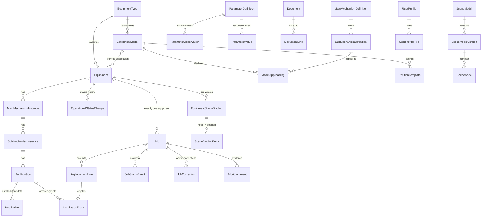
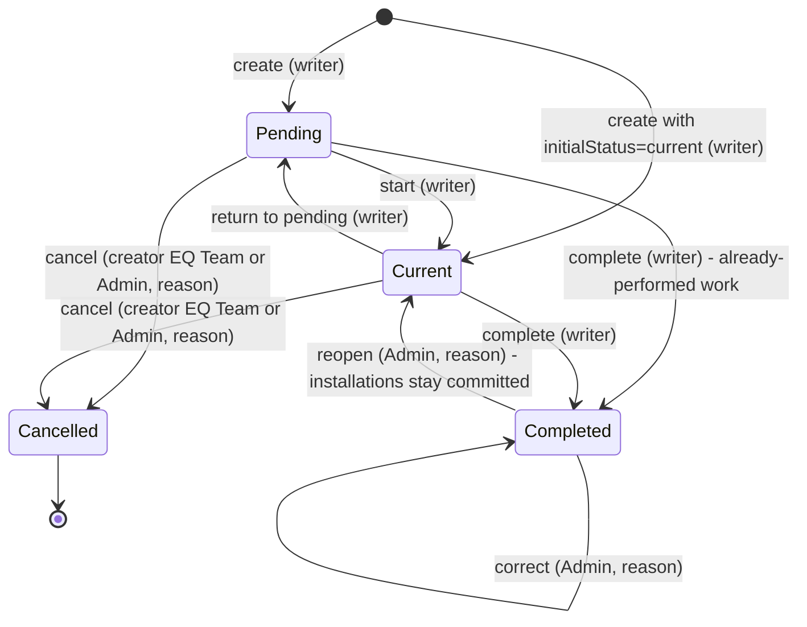

# Data contract

Prepared in P01 on 21 October 2026. Status: **design contract for R01 review**; P06/P07/P08/P10 implement it. Section numbers are referenced from `docs/ARCHITECTURE.md` and `docs/API_CONTRACT.md`. Requirement text quoted as "s<n>" refers to `documents/prompt-pack/APPROVED_REQUIREMENTS.md`.

## 1 Conventions

| Topic | Rule |
| --- | --- |
| Schema | All EQ tables in SQL Server schema `eq`. Table names singular PascalCase below |
| Primary keys | `uniqueidentifier` IDs generated by the application (`Guid.CreateVersion7()` for index locality) unless stated. IDs never change and are never reused |
| Codes | Mechanism codes, equipment codes, semantic keys, role codes and parameter codes are `nvarchar` **strings**, compared ordinally; leading zeroes are significant (`01` != `1`) |
| Business dates | `date` (no time, no time zone). Validated against "today" in Asia/Colombo |
| Audit instants | `datetime2(7)` in UTC, suffix `Utc`. Displayed in Asia/Colombo. An audit instant never stands in for a physical work date |
| Concurrency | Every mutable aggregate root has `RowVersion rowversion`; exposed in the API as `version` (base64) |
| Text limits | Code <= 32, name/title <= 200, reason <= 500, description/note <= 4000 characters unless stated; trimmed; control characters other than newline/tab rejected |
| Actor references | `...ByProfileId` columns reference `UserProfile.ProfileId`. Deactivated profiles keep their rows, so history stays readable |
| Data origin | Tables that can hold fleet/business records carry `DataOrigin` (`admin`, `referenceImport`, `developmentFixture`). Release checks refuse a target containing `developmentFixture` rows outside disposable databases |
| Deletion | Business and history rows are never hard-deleted. Where removal is allowed it is a state change (`deactivated`, `retired`, `removed`, `voided`, `cancelled`) with actor, time and reason. Exceptions are listed in s11 |

## 2 Entity overview



Two structures are deliberately separate (s3): the **coded classification** (definitions -> equipment-specific instances -> positions, which own history) and the **scene structure** (manifest nodes, which own geometry). They meet only through `SceneBindingEntry`.

## 3 Entities and invariants

### 3.1 Mechanism catalogue

**MainMechanismDefinition**

| Column | Type / constraint | Notes |
| --- | --- | --- |
| Id | PK | |
| Code | nvarchar(8), UQ, immutable | `01`...`17`; `10` is absent |
| Name | nvarchar(200), not null | display name |
| SourceName | nvarchar(200) null | as supplied |
| IsActive | bit | |
| Origin | `referenceImport` / `admin` | |
| ImportedValuesHash | char(64) null | sha256 of the imported field values; detects later Admin edits (s12) |
| SourceLine | int null | line in `mechanisms-original.txt` |
| RowVersion | rowversion | |

**SubMechanismDefinition**

| Column | Type / constraint | Notes |
| --- | --- | --- |
| Id | PK; alternate key (Id, MainDefinitionId) | |
| Code | nvarchar(8), UQ across the whole catalogue, immutable | `011`...`171` |
| MainDefinitionId | FK -> MainMechanismDefinition, **immutable** | supplied parent kept |
| Name | nvarchar(200) null | null only while reserved; `061` = Spreader, `062` = Headblock |
| SourceName, Description, SourceDescription | nvarchar | original label/description retained (`061` source label `lp`, `062` blank) |
| NameDecision | `preserve_source` / `user_confirmed_2026-10-21` / `admin_defined` | |
| IsActive, IsReserved | bit | `048`, `063`: IsActive = 0, IsReserved = 1 |
| Origin, ImportedValuesHash, SourceLine, RowVersion | | as above |

Invariants:

- C1 After the reference import the catalogue holds exactly 16 main and 43 sub definitions, 41 active and 2 reserved inactive (`048`, `063`); `015`, `024`, `033` are three separate definitions (SRC01-SRC03). The importer verifies these counts and the source checksum before writing (s12).
- C2 Codes and parents never change. The API refuses creating main code `10` (listed in `unassignedMainCodes`) or reusing any existing code; any later new definition uses a new code chosen by Admin (no renumbering).
- C3 A reserved definition is unselectable for new instances, positions or job targets until an Admin gives it an explicit name/description (`define-reserved`), which sets IsReserved = 0, IsActive = 1, NameDecision = `admin_defined`, audited.
- C4 Definitions are deactivated, never deleted. An inactive definition cannot be used for new applicability, instances or job targets; existing instances, positions and history stay readable.
- C5 Main 06 and sub 061 are both displayed "Spreader"; every UI shows code + name so the levels stay distinguishable.

### 3.2 Equipment types, equipment models, applicability, position templates

**EquipmentType**: Id; Code (nvarchar(16), UQ, e.g. `QC`, `RTG`, `ES`); Name; IsActive; SortOrder; RowVersion. Admin-configurable (s3). Three initial types are reference data with no fleet facts.

**EquipmentModel** (equipment model family/template, e.g. `CICT-J526A-STS`): Id; Code (UQ, immutable); Name; EquipmentTypeId (FK, immutable); Description; Status (`draft`, `active`, `retired`); TemplateRevision (int, increments on any applicability/position-template change); Origin; RowVersion.

**ModelApplicability**: (EquipmentModelId, SubDefinitionId) PK; State (`applicable`, `notApplicable`, `unknown`); Note; SourceReference (drawing/page or "Admin decision"); UpdatedByProfileId/Utc. Absence of a row means `unknown`. Unknown is never treated as applicable (SRC04).

**PositionTemplate**: Id; EquipmentModelId; SemanticKey (UQ within the model, immutable once any equipment was instantiated from it); SubDefinitionId; DisplayName; PositionKind (`serialized`, `quantityLot`); Category (`component`, `structural`, `ropeSet`, `electrical`, `hotspotOnly` etc., display only); DefaultUom; NominalQuantity (decimal(12,3) null); SourceReferencesJson (drawing number, page, manifest node key, provenance); Status (`draft`, `confirmed`, `deactivated`); SortOrder; RowVersion.

Invariants:

- T1 Applicability belongs to the model, not to the type and not to a single equipment item. Editing applicability or templates never changes existing instances, positions, installations or jobs (s3). It only increments TemplateRevision; applying it to an equipment item is a separate, previewed Admin action.
- T2 A position template's sub definition must be active and `applicable` for the model when the template is confirmed.
- T3 The initial QC position template is generated from the P03 node manifest plus drawing sources as `draft` rows with source references; Admin reviews, edits and confirms them before any instantiation (B-08). Structural members default to 15/151 (frame, legs, girder, A-frame, stays, fixed access) and 03/031 (boom members), one maintenance identity per member (s3).
- T4 Not applicable to the J526A family until Admin confirms otherwise (candidates only, SOURCE_MAP s6): 043, 044, 045, 091-094. Unknown: 047, 154, 155, 064. The template seed never marks them applicable.

### 3.3 Equipment

| Column | Type / constraint | Notes |
| --- | --- | --- |
| Id | PK | used in all URLs |
| Code | nvarchar(32), UQ (case-insensitive, trimmed) | business code such as `QC-DEMO-01`; Admin may edit with audit; duplicates refused (ADM01) |
| Name | nvarchar(200) null | |
| EquipmentTypeId | FK, immutable after creation | |
| EquipmentModelId | FK null | null = no model association |
| ModelAssociationState | `unassigned` / `verified` | `verified` only by an explicit Admin action with note, actor, time; never automatic (SRC06) |
| ModelAssociationNote, ModelAssociatedByProfileId, ModelAssociatedUtc | | |
| Lifecycle | `active` / `retired` | retired excluded from fleet counts by default (ADM04) |
| RetiredUtc, RetiredByProfileId, RetiredReason | | |
| SerialNumber, Manufacturer, CommissionedOn (date) | all null | unknown stays null; never inferred |
| CurrentStatus | `readyForOps` / `breakdown` / `maintenance` / **null** | null = Unreported (not a fourth status) |
| CurrentStatusChangeId | FK -> OperationalStatusChange null | |
| CurrentStatusSinceUtc | datetime2 null | effective instant of the current status |
| LastActivityUtc | datetime2 | max of status/job/installation changes; fleet "last updated" |
| DataOrigin, CreatedByProfileId, CreatedUtc, RowVersion | | |

Invariants:

- E1 New equipment has CurrentStatus = null, no model association, no serial/commission date unless Admin enters known values (SRC06, ADM01).
- E2 CurrentStatus, CurrentStatusChangeId and CurrentStatusSinceUtc change only inside the status-change transaction (s4.2) and always equal the latest OperationalStatusChange row.
- E3 Retiring is refused while uncompleted, uncancelled jobs exist (D-35). Retired equipment accepts no new jobs or status changes; it can be reactivated by Admin with a reason.
- E4 Changing the model association after history exists does not move, rename or delete positions; it changes only which template is offered for future instantiation and which parameters apply.

### 3.4 Equipment-specific instances and part positions

**MainMechanismInstance**: Id; EquipmentId; MainDefinitionId; State (`active`, `deactivated`); CreatedUtc/ByProfileId. UQ (EquipmentId, MainDefinitionId). Alternate key (Id, EquipmentId, MainDefinitionId).

**SubMechanismInstance**: Id; EquipmentId; MainInstanceId; MainDefinitionId; SubDefinitionId; State; InstantiatedFromTemplateRevision (int null). UQ (EquipmentId, SubDefinitionId). Alternate key (Id, EquipmentId, MainInstanceId).
Composite FKs: (MainInstanceId, EquipmentId, MainDefinitionId) -> MainMechanismInstance alternate key; (SubDefinitionId, MainDefinitionId) -> SubMechanismDefinition alternate key. This makes a sub instance under the wrong main, or under another equipment's main, impossible in the database (ADM03).

**PartPosition** (a maintainable main-part position; owner of exact-position history):

| Column | Type / constraint | Notes |
| --- | --- | --- |
| Id | PK; alternate key (Id, EquipmentId, SubInstanceId, MainInstanceId) | the stable history identity |
| EquipmentId, MainInstanceId, SubInstanceId | composite FK (SubInstanceId, EquipmentId, MainInstanceId) -> SubMechanismInstance alternate key | ancestor chain stored and enforced |
| SemanticKey | nvarchar(128), UQ (EquipmentId, SemanticKey); immutable once State = `active` | grammar s10.2; used for scene binding, never as a database key elsewhere |
| DisplayName | nvarchar(200) | renameable with audit |
| PositionKind | `serialized` / `quantityLot`; immutable once any InstallationEvent exists | D-29 |
| Category | display category | |
| Uom | nvarchar(16) | `ea` for serialized; e.g. `rope`, `set`, `m`, `pcs` for lots |
| NominalQuantity | decimal(12,3) null | serialized: 1; lots: known nominal or null (unknown) |
| PositionTemplateId | FK null | origin only; later template edits do not touch this row |
| State | `draft` / `active` / `deactivated` | jobs and replacement lines may target only `active` |
| ConfirmedByProfileId, ConfirmedUtc | | Admin confirmation (B-08) |
| LastEventSequence | int, default 0 | per-position event counter (s5) |
| SourceReferencesJson | | drawing/page/manifest node references |
| RowVersion | | |

Invariants:

- P1 Positions are per equipment. `QC-DEMO-01 / 011 / hoist.drive.motor.a` and `QC-DEMO-02 / 011 / hoist.drive.motor.a` are different rows with different IDs and independent history (ADM02, HIS01).
- P2 Instantiating a template copies applicable sub instances and confirmed position templates into `draft` rows for that equipment; Admin confirms (all or selected) to make them `active`. Before any history exists Admin may add, rename, change kind/UOM or deactivate; positions in `draft` with no references may be deleted (s11).
- P3 After history exists: DisplayName may be renamed (audited); SemanticKey, ancestor chain and PositionKind are frozen; deactivation is allowed (no new work) and keeps all history readable.
- P4 Re-applying a newer template revision previews additions only (new sub instances/positions); it never deletes, renames or re-parents existing rows. Removing something requires an explicit Admin deactivation.
- P5 A spatial container (machinery house, trolley assembly, portal frame) is never a PartPosition; it exists only in the scene manifest (s10.10).

### 3.5 Installations and installation events

**Installation** (an installed item at a serialized position, or an installed lot at a quantity position):

| Column | Notes |
| --- | --- |
| Id; PartPositionId + EquipmentId (composite FK) | |
| PositionKind | copied from the position (immutable) for the filtered unique index |
| ItemDescription (required), Manufacturer, ModelOrPartNumber, SerialNumber | null = unknown; never fabricated |
| InstalledQuantity decimal(12,3) > 0; Uom | serialized: exactly 1 `ea` |
| RemainingQuantity decimal(12,3) | lots: reduced by partial removals; serialized: 1 or 0 |
| InstalledOn date null | null only for a `baselineRecorded` installation with unknown date |
| InstalledByEventId | FK -> InstallationEvent |
| State | `open` / `closed` / `voided` |
| ClosedByEventId, ClosedOn | |

Filtered unique index: at most one `open` installation per serialized position: UQ (PartPositionId) WHERE State = 'open' AND PositionKind = 'serialized'.

**InstallationEvent** (append-only physical history; the order of record for a position):

| Column | Notes |
| --- | --- |
| Id; PartPositionId + EquipmentId (composite FK) | |
| Sequence int | UQ (PartPositionId, Sequence); = position.LastEventSequence + 1 at commit |
| Kind | `replacement` / `baselineRecorded` |
| ReplacementLineId | FK, required for `replacement`, null for baseline |
| BusinessDate date null | physical date; null only for baseline with unknown date |
| RemovedInstallationId, RemovedQuantity | the tracked item/lot removed (null when nothing tracked was removed) |
| RemovedItemKnown bit; RemovedItemDescription; RemovedItemSerial | for an untracked removed item: describes it if known, or marks it explicitly **Unknown**; never creates a fabricated opening installation |
| InstalledInstallationId | FK -> Installation created by this event |
| RecordedUtc; RecordedByProfileId | audit instant (not the work date) |
| VoidedByCorrectionId; VoidedUtc | set only by an Admin correction (s5.3) |

Invariants:

- I1 A position's current state is derived from its non-voided events in Sequence order; the stored `Installation.State`/`RemainingQuantity` values are maintained in the same transaction and tests prove they equal the derivation (HIS03).
- I2 Business dates are non-decreasing in Sequence order among non-voided events (D-32).
- I3 No event is created by template changes, model changes, mesh changes or imports.
- I4 A position with no events shows "No work recorded" and "Installed item unknown"; this is never presented as original, healthy or never replaced (HIS04).

### 3.6 Jobs, replacement lines, progress, corrections

**Job**

| Column | Notes |
| --- | --- |
| Id; Number (`EQJ-yyyy-nnnnnn` from a SQL sequence; UQ; immutable) | alternate key (Id, EquipmentId) |
| EquipmentId | immutable; exactly one equipment (s5) |
| TargetLevel | `equipment` / `main` / `sub` / `part` |
| MainInstanceId, SubInstanceId, PartPositionId | null per level; CHECK: equipment = all null; main = main only; sub = main + sub; part = main + sub + part |
| (composite FKs) | (MainInstanceId, EquipmentId) -> MainMechanismInstance; (SubInstanceId, EquipmentId, MainInstanceId) -> SubMechanismInstance alternate key; (PartPositionId, EquipmentId, SubInstanceId, MainInstanceId) -> PartPosition alternate key |
| Kind | `repair` / `replacement` |
| Title (required <= 200), Description (<= 4000) | |
| Priority | null / `low` / `normal` / `high` (simple field; no workflow) |
| PlannedOn date null; ResponsiblePerson nvarchar(200) null | optional |
| WorkStatus | `pending` / `current` / `completed` |
| CompletedOn date null; CompletionNote; CompletedUtc; CompletedByProfileId | required together when completed |
| IsCancelled bit; CancelledUtc; CancelledByProfileId; CancellationReason | separate marker; WorkStatus keeps its last value (`pending`/`current`) |
| CreatedByProfileId; CreatedUtc; UpdatedUtc; ReopenCount; RowVersion | |

**ReplacementLine**: Id; JobId + EquipmentId (composite FK -> Job alternate key); PartPositionId + EquipmentId (composite FK -> PartPosition); Mode (`full`, `partial`; serialized always `full`); ExpectedCurrentInstallationId (what the user replaced; null = nothing tracked); RemovedQuantity (partial lots); RemovedItemKnown/RemovedItemDescription/RemovedItemSerial (untracked removed item); ItemDescription (required), Manufacturer, ModelOrPartNumber, SerialNumber (null = unknown); Quantity (> 0; serialized = 1); Uom; ReplacedOn (date); Note; State (`committed`, `voided`); InstallationEventId; CommittedUtc; RowVersion. UQ (JobId, PartPositionId) WHERE State = 'committed'.

**JobStatusEvent** (progress history, append-only): Id; JobId; Kind (`created`, `started`, `returnedToPending`, `completed`, `reopened`, `cancelled`, `corrected`, `edited`); FromStatus; ToStatus; Reason; BusinessDate (completion date when relevant); ActorProfileId; OccurredUtc.

**JobCorrection** (groups one Admin correction): Id; JobId; Number (per job); Reason (required); ActorProfileId; OccurredUtc; ItemsJson (each item: entity, id, action, before, after). Every item is also written to `AuditEntry` with before/after snapshots.

**JobAttachment**: Id; JobId + EquipmentId (composite FK); DocumentId; ReplacementLineId null; Caption; UploadedByProfileId; UploadedUtc; State (`active`, `removed`); RemovedByProfileId/Utc/Reason.

Invariants:

- J1 Target instances/positions belong to the job's equipment (composite FKs) and are `active` with active definitions at creation or target change.
- J2 An equipment-level job has no component target and appears only in equipment-scope history unless it has replacement lines, which make it appear (once) in the scopes containing those lines (s9).
- J3 Replacement lines exist only on `replacement` jobs, are created only by completion or Admin correction (D-30), resolve an `active` position of the same equipment inside the job's target subtree (D-31), and a job cannot hold two committed lines for the same position (JOB05).
- J4 Operational status is never changed by any job command (JOB02, B-10).
- J5 A cancelled job keeps all rows; it is excluded from the three normal work views and counts unless `includeCancelled` is requested; it is never counted Completed (JOB12).

### 3.7 Operational status history

**OperationalStatusChange** (append-only): Id; EquipmentId; Sequence (UQ per equipment); Status (`readyForOps`, `breakdown`, `maintenance`); PreviousStatus (null when previously Unreported); PreviousChangeId; Reason (required, 1-500 chars, for `breakdown` and `maintenance`; optional for `readyForOps`); RelatedJobId + EquipmentId (composite FK -> Job alternate key, so a job from another equipment is impossible, JOB13); EffectiveUtc (= server time, D-33); RecordedByProfileId.

Time in current status = now - Equipment.CurrentStatusSinceUtc; shown only when CurrentStatus is not null. Nothing is inferred before the first recorded change (s5).

### 3.8 Source parameters

**ParameterDefinition**: Code (PK string, e.g. `rail-gauge`, `gantry-speed`); Label; Unit; DataType (`number`, `text`); Stage1Use (`major`, `technical`); SortOrder. Required major fields: SWL under spreader / cargo beam, rail gauge, outreach, backreach, lift height above rail, total lift height (s6).

**ParameterObservation** (immutable source fact): Id; ParameterCode; EquipmentModelId (the drawing family the observation belongs to, e.g. `CICT-J526A-STS`); NumericValue / TextValue; Unit; Condition (e.g. "65 t under spreader", "Not overall crane height"); SourceDocumentId (FK, when registered) + DrawingNumber + PdfPage; Verification (`visually_read_from_drawing`, ...); ImportBatchId; ObservedBy (`referenceImport` or Admin profile). UQ (ParameterCode, EquipmentModelId, DrawingNumber, PdfPage, NumericValue, TextValue, Condition) so repeat imports are no-ops.

**ParameterValue** (an authorized chosen value): Id; ParameterCode; ScopeType (`equipmentModel`, `equipment`); ScopeId; NumericValue/TextValue; Unit; Condition; Basis (`resolvedConflict`, `adminEntered`, `equipmentOverride`); SelectedObservationId null; Reason (required); DecidedByProfileId; DecidedUtc; IsCurrent; RowVersion. UQ (ParameterCode, ScopeType, ScopeId, Condition) WHERE IsCurrent = 1. A superseded value is kept (IsCurrent = 0) and audited.

Effective value for an equipment item: equipment override -> model-scoped ParameterValue -> the single observation for its verified model -> **unresolved conflict** when the model has two or more differing observations and no ParameterValue (gantry speed 46 vs 45.5 m/min, U-01; trolley motor 275 vs 270 kW, U-02). Equipment without a verified model shows no family parameters (SRC06). Observations stay visible beside any chosen value (ADM06, SRC05). `total-lift-height` (63 m) carries the condition "Not overall crane height" and no overall-height parameter exists in the reference data.

### 3.9 Protected documents

**Document**: Id; Kind (`sourceDrawing`, `referencePhoto`, `workEvidence`, `modelAsset`); OriginalFileName (sanitized display name <= 200); StorageKey (server-generated, immutable, never exposed); ContentType (validated); ByteLength; Sha256 (char(64)); PageCount null; DrawingNumber null; Title; State (`active`, `removed`); UploadedByProfileId or ImportBatchId; CreatedUtc. UQ (Kind, Sha256) WHERE Kind IN ('sourceDrawing', 'referencePhoto') so the same drawing is imported once (FILE04).

**DocumentLink**: Id; DocumentId; TargetType (`equipmentModel`, `equipment`, `positionTemplate`, `partPosition`, `parameterObservation`, `sceneNode`); TargetId/TargetKey; PdfPage null; Note. Links from the drawing register are "reference" links to the model family, not installed-component assignments.

Rules: originals are immutable (a new revision is a new Document); evidence belongs to one job (JobAttachment); every content read goes through the authorization pipeline (FILE01); allowed evidence types are JPEG, PNG and PDF verified by signature, maximum 20 MiB each (configurable); source imports also accept the drawing-set PNG/JPEG rasters and exclude `Thumbs.db`, `~$*` and other non-source files.

### 3.10 Scene models, versions, nodes and bindings

**SceneModel**: Id; Code (UQ, e.g. `cict-j526a-sts-scene`); EquipmentModelId (FK); Name.

**SceneModelVersion**: Id; SceneModelId; Version (int, UQ per model); Status (`draft`, `validated`, `active`, `retired`); AssetDocumentId + ManifestDocumentId (protected storage); AssetSha256; ManifestSha256; GeneratorName/Version/SourceCommit; Units (`m`); BoundsJson; TriangleCount; ValidationReportJson; RegisteredUtc; ValidatedUtc/ByProfileId.

**SceneNode** (one row per manifest node; immutable for a version): SceneModelVersionId + NodeKey (PK); Kind (`position`, `hotspot`, `container`, `decorative`); MainCode/SubCode (classification, null for containers/decorative); ParentNodeKey; Label; Pickable; PickPriority; ModesJson; ProvenanceJson; BoundsJson; CameraHintJson.

**EquipmentSceneBinding**: Id; EquipmentId; SceneModelVersionId; Status (`draft`, `active`, `superseded`); ValidationReportJson; ActivatedByProfileId; ActivatedUtc; RowVersion. UQ (EquipmentId) WHERE Status = 'active'.

**SceneBindingEntry**: BindingId; NodeKey null; PartPositionId null (composite FK with EquipmentId); SubInstanceId null (for hotspots); Source (`exactKey`, `adminMapping`, `noVisual`); Note. UQ (BindingId, NodeKey) WHERE NodeKey IS NOT NULL; UQ (BindingId, PartPositionId) WHERE PartPositionId IS NOT NULL.

Detailed behaviour: s10.

### 3.11 User profiles (local projection of central identities)

**UserProfile**: ProfileId (PK; the value issued in `cict:binding:eq-maintenance:local_user_id`); PortalSubjectId (UQ, immutable; the token `sub`); UserName; NormalizedUserName (UQ); DisplayName; Email null; IsActive; PortalProjectionRevision (bigint); PortalStateHash (char(64)); CreatedUtc; UpdatedUtc.

**UserProfileRole**: (ProfileId, RoleCode) PK; RoleCode in the three EQ role codes only; GrantedUtc.

**ProvisioningEvent** (append-only): Id; ProfileId; SubjectId; Outcome (`created`, `updated`, `unchanged`, `rejected`); Revision; StateHash; RolesJson; Active; CorrelationId; OccurredUtc; FailureCode.

Contract rules: s7.

### 3.12 Audit and idempotency

**AuditEntry** (append-only; the application never updates or deletes it; the runtime database login is granted INSERT/SELECT only on this table in P12): Id (bigint identity); OccurredUtc; ActorProfileId null (null for provisioning/import); ActorSubjectId null; Action (dotted code, e.g. `job.complete`, `status.change`, `installation.void`, `catalog.sub.deactivate`, `parameter.resolve`, `scene.binding.activate`, `provisioning.converge`); EntityType; EntityId; EquipmentId null; CorrelationId; IdempotencyKey null; Reason null; BeforeJson null; AfterJson null (bounded; no secrets, tokens or file contents).

Material changes that must write AuditEntry rows in the same transaction: every status change; job create/edit/start/return/complete/cancel/reopen/correct; replacement line commit/amend/void; installation create/close/void/baseline; attachment add/remove; catalogue, type, model, applicability, template, equipment, instance and position changes; model association; parameter resolution/override; scene version registration/validation and binding activation; provisioning convergence; every import batch.

**IdempotencyRecord**: (ActorProfileId, Key) PK (Key = client UUID); Operation (e.g. `job.complete`); TargetId; RequestHash (sha256 of the canonical request body + route); ResponseStatus; ResponseBodyJson; CreatedUtc; ExpiresUtc (default +30 days, D-27). Inserted in the **same** transaction as the change it records (s8).

## 4 Lifecycles and allowed transitions

### 4.1 Job work status



`Cancelled` is the separate cancellation marker (WorkStatus keeps `pending`/`current`), shown as a state here for clarity.

| From | Command | To | Allowed roles | Conditions / refusal |
| --- | --- | --- | --- | --- |
| - | create | pending or current | Admin, EQ Team | equipment active; target valid (J1); reason not needed |
| pending / current | edit | same | Admin, EQ Team | `version`; equipment immutable; target may change within the equipment |
| pending | start | current | Admin, EQ Team | |
| current | returnToPending | pending | Admin, EQ Team | |
| pending / current | complete | completed | Admin, EQ Team | completion date <= today (Asia/Colombo) and >= 2000-01-01; completion note required; `replacement` jobs need >= 1 valid line; `repair` jobs take no lines; Idempotency-Key |
| pending / current | cancel | cancelled marker | Admin (any job); EQ Team (only `CreatedByProfileId` = caller) | reason required; else 403 `not_job_creator` |
| completed | cancel | - | nobody | 409 `job_completed` (use correction) |
| completed | edit | - | nobody | 409 `job_completed` (Admin uses correct) |
| completed | reopen | current | Admin | reason; committed lines and installations unchanged; ReopenCount + 1 |
| completed | correct | completed | Admin | reason; rules s5.3 |
| cancelled | any | - | nobody | 409 `job_cancelled` |

Moving a card on the jobs board calls exactly these commands; there is no separate board-only rule (s7).

### 4.2 Operational status

- Allowed values: `readyForOps`, `breakdown`, `maintenance`. Null (Unreported) is only the initial state; it cannot be set again.
- Any transition between the three values (including from Unreported) is allowed for Admin and EQ Team; Management is refused.
- Reason mandatory for `breakdown`/`maintenance`; optional for `readyForOps`. Optional RelatedJobId must be a job of the same equipment (cancelled jobs refused).
- The request carries `expectedCurrentStatusChangeId` (null when Unreported); a mismatch returns 409 `status_changed`. A request for the current value returns 422 `status_unchanged` (D-33).
- Retired equipment: refused (409 `equipment_retired`).
- Completing, cancelling or reopening jobs never changes status (J4).

### 4.3 Other lifecycles

| Entity | States | Transitions (Admin only) |
| --- | --- | --- |
| Equipment | active, retired | retire (reason; no open jobs), reactivate (reason) |
| Main/sub definition | active, inactive (+ reserved) | deactivate, activate, define-reserved |
| EquipmentModel | draft, active, retired | activate (requires confirmed applicability review), retire (no new associations) |
| PositionTemplate | draft, confirmed, deactivated | confirm, deactivate, edit while draft |
| Mechanism instance | active, deactivated | deactivate (positions below must be deactivated first), activate |
| PartPosition | draft, active, deactivated | confirm, deactivate, reactivate, delete only as s11 |
| SceneModelVersion | draft, validated, active, retired | validate, activate (only through equipment binding), retire |
| EquipmentSceneBinding | draft, active, superseded | validate, activate (supersedes previous) |

## 5 Completion, quantities and corrections

### 5.1 Completion transaction (JOB04-JOB08, JOB10, JOB11)

All steps run in one database transaction inside the EF execution strategy (D-28). Any failure rolls everything back, including the idempotency record.

1. Look up `IdempotencyRecord (caller, key)`. Found with the same RequestHash -> return the stored response with header `Idempotent-Replayed: true`, change nothing. Found with a different hash -> 422 `idempotency_key_reused`.
2. Read the job `WITH (UPDLOCK, HOLDLOCK)`. Refuse if `version` differs (409 `version_conflict`), if cancelled (409 `job_cancelled`) or already completed (409 `job_already_completed`, body includes the job so a client whose earlier attempt succeeded can show it).
3. Validate completion fields and the line set: no duplicate positions (422 `duplicate_position`); each position belongs to the job's equipment (422 `target_not_in_equipment`), is `active` (422 `position_not_active`) and lies in the job target subtree (422 `position_outside_job_target`); kind/quantity rules (s5.2); ReplacedOn <= CompletedOn (422 `replacement_after_completion`).
4. Read all line positions `WITH (UPDLOCK, HOLDLOCK)` in ascending Id order (deadlock avoidance). For each line: the position's current open installation(s) must match `expectedCurrentInstallationId` (409 `installation_changed`, returns the current installation); ReplacedOn must be >= the latest non-voided event date (409 `out_of_order_installation`).
5. For each line: create ReplacementLine (`committed`), InstallationEvent (Sequence = LastEventSequence + 1), the new Installation, close/reduce the removed installation; update PartPosition.LastEventSequence.
6. Update the job (WorkStatus `completed`, completion fields), add JobStatusEvent, write AuditEntry rows, update Equipment.LastActivityUtc, insert the IdempotencyRecord with the response body.
7. Commit. A unique-key violation on commit from a parallel identical request is caught: the transaction is rolled back, the winner's IdempotencyRecord is read and replayed. A parallel request with a different key loses on the job `version`/state check.

Test-only fault injection (JOB08) is an `ICompletionFaultInjector` registered only in the integration-test host; the production registration is a no-op that cannot be configured.

### 5.2 Serialized versus quantity positions (JOB10)

| Aspect | `serialized` position (motor, brake, reducer, drum, wheel, sheave, PLC cabinet, structural member) | `quantityLot` position (rope set and similar multi-item positions) |
| --- | --- | --- |
| Installed record | One Installation, quantity 1 `ea`, serial optional | One or more open lots, each with InstalledQuantity/RemainingQuantity and the position's UOM |
| Line modes | `full` only | `full` (removes all open lots, installs one new lot) or `partial` (removes `removedQuantity` from the lot named by `expectedCurrentInstallationId`, installs a new lot) |
| Quantity validation | Quantity must be 1 and UOM `ea` | Quantity > 0 with the position's UOM; partial `removedQuantity` <= that lot's RemainingQuantity; when NominalQuantity is known, the open known total after the event must not exceed it |
| Nothing tracked yet | Line declares the removed item Unknown (or a known description/serial) and installs the new item; no opening installation is invented | Same; the open known total may be below nominal ("partly known") |
| Display | "Installed: <item>, serial <s or Unknown>, since <date>" | "Known installed: 2 of 4 rope (2 unknown)" style summary with each lot |

Illustrative example (quantities invented for the example only, not drawing facts): a rope position with NominalQuantity 4 `rope`, no tracked lots. Job A completes `full` with quantity 4: event 1, lot L1 (4). Job B completes `partial`, removing 1 from L1 and installing 1: event 2, L1 remaining 3, new lot L2 (1). Current known installed = 4 in two lots. Voiding job A's line later is refused because event 2 depends on L1 (s5.3).

### 5.3 Admin corrections and reopen (JOB09, HIS03)

Every correction is one transaction with a mandatory reason, creates one JobCorrection, writes before/after AuditEntry rows and returns the corrected job. Allowed items:

| Item | Rule |
| --- | --- |
| Job fields (title, description, priority, planned date, responsible person, completion note, completion date) | Allowed; completion date must stay >= every committed line's ReplacedOn and <= today; kind may change to `repair` only if no committed lines remain |
| Amend line/installation attributes (item description, manufacturer, part number, serial, note, removed-item description) | Allowed at any time; the event order is unaffected |
| Amend line ReplacedOn | Allowed only if it stays between the neighbouring non-voided events' dates at that position and <= the job completion date |
| Amend line quantity | Allowed only if no later non-voided event at that position consumed the lot this line installed |
| Void a committed line | Allowed **only if its event is the latest non-voided event at the position**. Effect: event `VoidedByCorrectionId` set, the installation it created becomes `voided`, the installation/lot it closed or reduced is restored. If a later event exists: 409 `later_installation_exists` listing the blocking events; the later work must be corrected first. The voided rows remain visible in history |
| Add a line to a completed job | Same validation as completion steps 3-5 (append-only; refused with 409 `out_of_order_installation` if a later event exists at that position) |
| Move a line to another position | Void + add in the same correction; both rules apply |

Reopen sets WorkStatus `current` with a reason and leaves every committed line, event and installation unchanged; reopening never reverses an installation. A later completion of the reopened job commits only the new lines it carries; to change committed lines Admin uses a correction. Completed work cannot be cancelled.

## 6 Server role matrix (exact)

Role codes in the token after `CictEng.Auth` restricts them to the EQ audience: `eq-maintenance:admin` (EQ Maintenance Admin), `eq-maintenance:eq-team` (EQ Team), `eq-maintenance:management` (Management). A user with several EQ roles receives the union of their permissions. None of them is PortalAdmin, and none can alter central identities or grant Portal roles.

| Permission | Requirement row (s4) | Admin | EQ Team | Management | Enforcement |
| --- | --- | --- | --- | --- | --- |
| `read` - fleet, equipment, hierarchy, parameters, jobs, history, status history, allowed documents/model assets | Read fleet, equipment, work and allowed documents | Yes | Yes | Yes | policy `EqRead` on every GET, including file content and model assets |
| `job.write` - create, edit Pending/Current, start, return to pending | Create jobs and update Pending/Current work | Yes | Yes | No | `EqWrite` |
| `job.complete` - complete a valid job and its replacement lines | Complete a valid job | Yes | Yes | No | `EqWrite` + state rules |
| `status.set` | Set equipment operational status | Yes | Yes | No | `EqWrite` |
| `job.correct`, `job.reopen` | Correct or reopen completed work, with reason/history | Yes | No | No | `EqAdmin` |
| `job.cancel` | Cancel an uncompleted job, with reason | Yes, any | Yes, own (`CreatedByProfileId`) | No | `EqWrite` + creator rule in Application layer |
| `config.manage` - equipment, types, models/templates, catalogue, instances, positions | Add/update equipment, templates, classifications and main parts | Yes | No | No | `EqAdmin` |
| `config.applicability`, `config.parameters`, `config.sceneBinding` | Set applicability, specifications and model bindings | Yes | No | No | `EqAdmin` |
| `evidence.attach` | Attach work evidence | Yes | Yes, to any non-cancelled job | No | `EqWrite` + job state rule |
| `evidence.remove` | (attachment correction) | Yes, with reason | Own upload, only while the job is uncompleted | No | `EqWrite` + rule |
| `audit.read` (raw audit log) | Admin oversight | Yes | No | No | `EqAdmin`; business histories remain readable by all roles |
| central identity / Portal role administration | Alter central identities or grant arbitrary Portal roles | No endpoint exists | No | No | not implemented in EQ |

Every request is first checked for an active, correctly bound local profile (s7). Management's denial is server-side for every unsafe method, including attachments and Admin endpoints (AUTH03); hidden buttons are not authorization.

## 7 Central subject and local profile contract

- The trust anchor is the token `sub` (Portal subject UUID) plus `cict:binding:eq-maintenance:local_user_id` (EQ ProfileId), both issued by Identity from its convergence ledger. EQ never accepts a profile ID, subject or role from a browser request body, query or header, and never matches people by display name or email.
- Request authorization (pattern of `SafetyAccessAuthorizationHandler`): parse `sub` and the binding claim as canonical lowercase UUIDs; load the UserProfile where ProfileId = binding **and** PortalSubjectId = sub; require IsActive; require the set of EQ role claims to equal the profile's roles exactly. Any failure -> 403 `access_not_ready` (or 401 if unauthenticated). The token's `cict:pwd_change_required = true` never reaches EQ with EQ claims, because Identity issues no app audiences in that state; EQ then sees a token without its audience and returns 401.
- Provisioning convergence `PUT /eq-maintenance/internal/provisioning/users/{subjectId}` (API s5) receives the full desired state (subject, expected local ID, desired revision, desired state hash, user name, display name, email, role codes, active). Rules, identical to the Safety implementation so Identity's `HttpAppConvergenceConnector` echo checks pass:

| Situation | Result |
| --- | --- |
| No profile for subject, no expected local ID | create profile (new ProfileId), roles, `created` |
| No profile but expected local ID supplied | 409 `local_user_missing` |
| Profile exists, expected local ID differs | 409 `local_user_mismatch` |
| Desired revision < applied revision | 409 `stale_revision` (stale updates cannot override current state, AUTH04) |
| Same revision, same hash, same state | `unchanged` (idempotent retry) |
| Same revision, different hash or state | 409 `revision_hash_conflict` / `revision_state_conflict` |
| Higher revision | update fields and replace roles, `updated` |
| Normalized user name owned by another subject | 409 `username_conflict` |
| Active with no role, unknown role code, duplicate roles, malformed hash (not 64 lowercase hex) | 400 `invalid_provisioning_request` |
| Active = false | profile deactivated; history references remain |

Convergence runs in a SERIALIZABLE transaction; a unique-key race on first creation is retried once and becomes idempotent for the same subject (Safety pattern). Exactly one profile per subject persists (AUTH04). The response echoes subject, local ID, applied revision/hash, user/display name, email, roles and active flag exactly.

## 8 Concurrency and idempotency rules

| Situation | Mechanism | Response |
| --- | --- | --- |
| Two edits of the same job/equipment/definition/position from the same version | `rowversion` compared with request `version` | Second gets 409 `version_conflict` with `current` representation and its new `version` (JOB07) |
| Status change racing another status change | `expectedCurrentStatusChangeId` + UPDLOCK on equipment | 409 `status_changed` with current status |
| Two completions of the same job (double-click, retry after timeout) with the same key | IdempotencyRecord in the same transaction | One completion; the repeat returns the stored response (`Idempotent-Replayed: true`) (JOB06) |
| Two completions of the same job with different keys | job version/state under UPDLOCK | One wins; other 409 `version_conflict` or `job_already_completed` |
| Two different jobs replacing the same position concurrently | UPDLOCK on PartPosition + `expectedCurrentInstallationId` + UQ (PartPositionId, Sequence) | One commits; the other 409 `installation_changed`; the user reviews the new current item |
| Key reused with a different body | RequestHash | 422 `idempotency_key_reused` |
| Retry after the idempotency record expired | job state | 409 `job_already_completed` (never a duplicate) |
| Transient SQL failure / deadlock | EF execution strategy retries the whole unit | Safe, because the idempotency record and the change commit together |

## 9 History semantics (S07, HIS01-HIS05)

All history queries take `equipmentId` and a scope; the target must belong to that equipment (else 422 `target_not_in_equipment`). Cancelled jobs are excluded unless `includeCancelled=true`. Each job appears **once** per query result, with `matchingLines` listing only its committed lines that fall inside the selected scope.

| Scope | Jobs included (de-duplicated by Job.Id) | Other sections |
| --- | --- | --- |
| equipment | every job of the equipment | operational status changes; summary counts |
| main (instance M) | jobs with MainInstanceId = M (direct main, sub and part targets under M) **or** having a committed line whose position's MainInstanceId = M | - |
| sub (instance S) | jobs with SubInstanceId = S **or** a committed line whose position's SubInstanceId = S | - |
| part (position P) | jobs with PartPositionId = P **or** a committed line at P (exact position only; a same-named position in another sub/rope category never leaks in) | installation events at P (including voided, marked) and the current installation(s) |

Sections (D-40): `openJobs` (pending/current, ordered by PlannedOn then CreatedUtc), `completedJobs` (ordered by CompletedOn desc, CompletedUtc desc, Id; cursor-paged), `installationEvents` (part scope; Sequence desc), `statusChanges` (equipment scope; Sequence desc; also available from the status-history endpoint). Job progress (JobStatusEvent) and corrections are included per job. Empty results return empty arrays plus `emptyState: "noWorkRecorded"`; the API never returns a health, originality or "never replaced" assertion (HIS04).

## 10 Model contract (S04-S07)

### 10.1 Concepts

- **SceneModel / SceneModelVersion**: the 3D representation of one EquipmentModel (initially `CICT-J526A-STS`, version 1). A version is immutable once registered.
- **Manifest node**: an entry in the version's `manifest.json`, identified by a semantic **node key**. Kinds: `position` (represents one maintainable position), `hotspot` (a qualified location marker for a sub mechanism whose exact geometry is not established), `container` (a spatial grouping such as the machinery house, trolley or portal frame), `decorative` (unclassified visual geometry such as rails or quay reference).
- **Equipment binding**: per equipment item and model version, the explicit mapping `node key -> PartPosition.Id` (or `-> SubMechanismInstance.Id` for hotspots). History is always keyed by the position/instance ID, never by node key, mesh name, runtime UUID, array offset or instance index.

### 10.2 Semantic key grammar and stability

- Grammar: lowercase ASCII segments `[a-z0-9]+(-[a-z0-9]+)*` joined by `.`; 2-12 segments; total <= 128 characters. First segment is the assembly domain (`structure`, `boom`, `hoist`, `trolley`, `trolley-drive`, `boom-hoist`, `gantry`, `reeving`, `headblock`, `spreader`, `machinery-house`, `electrical`, `cabin`, `access`, `auxiliary`, `emergency`). Containers use the `container.` prefix (for example `container.machinery-house`), so a container key can never collide with a position key.
- Examples from the brief (`hoist.drive.motor.a`, `gantry.bogie.waterside.a`, `structure.portal.waterside.leg.a`) illustrate the scheme only; P03 derives actual keys and counts from the drawings.
- A node key that has been bound to an active position must keep the same meaning in every later version of that SceneModel. A renamed or split node needs an explicit Admin mapping at binding time (s10.5).

### 10.3 Manifest schema (version 1)

```json
{
  "schemaVersion": 1,
  "modelCode": "cict-j526a-sts-scene",
  "equipmentModelCode": "CICT-J526A-STS",
  "version": 1,
  "units": "m",
  "axes": { "up": "+Y", "x": "+X toward waterside along the boom", "z": "along the rails (gantry travel)" },
  "origin": "top of waterside rail on the crane transverse centreline",
  "generator": { "name": "eq-model-generator", "version": "x.y.z", "sourceCommit": "<git sha>", "three": "0.186.1" },
  "asset": { "file": "scene.glb", "sha256": "<64 hex>", "bytes": 0, "triangles": 0, "drawCallsEstimate": 0 },
  "bounds": { "min": [0, 0, 0], "max": [0, 0, 0] },
  "nodes": [
    {
      "key": "hoist.drive.motor.a",
      "kind": "position",
      "label": "Main hoist motor A",
      "parentKey": "container.machinery-house",
      "classification": { "main": "01", "sub": "011" },
      "gltfNodeNames": ["hoist.drive.motor.a"],
      "instancing": null,
      "pickable": true,
      "pickPriority": 50,
      "modes": ["technical"],
      "provenance": { "kind": "approximate", "sources": [{ "drawing": "J526A0300", "pdfPage": 1, "note": "layout position; vendor shape simplified" }] },
      "bounds": { "min": [0, 0, 0], "max": [0, 0, 0] },
      "cameraHint": null
    }
  ],
  "instanceMaps": [{ "gltfNodeName": "gantry.wheels.instanced", "instanceKeys": ["gantry.wheel.ws-a.1", "..."] }]
}
```

Provenance kinds: `measured` (dimension read from a source), `drawing-derived` (computed from read dimensions), `estimated` (visual estimate, declared), `approximate-location` (hotspot placed in a documented area). Approximate and estimated nodes are labelled as such in Technical mode.

### 10.4 Registration validation (AdminCli `register-scene-version`, VIS09)

A version is stored as `draft` and becomes `validated` only if all checks pass: schema valid; units `m`; asset sha256/bytes match; every `gltfNodeNames` entry exists exactly once in the GLB and every GLB node carrying `userData.nodeKey` appears in the manifest; keys unique and grammatical; parent keys exist and contain no cycles; `position`/`hotspot` nodes carry a classification whose sub code exists in the catalogue under that main code; `container`/`decorative` nodes carry no classification; position bounds are finite and non-empty (thin items are allowed but flagged for minimum-extent fitting); hotspot nodes have a point and radius; instance maps cover every instance exactly once; the GLB contains no external URIs; the overall bounds are plausible for the declared family (sanity range, e.g. rail gauge 30 m between rail nodes; overall height derived from drawing dimensions, never set to the 63 m total lift). The report records triangle count, draw-call estimate and asset size against the brief's budgets.

### 10.5 Equipment binding validation and activation (VIS05)

Admin requests `validate` for (equipment, scene version); the server proposes entries and reports problems; `activate` stores them atomically and supersedes the previous active binding.

| Rule | Check |
| --- | --- |
| B1 | Equipment has a **verified** association to the scene's EquipmentModel; RTG/ES and unassociated equipment cannot be bound |
| B2 | Proposals are made only by **exact** equality of node key and PartPosition.SemanticKey; no fuzzy, label, order or index matching |
| B3 | Every active position appears exactly once: bound (`exactKey` or `adminMapping`) or explicitly `noVisual` with a note (it stays reachable through the tree) |
| B4 | A bound node exists in the version with kind `position` (hotspot for sub-instance entries) and its classification sub code equals the position's sub definition code |
| B5 | A node is bound to at most one position of this equipment |
| B6 | Compared with the previous active binding, the report lists changed nodes, orphaned positions (previous node missing), newly unbound nodes and `noVisual` positions. Activation is refused while any orphan is unresolved |
| B7 | Activation changes no position, installation, job or history row; history stays on position IDs |
| B8 | Bindings of two equipment items to the same version are independent; shared geometry never shares history (HIS01) |

### 10.6 Overall and Technical modes (S06)

| Aspect | Overall mode | Technical mode |
| --- | --- | --- |
| Appearance | Normal CICT appearance: red structure, light machinery house, named major assemblies | Enclosures (`container` meshes flagged `enclosure`) transparent (about 15 % opacity, no depth write) and **not pickable**; internals (`modes` contains `technical`) shown |
| Pickable | Major assemblies and visible positions | Internal positions and hotspots |
| Labels | Major assembly labels with decluttering by priority | Position labels; "Approximate"/"Estimated" badges from provenance; source-linked parameters in the panel |
| Status | Equipment status badge outside the geometry; selection/work overlays with a legend | same |

### 10.7 Picking policy

1. Raycast against pickable meshes only (enclosures are excluded in Technical mode).
2. For the nearest hit, walk up the object's ancestors to the first object with a `nodeKey` (or resolve `instanceId` through `instanceMaps`).
3. If that node is a bound `position` -> select the part. If it is a bound `hotspot` -> select its sub instance. If it is a `container` -> select nothing in the maintenance hierarchy; focus the container and list the positions it contains grouped by mechanism, without assigning them its identity. If it is `decorative` or unbound -> no maintenance selection and an "Not a maintenance position" hint.
4. Pointer and keyboard/tree selection use the same navigation; background clicks do not clear selection while a job form has unsaved changes (normal unsaved-changes prompt).

### 10.8 Focus and union bounds

- Part: bounds of its node (union of its glTF nodes).
- Sub: union of its bound positions plus its hotspots.
- Main: union over its sub instances (s9 scope rule mirrored spatially).
- Empty or hidden members are ignored. Thin items (ropes) use a minimum extent of 0.5 m per axis before fitting. If the union is empty, the camera does not move and the panel says the selection has no visual representation. Distances are clamped to the scene bounds; a running transition is cancelled by a newer selection or a drag; reduced motion makes the fit instant.

### 10.9 Fallback

No WebGL, context loss, asset/manifest failure (401/403/404/checksum), no active binding, no verified model, or RTG/ES (stage 1) -> the viewer region shows the reason; the tree, breadcrumb, history panel, technical sheet and permitted job actions work unchanged (VIS07, VIS08). A QC model is never displayed for RTG/ES.

### 10.10 Spatial containers versus coded mechanisms

A container (for example `container.machinery-house`, which contains hoist, trolley-drive, boom-hoist, electrical and auxiliary positions) is a spatial group only. It has no classification code, no PartPosition and no history. Selecting it never creates a main mechanism and never assigns its children a shared maintenance identity (s3).

## 11 Stable keys and deletion/deactivation rules (frozen for stage 1)

| Item | Stable identifier | May change | Never changes | Removal |
| --- | --- | --- | --- | --- |
| Main/sub definition | Code (string) | Name, description (audited); active flag | Code, parent | Deactivate only |
| Equipment type | Code | Name, sort | Code | Deactivate (no new equipment) |
| EquipmentModel | Code | Name, description, applicability, templates (TemplateRevision) | Code, type | Retire |
| PositionTemplate | (model, SemanticKey) | Everything while draft | Key after any instantiation | Deactivate; delete only while draft and never instantiated |
| Equipment | Id | Code (unique, audited), name, known attributes, model association | Id, type | Retire; hard delete only when it has no instances in use, jobs, status changes, attachments or bindings (audited) |
| Mechanism instance | Id | State | Equipment, definition, parent | Deactivate |
| PartPosition | Id | DisplayName; kind/UOM/key only before history | Id, equipment, ancestors; key/kind after activation/history | Deactivate; delete only while `draft` with no references |
| Installation / InstallationEvent | Id; (position, Sequence) | Attributes via correction (audited) | Sequence, kind, position | Void by correction only (latest event rule) |
| Job | Id, Number | Fields while uncompleted; Admin correction afterwards | Equipment, Number, CreatedBy | Cancel (uncompleted) only; never deleted |
| ReplacementLine | Id | Attributes via correction | Job, position (move = void + add) | Void by correction |
| OperationalStatusChange | Id, (equipment, Sequence) | Nothing | Everything | Never; a wrong status is followed by a new change |
| ParameterObservation | Id | Nothing | Everything | Never (a mistaken Admin observation is marked superseded by a value with reason) |
| ParameterValue | Id | New current value supersedes old | Old rows | Superseded, kept |
| Document | Id, Sha256, StorageKey | Title/links | Content, key, hash | Mark removed (content retained) |
| SceneModelVersion / SceneNode | (model, Version), (version, NodeKey) | Status | Asset, manifest, nodes | Retire |
| EquipmentSceneBinding | Id | Status | Entries once active | Superseded |
| UserProfile | ProfileId, PortalSubjectId | Names, email, roles, active (by convergence only) | ProfileId, subject | Deactivate only |
| AuditEntry, JobStatusEvent, JobCorrection, ProvisioningEvent, IdempotencyRecord | Id | Nothing (IdempotencyRecord expires) | Everything | Never (expiry purge for IdempotencyRecord only) |

## 12 Imports, reference data and fixtures

| Import (AdminCli, explicit) | Source | Behaviour |
| --- | --- | --- |
| `import-mechanisms` | `documents/prompt-pack/reference/mechanisms-approved.json` (+ checksum of `mechanisms-original.txt`) | Verifies counts (16/43/41/2, no main 10, string codes) before writing. Per code: missing -> create; present and unchanged -> no-op; source changed and no Admin edit since import (current values hash = ImportedValuesHash) -> update; Admin-edited and source differs -> **conflict reported, nothing changed** unless the operator passes an explicit per-code resolution `keep-admin` or `take-source`. Report lists created/updated/unchanged/conflicts (ADM05) |
| `import-parameters` | `major-parameters.json` plus a P06-authored supplementary observations file for U-02/U-03 and the additional observations in SOURCE_MAP s5.3 | Creates the `CICT-J526A-STS` EquipmentModel as `draft` if absent (no equipment association). Observations only; no ParameterValue for conflicts; repeat import is a no-op by the unique key |
| `import-drawings` | operator-supplied folder path (the as-built set) + `drawing-register.json` | Checksums against the register, skips `Thumbs.db`, `~$*` and unregistered files unless explicitly listed, de-duplicates by sha256, copies into protected storage, creates reference DocumentLinks to the model family |
| `register-scene-version` | `artifacts/models/<model>/<version>/` | s10.4 |
| `seed-fixtures` | `tests/fixtures` synthetic set | **Disposable databases only** (ARCHITECTURE s10). Creates `QC-DEMO-01`, `QC-DEMO-02` (same template, distinct positions), `RTG-DEMO-01`, `ES-DEMO-01`, demo jobs/status/history with `DataOrigin = developmentFixture` |

No import or seed runs at host startup. Reference imports never create equipment, statuses, installations or jobs, and never assign the J526A family to any equipment item (SRC06).

## 13 Invariant enforcement map

| Invariant | Database | Application | Test (phase) |
| --- | --- | --- | --- |
| Codes are strings; 16/43/41/2; no main 10 | nvarchar codes; UQ Code | importer count/checksum checks; API refuses code `10` | SRC01-SRC03 (P06) |
| Instance/position/job/line/status/attachment belong to one equipment and a consistent ancestor chain | composite FKs with EquipmentId; target CHECK | target validation with clear 422 errors | ADM03, JOB03, JOB05, JOB13 (P06/P07) |
| History belongs to positions, not templates or meshes | PartPosition.Id FKs from events/lines/jobs | binding rules B2-B8 | ADM02, HIS01, VIS05 (P06/P10) |
| One open installation per serialized position | filtered UQ | completion/correction rules | JOB04, JOB10 (P07) |
| No duplicate line per position per job | filtered UQ (JobId, PartPositionId) | duplicate check before write | JOB05 (P07) |
| Event order per position | UQ (PartPositionId, Sequence) | D-32 date rule; UPDLOCK | JOB09, HIS03 (P07) |
| Atomic, retry-safe completion | single transaction; IdempotencyRecord PK | s5.1 | JOB06, JOB08 (P07) |
| Status independent of jobs | no trigger/coupling | no job command touches status | JOB02 (P07) |
| Reason rules for status/cancel/correct/reopen | NOT NULL/CHECK where the state requires | validation | JOB12, JOB13, JOB09 (P07) |
| Management read-only | - | policies on every unsafe endpoint | AUTH03, FILE02 (P05/P07/P08) |
| Audit for material changes | AuditEntry insert-only grants | same-transaction writes | JOB02, ADM06, HIS03 (P07/P11) |
| Fixtures excluded from release | DataOrigin column | AdminCli guards; package check | OPS05 (P12) |
