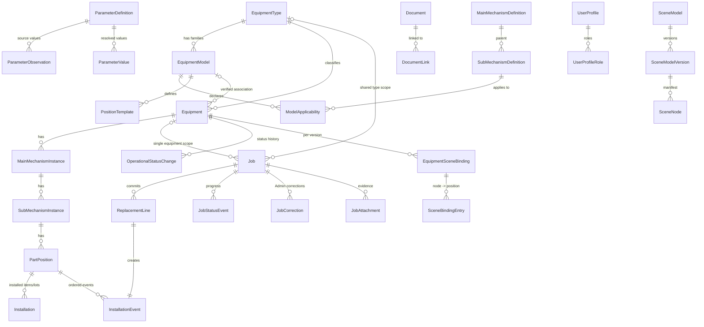
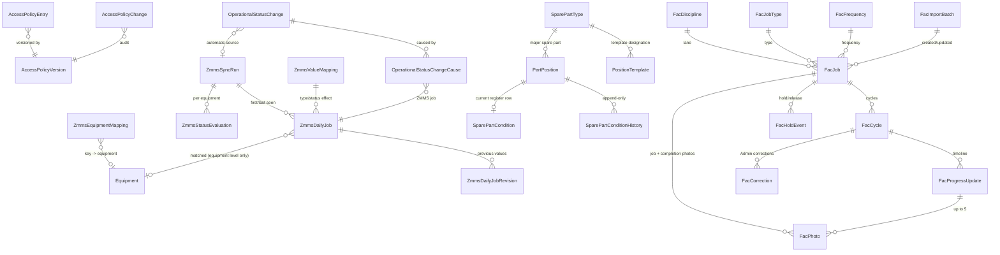
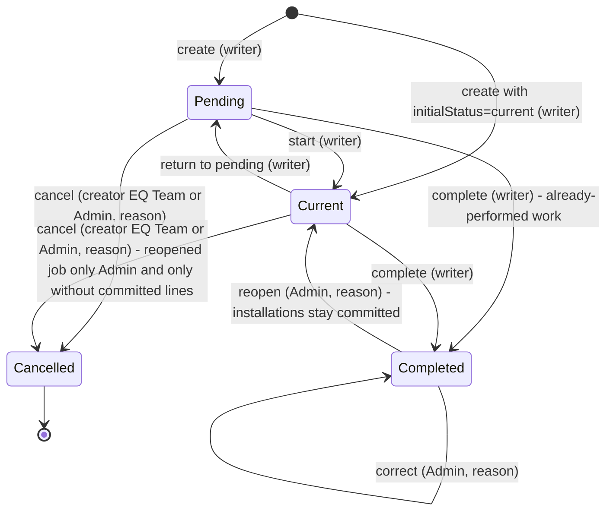

# Data contract

Prepared in P01 on 21 October 2026. Status: **design contract for R01 review**, revised by Repair-R01 on 21 October 2026 (findings F1, F2, F3, F5 of `docs/evidence/R01/review-20261021-1357.md`: J6, s4.1, s5.1, s5.3-s5.5, s8, alternate keys); P06/P07/P08/P10 implement it. Section numbers are referenced from `docs/ARCHITECTURE.md` and `docs/API_CONTRACT.md`. Requirement text quoted as "s<n>" refers to `documents/prompt-pack/APPROVED_REQUIREMENTS.md`.

**U1 round 6 addendum (23 October 2026, U1-C23..U1-C26, user answers and instructions in chat; DECISIONS "2026-10-23 U1 CHANGES REQUESTED (round 6)", D-155..D-160).** Changed sections: s3.6 (Job display switch columns, JobStatusEvent kinds, invariant J7), s3.12 (audit codes `job.display`, `fac.job.display`), s6 (`eq.work` and `fac.work` include the display switch; no new feature or toggleable cell), s9 (the crane view's Projects/Special tab lists completed jobs), s14.4 (FAC photos for dashboard-only readers: active and shown jobs), s17.2 (FacJob display switch, invariant F7), s18.1 (Projects/Special lists open and completed jobs; hidden jobs excluded), s18.3 (fleet open-job counts exclude hidden jobs), s18.4 (dashboard population excludes hidden jobs; new last lane group "Up to date"), s19 (export column "Shown on dashboard"). These supersede, for the Projects/Special tab only, SOW V2 s4.1 / APPROVED_REQUIREMENTS S07 "no work history in the crane view" and the U-31 open-only reading (D-122); and the D-119 rule that jobs completed earlier and not yet due are not in the moving list. The 3D model change of U1-C25 (013 load cell) is in the model source (`assets/models/source/cict-j526a-sts/README.md`, revision 5) and does not change this contract.

**U1 round 5 addendum (23 October 2026, U1-C20..U1-C22, user instructions in chat; DECISIONS "2026-10-23 U1 CHANGES REQUESTED (round 5)").** Changed sections: s3.1 (Admin-added definitions, fixed 061/062 names), s3.4 (draft re-parenting, Admin-added positions), s3.8 (Admin-entered specification rows, value source), s6 (`eq.work` adds spare parts; `admin.access` wording), s11, s14.1, s16.1, s16.3 (Add spare part), s16.6 (`registerAdd`), s18.1 (Maintenance "Open in Jobs" target) and s18.2 (four EQ Jobs tabs). These supersede SOW V2 s4.2 (one "Special & daily jobs" part) and s4.6 / APPROVED_REQUIREMENTS (only Admin marks major spare parts) where they differ.

**P01B addendum (22 October 2026, SOW V2 revision 4, requirements v2.0).** Extended for R02B review; P06, P07, P07B, P08, P08B, P09 and P10 implement it. Changed sections: s1, s2, s3.2, s3.3, s3.4, s3.5, s3.6, s3.7, s3.9, s3.11, s3.12, s4.2, s5.1, s6, s7, s8, s9, s11, s12, s13. New sections: s14 sections, navigation and the Access matrix; s15 ZMMS daily jobs and automatic status; s16 spare-part condition register; s17 FAC; s18 read models (crane current state, EQ Jobs tab, FAC Dashboard); s19 Excel exports; s20 ZMMS fields provisional until P07B. Every P01/R01 rule not named as superseded in `docs/DECISIONS.md` ("P01B supersessions") still holds. In V2 the P01 "jobs" are the EQ **special jobs**; their rules are unchanged.

## 1 Conventions

| Topic | Rule |
| --- | --- |
| Schema | All EQ tables in SQL Server schema `eq`. Table names singular PascalCase below |
| Primary keys | `uniqueidentifier` IDs generated by the application (`Guid.CreateVersion7()` for index locality) unless stated. IDs never change and are never reused |
| Codes | Mechanism codes, equipment codes, semantic keys, role codes and parameter codes are `nvarchar` **strings**, compared ordinally; leading zeroes are significant (`01` != `1`) |
| Business dates | `date` (no time, no time zone). Validated against "today" in Asia/Colombo |
| Audit instants | `datetime2(7)` in UTC, suffix `Utc`. Displayed in Asia/Colombo. An audit instant never stands in for a physical work date |
| Concurrency | Every mutable aggregate root has `RowVersion rowversion`; exposed in the API as `version` (base64) |
| Text limits | Code <= 32, name/title <= 200, reason <= 500, description/note <= 4000 characters unless stated; trimmed; control characters other than newline/tab rejected |
| Actor references | `...ByProfileId` columns reference `UserProfile.ProfileId`. Deactivated profiles keep their rows, so history stays readable |
| Data origin | Tables that can hold fleet/business records carry `DataOrigin` (`admin`, `referenceImport`, `developmentFixture`; V2 adds `zmmsSync` for rows written by a ZMMS sync, `facImport` for FAC jobs created by the master-list import and `user` for FAC jobs added in the app). Release checks refuse a target containing `developmentFixture` rows outside disposable databases |
| Deletion | Business and history rows are never hard-deleted. Where removal is allowed it is a state change (`deactivated`, `retired`, `removed`, `voided`, `cancelled`) with actor, time and reason. Exceptions are listed in s11 |
| Business day (V2) | `BusinessDay(instantUtc)` = the calendar date in Asia/Colombo (UTC+05:30, no daylight saving; IANA `Asia/Colombo`, Windows `Sri Lanka Standard Time`). "Today", "same day", "current day", "next day", FAC periods, the ZMMS run date and the manual-status correction day all use it. Midnight Asia/Colombo = 18:30 UTC of the previous UTC date |
| Week (V2) | Monday 00:00 to Sunday 24:00 Asia/Colombo (ISO week), used for weekly FAC cycles, "Done this week" and the FAC due-load chart (D-128) |
| Calendar months (V2) | Adding n months to a date uses `DateOnly.AddMonths(n)`: same day number, clamped to the last day of a shorter month (31 Jan + 1 month = 28 Feb, or 29 Feb in a leap year; 29 Feb 2028 + 12 months = 28 Feb 2029). Used by FAC due dates and spare-part predictions (D-108) |
| Feature check (V2) | Every read or write of a record is also gated by the Access matrix (s14): a request passes only if the caller's effective feature set contains the feature the endpoint, export or file requires |

## 2 Entity overview



Two structures are deliberately separate (s3): the **coded classification** (definitions -> equipment-specific instances -> positions, which own history) and the **scene structure** (manifest nodes, which own geometry). They meet only through `SceneBindingEntry`.

V2 entities (s14-s17). The EQ and FAC sections keep separate records: no FAC table references an EQ equipment, position or job, and no EQ table references a FAC job (SOW V2 s2).



## 3 Entities and invariants

### 3.1 Mechanism catalogue

**MainMechanismDefinition**

| Column | Type / constraint | Notes |
| --- | --- | --- |
| Id | PK | |
| Code | nvarchar(8), UQ, immutable | `01`...`17` as delivered; `10` is absent and never created; Admin-added codes are new two-digit strings (U1-C22) |
| Name | nvarchar(200), not null | display name |
| Description | nvarchar(2000) null | (U1-C22) Admin-entered; null for the delivered mains |
| SourceName | nvarchar(200) null | as supplied |
| IsActive | bit | |
| Origin | `referenceImport` / `admin` | |
| ImportedValuesHash | char(64) null | sha256 of the imported field values; detects later Admin edits (s12) |
| SourceLine | int null | line in `mechanisms-original.txt` |
| RowVersion | rowversion | |

**SubMechanismDefinition**

| Column | Type / constraint | Notes |
| --- | --- | --- |
| Id | PK; alternate key (Id, MainDefinitionId) | |
| Code | nvarchar(8), UQ across the whole catalogue, immutable | `011`...`171` |
| MainDefinitionId | FK -> MainMechanismDefinition, **immutable** | supplied parent kept |
| Name | nvarchar(200) null | null only while reserved; `061` = Spreader, `062` = Headblock |
| SourceName, Description, SourceDescription | nvarchar | original label/description retained (`061` source label `lp`, `062` blank) |
| NameDecision | `preserve_source` / `user_confirmed_2026-10-21` / `admin_defined` / `admin_renamed` (U1-C22) | |
| IsActive, IsReserved | bit | `048`, `063`: IsActive = 0, IsReserved = 1 |
| Origin, ImportedValuesHash, SourceLine, RowVersion | | as above |

Invariants:

- C1 After the reference import the catalogue holds exactly 16 main and 43 sub definitions, 41 active and 2 reserved inactive (`048`, `063`); `015`, `024`, `033` are three separate definitions (SRC01-SRC03). The importer verifies these counts and the source checksum before writing (s12).
- C2 Codes and parents never change. The API refuses creating main code `10` (listed in `unassignedMainCodes`) or reusing any existing code; any later new definition uses a new code chosen by Admin (no renumbering). (U1-C22) Admin adds main definitions with a new two-digit string code (`00` and `10` refused, 422 `code_unassigned_reserved` for `10`, 409 `duplicate_code`) and sub definitions whose code is the parent main code plus one digit, unique across the whole catalogue (422 `validation_failed` for another format, 422 `parent_inactive` under an inactive main). Added rows have Origin `admin`, NameDecision `admin_defined`, SourceName null; they never count toward the C1 reference totals (16 main / 43 sub stay as delivered).
- C2a (U1-C22) Admin edits Name and Description of any non-reserved definition with an audit row that keeps the previous values (catalogue change log); a rename of a reference definition sets NameDecision `admin_renamed` and keeps SourceName visible. The user-confirmed names `061` Spreader and `062` Headblock are fixed (409 `approved_name_locked`; their descriptions remain editable). Reserved `048`/`063` are refused (422 `reserved_definition`) and change only through define-reserved (C3).
- C3 A reserved definition is unselectable for new instances, positions or job targets until an Admin gives it an explicit name/description (`define-reserved`), which sets IsReserved = 0, IsActive = 1, NameDecision = `admin_defined`, audited.
- C4 Definitions are deactivated, never deleted. An inactive definition cannot be used for new applicability, instances or job targets; existing instances, positions and history stay readable.
- C5 Main 06 and sub 061 are both displayed "Spreader"; every UI shows code + name so the levels stay distinguishable.

### 3.2 Equipment types, equipment models, applicability, position templates

**EquipmentType**: Id; Code (nvarchar(16), UQ, e.g. `QC`, `RTG`, `ES`); Name; IsActive; SortOrder; RowVersion. Admin-configurable (s3). Three initial types are reference data with no fleet facts.

**EquipmentModel** (equipment model family/template, e.g. `CICT-J526A-STS`): Id; Code (UQ, immutable); Name; EquipmentTypeId (FK, immutable); Description; Status (`draft`, `active`, `retired`); TemplateRevision (int, increments on any applicability/position-template change); Origin; RowVersion.

**ModelApplicability**: (EquipmentModelId, SubDefinitionId) PK; State (`applicable`, `notApplicable`, `unknown`); Note; SourceReference (drawing/page or "Admin decision"); UpdatedByProfileId/Utc. Absence of a row means `unknown`. Unknown is never treated as applicable (SRC04).

**PositionTemplate**: Id; EquipmentModelId; SemanticKey (UQ within the model, immutable once any equipment was instantiated from it); SubDefinitionId; DisplayName; PositionKind (`serialized`, `quantityLot`); Category (`component`, `structural`, `ropeSet`, `electrical`, `hotspotOnly` etc., display only); DefaultUom; NominalQuantity (decimal(12,3) null); SourceReferencesJson (drawing number, page, manifest node key, provenance); Status (`draft`, `confirmed`, `deactivated`); SortOrder; **SparePartTypeId** (FK -> SparePartType, null; V2: non-null marks the template position as a major spare part, copied to positions at instantiation, s16); RowVersion.

Invariants:

- T1 Applicability belongs to the model, not to the type and not to a single equipment item. Editing applicability or templates never changes existing instances, positions, installations or jobs (s3). It only increments TemplateRevision; applying it to an equipment item is a separate, previewed Admin action.
- T2 A position template's sub definition must be active and `applicable` for the model when the template is confirmed.
- T3 The initial QC position template is generated from the P03 node manifest plus drawing sources as `draft` rows with source references; Admin reviews, edits and confirms them before any instantiation (B-08). Structural members default to 15/151 (frame, legs, girder, A-frame, stays, fixed access) and 03/031 (boom members), one maintenance identity per member (s3).
- T4 Not applicable to the J526A family until Admin confirms otherwise (candidates only, SOURCE_MAP s6): 043, 044, 045, 091-094. Unknown: 047, 154, 155, 064. The template seed never marks them applicable.

### 3.3 Equipment

| Column | Type / constraint | Notes |
| --- | --- | --- |
| Id | PK | used in all URLs |
| Code | nvarchar(32), UQ (case-insensitive, trimmed) | business code such as `QC-DEMO-01`; Admin may edit with audit; duplicates refused (ADM01) |
| Name | nvarchar(200) null | |
| EquipmentTypeId | FK, immutable after creation | |
| EquipmentModelId | FK null | null = no model association |
| ModelAssociationState | `unassigned` / `verified` | `verified` only by an explicit Admin action with note, actor, time; never automatic (SRC06) |
| ModelAssociationNote, ModelAssociatedByProfileId, ModelAssociatedUtc | | |
| Lifecycle | `active` / `retired` | retired excluded from fleet counts by default (ADM04) |
| RetiredUtc, RetiredByProfileId, RetiredReason | | |
| SerialNumber, Manufacturer, CommissionedOn (date) | all null | unknown stays null; never inferred. V2: CommissionedOn is the "equipment commissioning date" of S22, the base of the predicted replacement of Original spare parts (s16); Admin-only field |
| CurrentStatus | `readyForOps` / `breakdown` / `maintenance` / **null** | null = Unreported (not a fourth status) |
| CurrentStatusChangeId | FK -> OperationalStatusChange null | |
| CurrentStatusSinceUtc | datetime2 null | effective instant of the current status |
| CurrentStatusSource (V2) | `zmms` / `manual` / null | copied from the latest OperationalStatusChange (null while Unreported) |
| ManualOverrideOn (V2) | date null | business day of an active manual correction on ZMMS-mapped equipment; null when none (s15.7) |
| LastActivityUtc | datetime2 | max of status/job/installation changes; fleet "last updated" |
| DataOrigin, CreatedByProfileId, CreatedUtc, RowVersion | | |

Invariants:

- E1 New equipment has CurrentStatus = null, no model association, no serial/commission date unless Admin enters known values (SRC06, ADM01).
- E2 CurrentStatus, CurrentStatusChangeId and CurrentStatusSinceUtc change only inside the status-change transaction (s4.2) and always equal the latest OperationalStatusChange row.
- E3 Retiring is refused while uncompleted, uncancelled jobs exist (D-35). Retired equipment accepts no new jobs or status changes; it can be reactivated by Admin with a reason.
- E4 Changing the model association after history exists does not move, rename or delete positions; it changes only which template is offered for future instantiation and which parameters apply.
- E5 (V2) CurrentStatusSource and ManualOverrideOn change only inside a status-change transaction (manual command, Back to automatic or a ZMMS sync, s15.7) together with CurrentStatus; the one exception is the retirement of the equipment's last ZMMS mapping, which clears ManualOverrideOn under the same equipment lock (s4.2). "ZMMS-mapped" is derived: the equipment has at least one active ZmmsEquipmentMapping (s15.4). The status **mode** shown to users is derived, never stored: `manualOnly` (not mapped), `automatic` (mapped, ManualOverrideOn null), `manualOverride` (mapped, ManualOverrideOn = today), `manualOverrideExpired` (mapped, ManualOverrideOn < today, no successful sync since midnight).

### 3.4 Equipment-specific instances and part positions

**MainMechanismInstance**: Id; EquipmentId; MainDefinitionId; State (`active`, `deactivated`); CreatedUtc/ByProfileId. UQ (EquipmentId, MainDefinitionId). Alternate keys (unique constraints declared so composite FKs can reference them): (Id, EquipmentId) and (Id, EquipmentId, MainDefinitionId).

**SubMechanismInstance**: Id; EquipmentId; MainInstanceId; MainDefinitionId; SubDefinitionId; State; InstantiatedFromTemplateRevision (int null). UQ (EquipmentId, SubDefinitionId). Alternate keys: (Id, EquipmentId) and (Id, EquipmentId, MainInstanceId).
Composite FKs: (MainInstanceId, EquipmentId, MainDefinitionId) -> MainMechanismInstance alternate key; (SubDefinitionId, MainDefinitionId) -> SubMechanismDefinition alternate key. This makes a sub instance under the wrong main, or under another equipment's main, impossible in the database (ADM03).

Every composite FK in this contract references a key declared as a primary key or alternate key (unique constraint) on the referenced table. Declared alternate keys: SubMechanismDefinition (Id, MainDefinitionId); MainMechanismInstance (Id, EquipmentId), (Id, EquipmentId, MainDefinitionId); SubMechanismInstance (Id, EquipmentId), (Id, EquipmentId, MainInstanceId); PartPosition (Id, EquipmentId), (Id, EquipmentId, SubInstanceId, MainInstanceId); Job (Id, EquipmentId); EquipmentSceneBinding (Id, EquipmentId).

**PartPosition** (a maintainable main-part position; owner of exact-position history):

| Column | Type / constraint | Notes |
| --- | --- | --- |
| Id | PK; alternate keys (Id, EquipmentId) and (Id, EquipmentId, SubInstanceId, MainInstanceId) | the stable history identity |
| EquipmentId, MainInstanceId, SubInstanceId | composite FK (SubInstanceId, EquipmentId, MainInstanceId) -> SubMechanismInstance alternate key | ancestor chain stored and enforced |
| SemanticKey | nvarchar(128), UQ (EquipmentId, SemanticKey); editable only while State = `draft`, immutable from confirmation (`active`) onwards, including after deactivation | grammar s10.2; used for scene binding, never as a database key elsewhere |
| DisplayName | nvarchar(200) | renameable with audit |
| PositionKind | `serialized` / `quantityLot`; immutable once any InstallationEvent exists | D-29 |
| Category | display category | |
| Uom | nvarchar(16) | `ea` for serialized; e.g. `rope`, `set`, `m`, `pcs` for lots |
| NominalQuantity | decimal(12,3) null | serialized: 1; lots: known nominal or null (unknown) |
| PositionTemplateId | FK null | origin only; later template edits do not touch this row |
| State | `draft` / `active` / `deactivated` | jobs and replacement lines may target only `active` |
| ConfirmedByProfileId, ConfirmedUtc | | Admin confirmation (B-08) |
| LastEventSequence | int, default 0 | per-position event counter (s5) |
| SourceReferencesJson | | drawing/page/manifest node references |
| IsMajorSparePart (V2) | bit, default 0 | copied from the template (SparePartTypeId not null) at instantiation, then adjustable per equipment by Admin (s16.1) |
| SparePartTypeId (V2) | FK -> SparePartType null | required when IsMajorSparePart = 1 |
| ExpectedLifeMonthsOverride (V2) | int null, 1..600 | per-position override of the type's default expected life (Admin) |
| RowVersion | | |

Invariants:

- P1 Positions are per equipment. `QC-DEMO-01 / 011 / hoist.drive.motor.a` and `QC-DEMO-02 / 011 / hoist.drive.motor.a` are different rows with different IDs and independent history (ADM02, HIS01).
- P2 Instantiating a template copies applicable sub instances and confirmed position templates into `draft` rows for that equipment; Admin confirms (all or selected) to make them `active`. While a position is `draft` Admin may also edit its SemanticKey. Before any history exists Admin may add, rename, change kind/UOM or deactivate; positions in `draft` with no references may be deleted (s11). (U1-C22) Admin may add a position to one equipment (`POST /admin/equipment/{id}/positions`): it starts as `draft` under an active, non-reserved sub instance of that equipment, with a key that satisfies s10.2, is unique for the equipment (409 `duplicate_semantic_key`) and never starts with `container.`; other equipment from the same template are unchanged (P1). While a position is `draft` and has no references Admin may also move it to another sub instance of the same equipment (ancestor chain rewritten in one statement; 409 `ancestors_frozen` once confirmed or referenced). Once confirmed, the SemanticKey never changes (409 `position_key_frozen`); a wrong key on an active position is handled by deactivating it and adding a new position, so bindings and history never follow a re-keyed row.
- P3 After history exists: DisplayName may be renamed (audited); SemanticKey, ancestor chain and PositionKind are frozen; deactivation is allowed (no new work) and keeps all history readable.
- P4 Re-applying a newer template revision previews additions only (new sub instances/positions); it never deletes, renames or re-parents existing rows. Removing something requires an explicit Admin deactivation.
- P5 A spatial container (machinery house, trolley assembly, portal frame) is never a PartPosition; it exists only in the scene manifest (s10.10).

### 3.5 Installations and installation events

**Installation** (an installed item at a serialized position, or an installed lot at a quantity position):

| Column | Notes |
| --- | --- |
| Id; PartPositionId + EquipmentId (composite FK -> PartPosition (Id, EquipmentId)) | |
| PositionKind | copied from the position (immutable) for the filtered unique index |
| ItemDescription (required), Manufacturer, ModelOrPartNumber, SerialNumber | null = unknown; never fabricated |
| InstalledQuantity decimal(12,3) > 0; Uom | serialized: exactly 1 `ea` |
| RemainingQuantity decimal(12,3) | lots: reduced by partial removals; serialized: 1 or 0 |
| InstalledOn date null | null only for a `baselineRecorded` installation with unknown date |
| InstalledByEventId | FK -> InstallationEvent |
| State | `open` / `closed` / `voided` |
| ClosedByEventId, ClosedOn | |

Filtered unique index: at most one `open` installation per serialized position: UQ (PartPositionId) WHERE State = 'open' AND PositionKind = 'serialized'.

**InstallationEvent** (append-only physical history; the order of record for a position):

| Column | Notes |
| --- | --- |
| Id; PartPositionId + EquipmentId (composite FK -> PartPosition (Id, EquipmentId)) | |
| Sequence int | UQ (PartPositionId, Sequence); = position.LastEventSequence + 1 at commit |
| Kind | `replacement` / `baselineRecorded` / `conditionReplacement` (V2: a replacement recorded directly in the spare-part register without a special job, s16.3) |
| ReplacementLineId | FK, required for `replacement`, null for baseline and `conditionReplacement` |
| SparePartEntryId (V2) | FK -> SparePartConditionHistory, required for `conditionReplacement` and for a `baselineRecorded` event created by the register's Record Original action; null otherwise |
| BusinessDate date null | physical date; null only for baseline with unknown date |
| RemovedInstallationId, RemovedQuantity | the tracked item/lot removed (null when nothing tracked was removed) |
| RemovedItemKnown bit; RemovedItemDescription; RemovedItemSerial | for an untracked removed item: describes it if known, or marks it explicitly **Unknown**; never creates a fabricated opening installation |
| InstalledInstallationId | FK -> Installation created by this event |
| RecordedUtc; RecordedByProfileId | audit instant (not the work date) |
| VoidedByCorrectionId; VoidedUtc | set only by an Admin correction (s5.3) |

Invariants:

- I1 A position's current state is derived from its non-voided events in Sequence order; the stored `Installation.State`/`RemainingQuantity` values are maintained in the same transaction and tests prove they equal the derivation (HIS03).
- I2 Business dates are non-decreasing in Sequence order among non-voided events (D-32). Consequence for manual back-entry of past work (B-07): an event can only be appended after the latest non-voided event at that position, so an older replacement cannot be inserted below a newer one. The supported back-entry procedure is in s5.4.
- I3 No event is created by template changes, model changes, mesh changes, imports or a ZMMS sync.
- I5 (V2) A `conditionReplacement` event follows every rule of a `replacement` event (D-32 date order, `expectedCurrentInstallationId`, UPDLOCK on the position, latest-event void rule) except that it has no job; it is the only way the register records a new installed item without a special job (s16.3).
- I4 A position with no events shows "No work recorded" and "Installed item unknown"; this is never presented as original, healthy or never replaced (HIS04).

### 3.6 Jobs, replacement lines, progress, corrections

V2: these are the EQ **special jobs** (major or non-routine work entered by hand, SOW V2 s4.3). The original states remain; U1-C50 extends special jobs with explicit overall progress as described below. The optional photos of SOW V2 s4.3 are the existing JobAttachment evidence. ZMMS daily jobs are a separate, read-only entity (s15.3) and are never Job rows.

**Job**

| Column | Notes |
| --- | --- |
| Id; Number (`EQJ-yyyy-nnnnnn` from a SQL sequence; UQ; immutable) | alternate key (Id, EquipmentId) (unique constraint) |
| EquipmentId nullable; EquipmentTypeCode nullable | U1-C51: immutable scope; exactly one is set. One equipment, or all active equipment of one type (including later additions). Type-wide scope uses equipment-level target only. |
| TargetLevel | `equipment` / `main` / `sub` / `part` |
| MainInstanceId, SubInstanceId, PartPositionId | null per level; CHECK: equipment = all null; main = main only; sub = main + sub; part = main + sub + part |
| (composite FKs) | (MainInstanceId, EquipmentId) -> MainMechanismInstance alternate key (Id, EquipmentId); (SubInstanceId, EquipmentId, MainInstanceId) -> SubMechanismInstance alternate key; (PartPositionId, EquipmentId, SubInstanceId, MainInstanceId) -> PartPosition alternate key |
| Kind | `repair` / `replacement` / `project` (U1-C51) |
| Title (required <= 200), Description (<= 4000) | |
| Priority | null / `low` / `normal` / `high` (simple field; no workflow) |
| PlannedOn date null; ResponsiblePerson nvarchar(200) null | optional |
| WorkStatus | `pending` / `current` / `completed` |
| CompletedOn date null; CompletionNote; CompletedUtc; CompletedByProfileId | required together when completed |
| ProgressPercent int null; ProgressUpdatedOn date null; ProgressNote nvarchar(2000) null | U1-C50: latest explicit progress. Integer 0..100; null means no percentage recorded for active work. Completed work displays 100; Pending starts at 0. See J8. |
| IsCancelled bit; CancelledUtc; CancelledByProfileId; CancellationReason | separate marker; WorkStatus keeps its last value (`pending`/`current`) |
| ShowOnDashboard bit NOT NULL DEFAULT 1; DisplayChangedUtc null; DisplayChangedByProfileId null | U1-C26 (D-158): the shared "Show on dashboard / 3D" switch of this special job; existing rows migrate to 1 (shown). Display only: it never changes the work fields, work status, history or operational status |
| CreatedByProfileId; CreatedUtc; UpdatedUtc; ReopenCount; RowVersion | |

**ReplacementLine**: Id; JobId (FK -> Job); EquipmentId (the equipment that owns the replaced position); PartPositionId + EquipmentId (composite FK -> PartPosition alternate key (Id, EquipmentId)); U1-C51: the completion transaction verifies that EquipmentId is inside the immutable single-equipment or type scope of Job. The former JobId + EquipmentId composite FK is superseded because type-wide jobs have no single EquipmentId; Mode (`full`, `partial`; serialized always `full`); ExpectedCurrentInstallationId (what the user replaced; null = nothing tracked); RemovedQuantity (partial lots); RemovedItemKnown/RemovedItemDescription/RemovedItemSerial (untracked removed item); ItemDescription (required), Manufacturer, ModelOrPartNumber, SerialNumber (null = unknown); Quantity (> 0; serialized = 1); Uom; ReplacedOn (date); Note; State (`committed`, `voided`); InstallationEventId; CommittedUtc; RowVersion. UQ (JobId, PartPositionId) WHERE State = 'committed'.

**JobStatusEvent** (progress history, append-only): Id; JobId; Kind (`created`, `started`, `returnedToPending`, `completed`, `reopened`, `cancelled`, `corrected`, `edited`, `displayShown`, `displayHidden`, `progressUpdated`; the display kinds (U1-C26) keep FromStatus = ToStatus); FromStatus; ToStatus; Reason; BusinessDate (completion date when relevant); ActorProfileId; OccurredUtc.

U1-C50: `progressUpdated` events additionally retain WorkDate, Percent, PreviousPercent and the required progress note, with ActorProfileId/OccurredUtc. Completion events retain the actual completion note, work date and 100%. Progress edits append events and AuditEntry before/after summaries; they do not overwrite prior notes.

**JobCorrection** (groups one Admin correction): Id; JobId; Number (per job); Reason (required); ActorProfileId; OccurredUtc; ItemsJson (each item: entity, id, action, before, after). Every item is also written to `AuditEntry` with before/after snapshots.

**JobAttachment**: Id; JobId (FK -> Job; U1-C51 supersedes the single-equipment composite FK); DocumentId; ReplacementLineId null; Caption; UploadedByProfileId; UploadedUtc; State (`active`, `removed`); RemovedByProfileId/Utc/Reason.

Invariants:

- J1 Target instances/positions belong to the job's single equipment (composite FKs) and are `active` with active definitions at creation or target change. U1-C51 type-wide jobs have no component target; replacement positions must belong to active equipment of the selected type.
- J2 An equipment-level job has no component target and appears only in equipment-scope history unless it has replacement lines, which make it appear (once) in the scopes containing those lines (s9).
- J3 Replacement lines are required on `replacement` jobs, optional on `project` jobs and forbidden on `repair` jobs (U1-C51). They are created only by completion or Admin correction (D-30), resolve an `active` position of equipment inside the job scope and target subtree (D-31), and a job cannot hold two committed lines for the same position (JOB05).
- J4 Operational status is never changed by any job command (JOB02, B-10). V2: the only other writer of status is a successful ZMMS sync for mapped equipment (s15.7); a job completion still never sets Ready for OPS.
- J5 A cancelled job keeps all rows; it is excluded from the three normal work views and counts unless `includeCancelled` is requested; it is never counted Completed (JOB12).
- J6 **Committed work on an uncompleted job.** A job that was completed and then reopened (ReopenCount > 0) is "previously completed"; it may also hold committed, non-voided replacement lines and their installation events. While uncompleted it is protected as completed work (s5, requirement s5 "a completed job cannot be cancelled"; "a completed replacement cannot be silently undone"):
  - it cannot be cancelled by EQ Team (409 `job_previously_completed`); Admin may cancel it only when it holds no committed, non-voided line (else 409 `job_has_committed_replacements`, listing the lines; Admin voids them first through a correction, s5.3, which enforces the latest-event rule);
  - its kind cannot change to `repair` while committed, non-voided lines exist (409 `job_has_committed_replacements`);
  - its target cannot change to a target whose subtree excludes the position of any committed, non-voided line (409 `committed_lines_outside_target`, listing the lines), so J3/D-31 keep holding;
  - re-completion follows s5.1 with the reopened-job rules in s5.3.
- J7 **Display switch (U1-C26, D-158).** `ShowOnDashboard` is one shared setting per special job (every viewer, including Management and the TV dashboard, sees the same). It is set through its own command (API s4.8 `PUT /jobs/{jobId}/display`, `eq.work`: EQ Team and Admin, for any special job whatever its creator, work state or cancellation; Management and FAC Team 403) with the job `version`, writes `JobStatusEvent` `displayShown`/`displayHidden` (optional reason) and `AuditEntry` `job.display` (before/after) in one transaction, and increments RowVersion. A hidden job is left out of the crane-view current state (s18.1: Projects/Special list and counts, tab badges, tree and 3D/flat label work badges) and of the fleet open-job counts (s18.3). It stays in the EQ Jobs tab, the scoped history (s9), the job record, the exports (s19) and the audit. Equipment-level, mechanism and part jobs follow the same rule.

- J8 **Overall special-job progress (U1-C50, D-194).** EQ Team/Admin record an integer percentage (0..100), work date and nonempty note (<=2000). Work date is a real Asia/Colombo calendar date, not future and not before the latest progress (or prior completion after reopening). Positive progress moves Pending to Current; 0 does not undo an existing start. Revised estimates may decrease, with previous values retained in the append-only timeline and audit. 100 completes through the same atomic replacement/installation/register path as Complete, including replacement dates <= completion date. Invalid or stale submissions write nothing. Requests use RowVersion and an idempotency key scoped to the job. Completed, cancelled or retired-equipment jobs reject new progress; authorized retries replay without another mutation. Reopening clears the active percentage/date/note but preserves earlier progress, completion notes and committed installations. Re-completion reuses committed lines and does not force duplicate replacement rows. No job progress command changes equipment operational status.
- J9 **Progress read boundary.** Percent/date/note summaries belong to EQ Jobs list/detail and its authorized timeline. Existing CurrentSpecial DTOs and crane-view work projections remain allowlisted and exclude progress fields, notes and events. No percentage is invented for previously Current jobs: display Not updated until an explicit update is recorded. Prototype completion/photos remain within the existing stage boundary; this change does not implement evidence uploads or production persistence.

### 3.7 Operational status history

**OperationalStatusChange** (append-only): Id; EquipmentId; Sequence (UQ per equipment); Status (`readyForOps`, `breakdown`, `maintenance`); PreviousStatus (null when previously Unreported); PreviousChangeId; Reason (required, 1-500 chars, for `breakdown` and `maintenance`; optional for `readyForOps`); RelatedJobId (FK -> Job; U1-C51: transaction verifies that this equipment is inside the job's single-equipment or shared type scope, superseding the old JobId + EquipmentId composite FK, JOB13); EffectiveUtc (= server time, D-33); RecordedByProfileId.

V2 columns (S21, s15.7):

| Column | Notes |
| --- | --- |
| Source | where the **value** comes from: `manual` (a user's choice) / `zmms` (a sync evaluation). Mandatory. `backToAutomatic` is `zmms` when it applies today's evaluation and `manual` (value kept, "awaiting today's ZMMS sync") when no evaluation of today has a computed value yet (D-96, s15.7 step 6) |
| Kind | `manualSet` (equipment without a ZMMS mapping: the V1 rule), `manualCorrection` (mapped equipment: current-day correction), `automatic` (applied by a sync), `backToAutomatic` (a user ended the correction), `overrideEnded` (a sync of a later business day ended an expired correction) |
| SyncRunId | FK -> ZmmsSyncRun; required for `automatic` and `overrideEnded`; for `backToAutomatic`, the run whose evaluation was applied (null when none exists yet today); null otherwise |
| OverrideOn | date; required for `manualCorrection` (= BusinessDay(EffectiveUtc)), null otherwise |
| RecordedByProfileId | required for user actions (`manualSet`, `manualCorrection`, `backToAutomatic`); null for `automatic` and `overrideEnded` |
| Reason | rules above for `manualSet`; **always required** for `manualCorrection` (including Ready for OPS, s5); optional for `backToAutomatic`; null for `automatic` and `overrideEnded` (the causes explain them) |

**OperationalStatusChangeCause** (append-only, V2): (StatusChangeId, ZmmsDailyJobId) PK; Effect (`breakdown`, `maintenance`); the ZMMS daily jobs whose mapped type/status produced an `automatic` or `overrideEnded` Breakdown/Maintenance result (all of them, not only the first). A Ready for OPS result has no cause rows; the change displays "Not in the ZMMS plan for <date>". `backToAutomatic` rows copy the causes of the evaluation they apply (s15.7).

Invariants:

- O1 A row is appended only when the resulting status, the source or the mode changes; the single allowed exception to "value must change" is a `backToAutomatic` or `manualCorrection` row that keeps the same value but changes source/mode (D-94, D-96). A sync that computes the current value for an `automatic` equipment appends nothing (its evaluation is recorded in ZmmsStatusEvaluation only).
- O2 E2 still holds: Equipment.CurrentStatus/CurrentStatusChangeId/CurrentStatusSinceUtc/CurrentStatusSource equal the latest row. CurrentStatusSinceUtc moves only when the **value** changes (a source-only row keeps the previous instant), so "time in current status" is the time in that value.
- O3 Rows are never edited or deleted; a wrong status is followed by a new row.

Time in current status = now - Equipment.CurrentStatusSinceUtc; shown only when CurrentStatus is not null. Nothing is inferred before the first recorded change (s5).

### 3.8 Source parameters

**ParameterDefinition**: Code (PK string, e.g. `rail-gauge`, `gantry-speed`); Label; Unit; DataType (`number`, `text`); Stage1Use (`major`, `technical`); SortOrder; (U1-C22) Origin (`referenceImport` / `admin`); EquipmentModelId (null for reference definitions, the model scope of an Admin-entered row); Condition (null); RowVersion. Admin adds specification rows (`POST /admin/parameters/definitions`, with the first ParameterValue, Basis `adminEntered`, in the same transaction) and edits Label, Unit, Condition, Stage1Use and the ParameterMechanismLink of Admin-entered rows only, keeping the previous definition in AuditEntry; reference definitions are refused (409 `source_definition_fixed`). Admin-entered rows have no ParameterObservation and are labelled "Admin-entered" wherever they appear (Technical tab included). Required major fields: SWL under spreader / cargo beam, rail gauge, outreach, backreach, lift height above rail, total lift height (s6).

**ParameterObservation** (immutable source fact): Id; ParameterCode; EquipmentModelId (the drawing family the observation belongs to, e.g. `CICT-J526A-STS`); NumericValue / TextValue; Unit; Condition (e.g. "65 t under spreader", "Not overall crane height"); SourceDocumentId (FK, when registered) + DrawingNumber + PdfPage; Verification (`visually_read_from_drawing`, ...); ImportBatchId; ObservedBy (`referenceImport` or Admin profile). UQ (ParameterCode, EquipmentModelId, DrawingNumber, PdfPage, NumericValue, TextValue, Condition) so repeat imports are no-ops.

**ParameterValue** (an authorized chosen value): Id; ParameterCode; ScopeType (`equipmentModel`, `equipment`); ScopeId; NumericValue/TextValue; Unit; Condition; Basis (`resolvedConflict`, `adminEntered`, `equipmentOverride`); SelectedObservationId null; Reason (required); SourceNote (nvarchar(300) null, U1-C22: document/page, nameplate or decision the value comes from; required for an Admin-entered definition's first value); DecidedByProfileId; DecidedUtc; IsCurrent; RowVersion. UQ (ParameterCode, ScopeType, ScopeId, Condition) WHERE IsCurrent = 1. A superseded value is kept (IsCurrent = 0) and audited.

Effective value for an equipment item: equipment override -> model-scoped ParameterValue -> the single observation for its verified model -> **unresolved conflict** when the model has two or more differing observations and no ParameterValue (gantry speed 46 vs 45.5 m/min, U-01; trolley motor 275 vs 270 kW, U-02). Equipment without a verified model shows no family parameters (SRC06). Observations stay visible beside any chosen value (ADM06, SRC05). `total-lift-height` (63 m) carries the condition "Not overall crane height" and no overall-height parameter exists in the reference data.

### 3.9 Protected documents

**Document**: Id; Kind (`sourceDrawing`, `referencePhoto`, `workEvidence`, `modelAsset`; V2 adds `facPhoto` and `facPhotoThumbnail`, s17.8); OriginalFileName (sanitized display name <= 200); StorageKey (server-generated, immutable, never exposed); ContentType (validated); ByteLength; Sha256 (char(64)); PageCount null; DrawingNumber null; Title; State (`active`, `removed`); UploadedByProfileId or ImportBatchId; CreatedUtc. UQ (Kind, Sha256) WHERE Kind IN ('sourceDrawing', 'referencePhoto') so the same drawing is imported once (FILE04).

**DocumentLink**: Id; DocumentId; TargetType (`equipmentModel`, `equipment`, `positionTemplate`, `partPosition`, `parameterObservation`, `sceneNode`); TargetId/TargetKey; PdfPage null; Note. Links from the drawing register are "reference" links to the model family, not installed-component assignments.

Rules: originals are immutable (a new revision is a new Document); evidence belongs to one job (JobAttachment); every content read goes through the authorization pipeline (FILE01); allowed evidence types are JPEG, PNG and PDF verified by signature, maximum 20 MiB each (configurable); source imports also accept the drawing-set PNG/JPEG rasters and exclude `Thumbs.db`, `~$*` and other non-source files. V2: FAC photos follow their own stricter rules (JPG/PNG only, 10 MiB, re-encoded, s17.8) and their own feature checks (s14.4); EQ special-job photos remain work evidence under the rules above.

### 3.10 Scene models, versions, nodes and bindings

**SceneModel**: Id; Code (UQ, e.g. `cict-j526a-sts-scene`); EquipmentModelId (FK); Name.

**SceneModelVersion**: Id; SceneModelId; Version (int, UQ per model); Status (`draft`, `validated`, `active`, `retired`); AssetDocumentId + ManifestDocumentId (protected storage); AssetSha256; ManifestSha256; GeneratorName/Version/SourceCommit; Units (`m`); BoundsJson; TriangleCount; ValidationReportJson; RegisteredUtc; ValidatedUtc/ByProfileId.

**SceneNode** (one row per manifest node; immutable for a version): SceneModelVersionId + NodeKey (PK); Kind (`position`, `hotspot`, `container`, `decorative`); MainCode/SubCode (classification, null for containers/decorative); ParentNodeKey; Label; Pickable; PickPriority; ModesJson; ProvenanceJson; BoundsJson; CameraHintJson.

**EquipmentSceneBinding**: Id; EquipmentId; SceneModelVersionId; Status (`draft`, `active`, `superseded`); ValidationReportJson; ActivatedByProfileId; ActivatedUtc; RowVersion. Alternate key (Id, EquipmentId). UQ (EquipmentId) WHERE Status = 'active'.

**SceneBindingEntry**: BindingId; EquipmentId; NodeKey null; PartPositionId null; SubInstanceId null (for hotspots); Source (`exactKey`, `adminMapping`, `noVisual`); Note. Composite FKs share the one EquipmentId column: (BindingId, EquipmentId) -> EquipmentSceneBinding alternate key (Id, EquipmentId); (PartPositionId, EquipmentId) -> PartPosition alternate key (Id, EquipmentId); (SubInstanceId, EquipmentId) -> SubMechanismInstance alternate key (Id, EquipmentId). An entry that binds another equipment's position or sub instance is therefore impossible in the database. CHECK: exactly one of PartPositionId and SubInstanceId is set. UQ (BindingId, NodeKey) WHERE NodeKey IS NOT NULL; UQ (BindingId, PartPositionId) WHERE PartPositionId IS NOT NULL.

Detailed behaviour: s10.

### 3.11 User profiles (local projection of central identities)

**UserProfile**: ProfileId (PK; the value issued in `cict:binding:eq-maintenance:local_user_id`); PortalSubjectId (UQ, immutable; the token `sub`); UserName; NormalizedUserName (UQ); DisplayName; Email null; IsActive; PortalProjectionRevision (bigint); PortalStateHash (char(64)); CreatedUtc; UpdatedUtc.

**UserProfileRole**: (ProfileId, RoleCode) PK; RoleCode in the four role codes only (`eq-maintenance:admin`, `eq-maintenance:management`, `eq-maintenance:eq-team`, `eq-maintenance:fac-team`; V2 adds the fourth); GrantedUtc.

**ProvisioningEvent** (append-only): Id; ProfileId; SubjectId; Outcome (`created`, `updated`, `unchanged`, `rejected`); Revision; StateHash; RolesJson; Active; CorrelationId; OccurredUtc; FailureCode.

Contract rules: s7.

### 3.12 Audit and idempotency

**AuditEntry** (append-only; the application never updates or deletes it; the runtime database login is granted INSERT/SELECT only on this table in P12): Id (bigint identity); OccurredUtc; ActorProfileId null (null for provisioning/import); ActorSubjectId null; Action (dotted code, e.g. `job.complete`, `status.change`, `installation.void`, `catalog.sub.deactivate`, `parameter.resolve`, `scene.binding.activate`, `provisioning.converge`); EntityType; EntityId; EquipmentId null; CorrelationId; IdempotencyKey null; Reason null; BeforeJson null; AfterJson null (bounded; no secrets, tokens or file contents).

Material changes that must write AuditEntry rows in the same transaction: every status change; job create/edit/start/return/complete/cancel/reopen/correct; replacement line commit/amend/void; installation create/close/void/baseline; attachment add/remove; catalogue, type, model, applicability, template, equipment, instance and position changes; model association; parameter resolution/override; scene version registration/validation and binding activation; provisioning convergence; every import batch. V2 adds: Access matrix changes (`access.change`); ZMMS settings, equipment mappings, value mappings and every sync run outcome (`zmms.*`); automatic status changes (actor null, `SyncRunId` in AfterJson); spare-part designation, expected life, due-soon window and every register action (`sparepart.*`); FAC master-list create/edit/deactivate/reactivate, import confirm, progress update, Done today/this week, undo, hold/release, photo add/remove, cycle correction, Admin due date and FAC settings/list changes (`fac.*`); and every Excel export (`export.generate` with the filter, row count and feature, no file content). U1 round 6 adds the display switch of a special job (`job.display`) and of a FAC job (`fac.job.display`), each with before/after `showOnDashboard` and the optional reason.

**IdempotencyRecord**: (ActorProfileId, Key) PK (Key = client UUID); Operation (e.g. `job.complete`); TargetId; RequestHash (sha256 of the canonical request body + route); ResponseStatus; ResponseBodyJson; CreatedUtc; ExpiresUtc (default +30 days, D-27). Inserted in the **same** transaction as the change it records (s8).

## 4 Lifecycles and allowed transitions

### 4.1 Job work status



`Cancelled` is the separate cancellation marker (WorkStatus keeps `pending`/`current`), shown as a state here for clarity. A reopened job (ReopenCount > 0) is "previously completed" and keeps the protections of invariant J6 while it is `current` or `pending`.

| From | Command | To | Allowed roles | Conditions / refusal |
| --- | --- | --- | --- | --- |
| - | create | pending or current | Admin, EQ Team | equipment active; target valid (J1); reason not needed |
| pending / current | edit | same | Admin, EQ Team | `version`; equipment immutable; target may change within the equipment. With committed, non-voided lines (reopened job, J6): kind cannot become `repair` (409 `job_has_committed_replacements`) and the new target must still contain every committed line's position (409 `committed_lines_outside_target`) |
| pending | start | current | Admin, EQ Team | |
| current | returnToPending | pending | Admin, EQ Team | |
| pending / current | complete | completed | Admin, EQ Team | completion date <= today (Asia/Colombo) and >= 2000-01-01; completion note required; `replacement` jobs need >= 1 line counting new lines **plus** the job's committed, non-voided lines (a reopened job may be re-completed with zero new lines); `repair` jobs take no lines; reopened-job rules in s5.3; Idempotency-Key |
| pending / current | cancel | cancelled marker | Admin (any job); EQ Team (only `CreatedByProfileId` = caller) | reason required; EQ Team on another creator's job: 403 `not_job_creator`. Previously completed job (ReopenCount > 0): EQ Team 409 `job_previously_completed`; Admin only when no committed, non-voided line remains, else 409 `job_has_committed_replacements` (J6) |
| pending / current, previously completed | correct | same | Admin | reason; s5.3 line amendments and line voids only (new lines are added by re-completing); job completion fields are not edited until re-completion |
| completed | cancel | - | nobody | 409 `job_completed` (use correction) |
| completed | edit | - | nobody | 409 `job_completed` (Admin uses correct) |
| completed | reopen | current | Admin | reason; committed lines and installations unchanged; ReopenCount + 1 |
| completed | correct | completed | Admin | reason; rules s5.3 |
| cancelled | any | - | nobody | 409 `job_cancelled` |

Moving a card on the jobs board calls exactly these commands; there is no separate board-only rule (s7).

### 4.2 Operational status

- Allowed values: `readyForOps`, `breakdown`, `maintenance`. Null (Unreported) is only the initial state; it cannot be set again.
- Any transition between the three values (including from Unreported) is allowed for Admin and EQ Team (feature `eq.work`, s14); Management and FAC Team are refused.
- Reason mandatory for `breakdown`/`maintenance`; optional for `readyForOps`. Optional RelatedJobId must be a job of the same equipment (cancelled jobs refused).
- The request carries `expectedCurrentStatusChangeId` (null when Unreported); a mismatch returns 409 `status_changed`. A request for the current value returns 422 `status_unchanged` (D-33).
- Retired equipment: refused (409 `equipment_retired`).
- Completing, cancelling or reopening jobs never changes status (J4).

V2 (S21, B-18): the rules above are the `manualSet` rules for equipment **without** a ZMMS mapping. For ZMMS-mapped equipment the status is automatic and a user command is a current-day correction:

```mermaid
stateDiagram-v2
  [*] --> Unreported
  Unreported --> Automatic: first successful sync with automatic status enabled (kind automatic)
  Unreported --> ManualOverride: user correction today (kind manualCorrection)
  Automatic --> Automatic: successful sync, value changes (kind automatic)
  Automatic --> ManualOverride: user correction, reason required (kind manualCorrection, OverrideOn = today)
  ManualOverride --> ManualOverride: same-day sync (evaluation recorded, not applied); another correction today
  ManualOverride --> Automatic: Back to automatic (kind backToAutomatic)
  ManualOverride --> OverrideExpired: Asia/Colombo midnight passes (derived, no row)
  OverrideExpired --> Automatic: first successful sync of a later business day (kind overrideEnded)
  OverrideExpired --> ManualOverride: user correction on the new day
  OverrideExpired --> Automatic: Back to automatic
```



| Command / event | Applies to | Rule |
| --- | --- | --- |
| User sets status | mapped, active | Kind `manualCorrection`; reason **always** required (422 `reason_required`); OverrideOn = today; a value equal to the current value is accepted only when the current source is `zmms` or the override has expired (it converts the automatic value into a held manual one, D-94); equal value while a correction for today is already active: 422 `status_unchanged`; `expectedCurrentStatusChangeId` as above |
| Back to automatic | mapped, ManualOverrideOn not null | s15.7 step 6; 409 `not_in_manual_override` otherwise; 422 `equipment_not_zmms_mapped` for unmapped equipment |
| Successful sync, override day | mapped, ManualOverrideOn >= run business day | evaluation stored with `Applied = false`, SkipReason `manualOverride`; status unchanged |
| Successful sync of a later day | mapped, ManualOverrideOn < run business day | override ends; kind `overrideEnded` with the computed value (row appended even if the value is unchanged, because source/mode change) |
| Failed or partial sync | any | nothing changes (s15.6) |
| Mapping added | previously unmapped | status unchanged until the next successful sync evaluates it |
| Mapping retired (last one) | mapped -> unmapped | value kept; ManualOverrideOn cleared; mode becomes `manualOnly`; no status row (the next change is `manualSet`) |
| Equipment retired | any | no automatic evaluation, no user change (409 `equipment_retired`) |

### 4.3 Other lifecycles

| Entity | States | Transitions (Admin only) |
| --- | --- | --- |
| Equipment | active, retired | retire (reason; no open jobs), reactivate (reason) |
| Main/sub definition | active, inactive (+ reserved) | deactivate, activate, define-reserved |
| EquipmentModel | draft, active, retired | activate (requires confirmed applicability review), retire (no new associations) |
| PositionTemplate | draft, confirmed, deactivated | confirm, deactivate, edit while draft |
| Mechanism instance | active, deactivated | deactivate (positions below must be deactivated first), activate |
| PartPosition | draft, active, deactivated | confirm, deactivate, reactivate, delete only as s11 |
| SceneModelVersion | draft, validated, active, retired | validate, activate (only through equipment binding), retire |
| EquipmentSceneBinding | draft, active, superseded | validate, activate (supersedes previous) |

## 5 Completion, quantities and corrections

### 5.1 Completion transaction (JOB04-JOB08, JOB10, JOB11)

All steps run in one database transaction inside the EF execution strategy (D-28). Any failure rolls everything back, including the idempotency record.

1. Look up `IdempotencyRecord (caller, key)` (fast path for a retry after an earlier commit; no lock). Found with the same RequestHash -> return the stored response with header `Idempotent-Replayed: true`, change nothing. Found with a different hash -> 422 `idempotency_key_reused`.
2. Read the job `WITH (UPDLOCK, HOLDLOCK)`. The lock is held until commit, so concurrent completions of the same job are serialized here.
3. **Re-check `IdempotencyRecord (caller, key)` now that the job lock is held**, as a separate statement before any version or state check. A same-key request that waited on the lock (double-click, client retry after timeout while the first attempt was still running) now reads the winner's committed record: same RequestHash -> replay with `Idempotent-Replayed: true`; different hash -> 422 `idempotency_key_reused`. Only when no record exists: refuse if `version` differs (409 `version_conflict`), if cancelled (409 `job_cancelled`) or already completed (409 `job_already_completed`, body includes the job so a client whose earlier attempt succeeded can show it).
4. Validate completion fields and the line set: no duplicate positions within the request, and none at a position that already holds a committed, non-voided line of this job (reopened job) (422 `duplicate_position`, naming the existing line); each position belongs to the job's equipment (422 `target_not_in_equipment`), is `active` (422 `position_not_active`) and lies in the job target subtree (422 `position_outside_job_target`); kind/quantity rules (s5.2); for a `replacement` job the new lines plus the job's committed, non-voided lines number >= 1 (422 `lines_required`); every new line's ReplacedOn and every committed, non-voided line's ReplacedOn is <= CompletedOn (422 `replacement_after_completion`).
5. Read all line positions `WITH (UPDLOCK, HOLDLOCK)` in ascending Id order (deadlock avoidance). For each line: the position's current open installation(s) must match `expectedCurrentInstallationId` (409 `installation_changed`, returns the current installation); ReplacedOn must be >= the latest non-voided event date (409 `out_of_order_installation`).
6. For each new line: create ReplacementLine (`committed`), InstallationEvent (Sequence = LastEventSequence + 1), the new Installation, close/reduce the removed installation; update PartPosition.LastEventSequence. Committed lines of a reopened job are not touched.
6a. (V2, S22, SP02) For each new line whose position has IsMajorSparePart = 1: write the spare-part register in the same transaction (s16.4): upsert SparePartCondition from the line (condition `replaced`, replaced date = line ReplacedOn, brand = Manufacturer, model/part number = ModelOrPartNumber, serial = SerialNumber, remarks = the line's optional `conditionRemarks`, LastSource `jobCompletion`, LastJobId, LastReplacementLineId, Revision + 1) and append one SparePartConditionHistory row with the previous and new values. The "pre-filled condition form" of SOW V2 s4.3 edits these same line fields; there is no second copy that could disagree. A failure here rolls back the whole completion (job, lines, events, installations, register, audit, idempotency record).
7. Update the job (WorkStatus `completed`, completion fields), add JobStatusEvent, write AuditEntry rows (for a re-completion the before snapshot carries the previous completion fields), update Equipment.LastActivityUtc, insert the IdempotencyRecord with the response body.
8. Commit. The step-3 re-check covers same-key races on the same job. A unique-key violation on the IdempotencyRecord primary key at commit can still occur when the same caller sends the same key concurrently for a **different** job (the job lock does not serialize those); it is caught: the transaction is rolled back, the winner's record is read and replayed if its RequestHash matches, else 422 `idempotency_key_reused`. A parallel request with a different key loses on the job `version`/state check in step 3.

Every other command that takes an `Idempotency-Key` and locks an aggregate (start, return to pending, cancel, reopen, correction, status change, attachment add/remove) uses the same order: fast-path lookup, lock, re-check under the lock, then version/state checks. V2 applies the same order to Back to automatic, every spare-part register action (lock: the position), every FAC command (lock: the FAC job row, then its cycle), Access matrix changes (lock: AccessPolicyVersion) and ZMMS Admin commands (lock: ZmmsSettings or the mapping row).

Admin corrections at a major-spare-part position (s5.3) that void a committed line, amend its ReplacedOn, or amend the manufacturer, part number or serial of the line that installed the current item recompute the register from the position's non-voided events in the same transaction and append a SparePartConditionHistory row with source `correction` (s16.5).

Test-only fault injection (JOB08) is an `ICompletionFaultInjector` registered only in the integration-test host; the production registration is a no-op that cannot be configured.

### 5.2 Serialized versus quantity positions (JOB10)

| Aspect | `serialized` position (motor, brake, reducer, drum, wheel, sheave, PLC cabinet, structural member) | `quantityLot` position (rope set and similar multi-item positions) |
| --- | --- | --- |
| Installed record | One Installation, quantity 1 `ea`, serial optional | One or more open lots, each with InstalledQuantity/RemainingQuantity and the position's UOM |
| Line modes | `full` only | `full` (removes all open lots, installs one new lot) or `partial` (removes `removedQuantity` from the lot named by `expectedCurrentInstallationId`, installs a new lot) |
| Quantity validation | Quantity must be 1 and UOM `ea` | Quantity > 0 with the position's UOM; partial `removedQuantity` <= that lot's RemainingQuantity; when NominalQuantity is known, the open known total after the event must not exceed it |
| Nothing tracked yet | Line declares the removed item Unknown (or a known description/serial) and installs the new item; no opening installation is invented | Same; the open known total may be below nominal ("partly known") |
| Display | "Installed: <item>, serial <s or Unknown>, since <date>" | "Known installed: 2 of 4 rope (2 unknown)" style summary with each lot |

Illustrative example (quantities invented for the example only, not drawing facts): a rope position with NominalQuantity 4 `rope`, no tracked lots. Job A completes `full` with quantity 4: event 1, lot L1 (4). Job B completes `partial`, removing 1 from L1 and installing 1: event 2, L1 remaining 3, new lot L2 (1). Current known installed = 4 in two lots. Voiding job A's line later is refused because event 2 depends on L1 (s5.3).

### 5.3 Admin corrections and reopen (JOB09, HIS03)

Every correction is one transaction with a mandatory reason, creates one JobCorrection, writes before/after AuditEntry rows and returns the corrected job. Allowed items:

| Item | Rule |
| --- | --- |
| Job fields (title, description, priority, planned date, responsible person, completion note, completion date) | Allowed; completion date must stay >= every committed line's ReplacedOn and <= today; kind may change to `repair` only if no committed lines remain |
| Amend line/installation attributes (item description, manufacturer, part number, serial, note, removed-item description) | Allowed at any time; the event order is unaffected |
| Amend line ReplacedOn | Allowed only if it stays between the neighbouring non-voided events' dates at that position and <= the job completion date |
| Amend line quantity | Allowed only if no later non-voided event at that position consumed the lot this line installed |
| Void a committed line | Allowed **only if its event is the latest non-voided event at the position**. Effect: event `VoidedByCorrectionId` set, the installation it created becomes `voided`, the installation/lot it closed or reduced is restored. If a later event exists: 409 `later_installation_exists` listing the blocking events; the later work must be corrected first. The voided rows remain visible in history |
| Add a line to a completed job | Same validation as completion steps 4-6 (append-only; refused with 409 `out_of_order_installation` if a later event exists at that position; 422 `duplicate_position` if the job already holds a committed line there). Not offered on a reopened (uncompleted) job: its new lines are added by re-completing it |
| Move a line to another position | Void + add in the same correction; both rules apply |

Reopen sets WorkStatus `current` with a reason and leaves every committed line, event and installation unchanged; reopening never reverses an installation. The previous completion fields (CompletedOn, CompletionNote, CompletedUtc, CompletedByProfileId) are recorded in the `reopened` JobStatusEvent and the AuditEntry before snapshot; they stay on the job, displayed as "previously completed", until re-completion replaces them. Completed work cannot be cancelled.

Reopened job (J6) rules:

| Command on a reopened job | Rule |
| --- | --- |
| Edit (EQ Team or Admin) | Title, description, priority, planned date, responsible person allowed. Kind cannot become `repair` while committed, non-voided lines exist (409 `job_has_committed_replacements`). A target change must keep every committed line's position inside the new target subtree (409 `committed_lines_outside_target`) |
| Cancel | EQ Team: 409 `job_previously_completed`. Admin: allowed with reason only when no committed, non-voided line remains; else 409 `job_has_committed_replacements` with the line list and a pointer to the correction path |
| Re-complete (EQ Team or Admin) | s5.1. Zero new lines are accepted when the job already holds >= 1 committed, non-voided line. CompletedOn must be >= every committed, non-voided line's ReplacedOn (422 `replacement_after_completion`). A new line at a position already holding a committed line of this job: 422 `duplicate_position` (that line is changed only by Admin correction). Committed lines and their events are never re-created or re-dated |
| Correct (Admin) | Line amendments and line voids per the table above (latest-event rule unchanged); no new lines (use re-completion); job completion fields are not edited until re-completion |

A reopened job with committed lines keeps appearing in scoped history through those lines (s9) while it is open, so the installation events it created stay explained.

### 5.4 Manual back-entry of past work (B-07, D-32)

B-07 allows earlier work to be entered manually as completed jobs with past business dates. Because events at a position are append-only in date order (I2), the order of entry matters:

1. **Normal procedure.** Enter historical work for a position in chronological order, oldest first, before newer work is recorded there. Back-entry before or shortly after go-live, position by position, avoids any conflict. Back-dated work at a position that has no later event is accepted like any completion.
2. **Older work discovered after a newer event exists.** The completion is refused with 409 `out_of_order_installation`, naming the later event. Re-entering the work as a `repair` job without lines is not a substitute, because it would hide a physical replacement. To record the older replacement, Admin performs a date-order re-entry: (a) void the later line(s) at that position, latest first, through corrections on their jobs (each void is audited and stays visible as voided history); (b) complete the older replacement job; (c) re-add the later line(s) through corrections on their jobs with the original values (oldest first). Each step is its own transaction, so between steps the position briefly shows the intermediate state; Admin does this when no other work is being recorded at that position.
3. Nothing is overwritten: voided and re-added lines both stay in history with their correction records (JOB09, HIS03).

Impact: correct, but laborious for a position with several later events. Stage 1 accepts this limit; an "insert earlier event" operation that re-sequences a position is not provided, because it would rewrite the derived installation state of later events (I1). If manual back-entry in arbitrary order turns out to be common, a later stage may add it (DECISIONS D-42).

### 5.5 Required test cases for committed work and idempotency (P07)

| Case | Expected | Acceptance |
| --- | --- | --- |
| EQ Team creator cancels a reopened replacement job holding committed lines | 409 `job_previously_completed`; job, lines, events unchanged | JOB12, JOB09 |
| Admin cancels a reopened job holding committed lines | 409 `job_has_committed_replacements`; after Admin voids the lines (latest-event rule) the cancel succeeds and history keeps the voided rows | JOB12, JOB09 |
| Edit a reopened job: kind to `repair` / target to a subtree excluding a committed line | 409 `job_has_committed_replacements` / 409 `committed_lines_outside_target` | JOB09, JOB03 |
| Re-complete a reopened replacement job with zero new lines | 200 completed; no new event; previous completion fields in audit | JOB09 |
| Re-complete with CompletedOn before a committed line's ReplacedOn | 422 `replacement_after_completion` | JOB09 |
| Re-complete with a new line at a position already committed in the job | 422 `duplicate_position` | JOB09, JOB05 |
| Two simultaneous completions with the same key | Exactly one completion; the second response is the stored one with `Idempotent-Replayed: true` (not 409) | JOB06 |
| Older replacement entered after a newer one at the same position | 409 `out_of_order_installation`; date-order re-entry (s5.4) then succeeds with full audit | JOB09, HIS03 |

## 6 Server role matrix (exact)

V2 (B-15, S19): four Portal roles. The token's role codes, after `CictEng.Auth` restricts them to the EQ audience, are `eq-maintenance:admin` (EQ & FAC Maintenance Admin), `eq-maintenance:management` (Management), `eq-maintenance:eq-team` (EQ Team) and `eq-maintenance:fac-team` (FAC Team). A user with several roles receives the union of their permissions. None of them is PortalAdmin, and none can alter central identities or grant Portal roles. The P01 three-role table is superseded by this one (DECISIONS "P01B supersessions").

Each permission below is an **Access-matrix feature** (s14). The Portal role sets the ceiling; the matrix can switch a role's toggleable cells on or off but never above the ceiling. "Fixed" = always on for that role; "Toggle (default)" = Admin can switch it in Admin > Access; "No" = above the ceiling, cannot be switched on.

| Feature key | Permission (requirement s4.1 row) | Admin | EQ Team | FAC Team | Management |
| --- | --- | --- | --- | --- | --- |
| `eq.fleet.view` | Read EQ Fleet tab and equipment detail (crane view), hierarchy, parameters, drawings, model assets | Fixed | Fixed | Toggle (on) | Toggle (on) |
| `eq.jobs.view` | Read EQ Jobs tab: special jobs and their scoped history, ZMMS daily jobs, EQ status board/history, spare-part register/history, EQ work evidence | Fixed | Fixed | Toggle (on) | Toggle (on) |
| `eq.work` | Create special jobs, edit/start/return Pending/Current work, complete jobs and replacement lines, cancel own uncompleted jobs, correct the operational status (manual, current day) and Back to automatic, add spare parts to an equipment's register and update spare-part condition (U1-C21, s16.3), attach EQ work evidence, remove own evidence while the job is uncompleted, set the "Show on dashboard / 3D" switch of any special job (U1-C26, J7) | Fixed | Fixed | No | No |
| `eq.work.admin` | Correct or reopen completed EQ work, cancel any uncompleted job, void register entries, record a baseline as Admin (D-36), remove any evidence with reason | Fixed | No | No | No |
| `fac.dashboard.view` | Read FAC Dashboard (including TV mode), the FAC photo thumbnails it shows and the read-only detail of an active job opened from a dashboard row (SOW V2 5.5.7, D-140); not the FAC Jobs list, the full cycle list or the FAC export | Fixed | Toggle (on) | Fixed | Toggle (on) |
| `fac.jobs.view` | Read FAC Jobs tab, job detail, timeline, previous cycles, FAC photos | Fixed | Toggle (on) | Fixed | Toggle (on) |
| `fac.work` | Update FAC progress, Done today / Done this week, hold/release, completion photos and job picture, undo own last update the same day, remove own photo the same day, set the "Show on dashboard" switch of any FAC job of any kind (U1-C26, F7) | Fixed | No | Fixed | No |
| `fac.oneTimeJobs.add` | Add FAC one-time jobs (and edit own one-time job before any progress) | Fixed | No | Toggle (on) | No |
| `fac.masterList.manage` | Add, edit, deactivate and reactivate FAC master-list jobs (all kinds) | Fixed | No | Toggle (off) | No |
| `fac.work.admin` | Correct FAC cycles and updates, set an Admin due date, remove any FAC photo, with reason | Fixed | No | No | No |
| `export.excel` | Export filtered lists to .xlsx (only lists of tabs the user can view) | Fixed | Toggle (on) | Toggle (on) | Toggle (on) |
| `admin.access` | Admin pages: EQ settings (equipment, models, catalogue add/edit, positions add/edit, applicability, specifications add/edit and values, bindings, spare-part types, expected life and register adjustments (U1-C22), ZMMS mapping, job-type mapping, sync times and health), FAC settings (master list, import, lists, settings), Access matrix, raw audit, user profiles | Fixed | No | No | No |
| central identity / Portal role administration | Alter central identities or grant arbitrary Portal roles | No endpoint exists | No | No | No |

Rules:

- R1 Only the "Toggle" cells are stored (AccessPolicyEntry, s14.2). Fixed and "No" cells are compiled into the application; a stored row for a non-toggleable cell is ignored by the evaluator and refused by the API (422 `access_cell_not_toggleable`). The matrix therefore cannot give Management or FAC Team an EQ write, EQ Team or Management a FAC write, or anyone `admin.access` (ACC03), and cannot switch any Admin right off.
- R2 Write features imply nothing about view features and vice versa; an endpoint states every feature it needs (API s2). A user can export only lists of tabs whose view feature they hold, so `export.excel` never widens what is readable (FAC12).
- R3 Resource rules stay on top of the feature check: EQ Team cancels only jobs it created and never a reopened job (J6); evidence removal by the uploader only while the job is uncompleted; FAC undo/photo removal only by the author on the same business day; state rules from s4, s15, s16, s17.
- R4 Every request is first checked for an active, correctly bound local profile (s7), then for the feature, then for resource rules. Management's denial is server-side for every unsafe method, including attachments, FAC photos, exports it is not allowed and Admin endpoints (AUTH03, FAC11); hidden buttons and hidden tabs are not authorization (s14.4).

## 7 Central subject and local profile contract

- The trust anchor is the token `sub` (Portal subject UUID) plus `cict:binding:eq-maintenance:local_user_id` (EQ ProfileId), both issued by Identity from its convergence ledger. EQ never accepts a profile ID, subject or role from a browser request body, query or header, and never matches people by display name or email.
- Request authorization (pattern of `SafetyAccessAuthorizationHandler`): parse `sub` and the binding claim as canonical lowercase UUIDs; load the UserProfile where ProfileId = binding **and** PortalSubjectId = sub; require IsActive; require the set of EQ role claims to equal the profile's roles exactly. Any failure -> 403 `access_not_ready` (or 401 if unauthenticated). The token's `cict:pwd_change_required = true` never reaches EQ with EQ claims, because Identity issues no app audiences in that state; EQ then sees a token without its audience and returns 401.
- Provisioning convergence `PUT /eq-maintenance/internal/provisioning/users/{subjectId}` (API s5) receives the full desired state (subject, expected local ID, desired revision, desired state hash, user name, display name, email, role codes, active). Rules, identical to the Safety implementation so Identity's `HttpAppConvergenceConnector` echo checks pass:

| Situation | Result |
| --- | --- |
| No profile for subject, no expected local ID | create profile (new ProfileId), roles, `created` |
| No profile but expected local ID supplied | 409 `local_user_missing` |
| Profile exists, expected local ID differs | 409 `local_user_mismatch` |
| Desired revision < applied revision | 409 `stale_revision` (stale updates cannot override current state, AUTH04) |
| Same revision, same hash, same state | `unchanged` (idempotent retry) |
| Same revision, different hash or state | 409 `revision_hash_conflict` / `revision_state_conflict` |
| Higher revision | update fields and replace roles, `updated` |
| Normalized user name owned by another subject | 409 `username_conflict` |
| Active with no role, unknown role code (anything outside the four codes of s3.11), duplicate roles, malformed hash (not 64 lowercase hex) | 400 `invalid_provisioning_request` |
| Active = false | profile deactivated; history references remain |

Convergence runs in a SERIALIZABLE transaction; a unique-key race on first creation is retried once and becomes idempotent for the same subject (Safety pattern). Exactly one profile per subject persists (AUTH04). The response echoes subject, local ID, applied revision/hash, user/display name, email, roles and active flag exactly.

## 8 Concurrency and idempotency rules

| Situation | Mechanism | Response |
| --- | --- | --- |
| Two edits of the same job/equipment/definition/position from the same version | `rowversion` compared with request `version` | Second gets 409 `version_conflict` with `current` representation and its new `version` (JOB07) |
| Status change racing another status change | `expectedCurrentStatusChangeId` + UPDLOCK on equipment | 409 `status_changed` with current status |
| Two completions of the same job (double-click, retry after timeout) with the same key | IdempotencyRecord in the same transaction, re-checked after the job UPDLOCK is granted and before the version check (s5.1 step 3) | One completion; the repeat, whether it arrives after the commit or waits on the lock while the first attempt runs, returns the stored response (`Idempotent-Replayed: true`), never 409 (JOB06) |
| Two completions of the same job with different keys | job version/state under UPDLOCK | One wins; other 409 `version_conflict` or `job_already_completed` |
| Same caller sends the same key concurrently for two different jobs | IdempotencyRecord primary key at commit (s5.1 step 8) | One commits; the other is rolled back and gets 422 `idempotency_key_reused` |
| Two different jobs replacing the same position concurrently | UPDLOCK on PartPosition + `expectedCurrentInstallationId` + UQ (PartPositionId, Sequence) | One commits; the other 409 `installation_changed`; the user reviews the new current item |
| Key reused with a different body | RequestHash | 422 `idempotency_key_reused` |
| Retry after the idempotency record expired | job state | 409 `job_already_completed` (never a duplicate) |
| Transient SQL failure / deadlock | EF execution strategy retries the whole unit | Safe, because the idempotency record and the change commit together |
| (V2) User status correction racing a ZMMS sync for the same equipment | the sync takes UPDLOCK on each equipment row it changes (ascending Id) and re-reads ManualOverrideOn under the lock; the user command carries `expectedCurrentStatusChangeId` | Whichever commits first wins; the other sees the new row: the user gets 409 `status_changed`, the sync treats a correction committed before its lock as an override (s15.7) |
| (V2) Two Sync now requests, or Sync now during a scheduled run | single-run lock (s15.5) | One run; the second request returns 202 with `alreadyRunning: true` and the running run's ID (ZM01) |
| (V2) Two spare-part register actions on one position | UPDLOCK on PartPosition + `version` of SparePartCondition (+ `expectedCurrentInstallationId` for Record replacement) | 409 `version_conflict` / `installation_changed` |
| (V2) Two FAC updates of one cycle (double submit, two users) | Idempotency-Key per tap/submit; UPDLOCK on the FAC job then the cycle; `cycleVersion` | Same key: replay. Different key, stale version: 409 `version_conflict` with the current cycle. Quantity beyond the remainder: 422 `quantity_exceeds_remaining`. Cycle already completed: 409 `cycle_already_completed` (FAC05, FAC07) |
| (V2) Two Admins editing the Access matrix | AccessPolicyVersion `version` | 409 `version_conflict` with the current matrix |

## 9 History semantics (S07, HIS01-HIS05)

V2 (S07, S08, B-16): these scoped, de-duplicated history queries are served to the **EQ Jobs tab** (special-jobs part, opened directly or through "Open in Jobs" from the crane view, s18.1). Their rules below are unchanged. The crane view no longer shows history: its right panel uses the current-state read model of s18.1, which never returns installation events, status changes, corrections or job progress; since U1 round 6 (U1-C23, D-155) its Projects/Special tab also lists the completed special jobs of the scope as the allowlisted current-state projection (completion date only). Spare-part condition history (s16.6) and ZMMS daily-job history (s15.3) are separate Jobs-tab parts with their own queries.

All history queries take `equipmentId` and a scope; the target must belong to that equipment (else 422 `target_not_in_equipment`). Cancelled jobs are excluded unless `includeCancelled=true`. Each job appears **once** per query result, with `matchingLines` listing only its committed lines that fall inside the selected scope.

| Scope | Jobs included (de-duplicated by Job.Id) | Other sections |
| --- | --- | --- |
| equipment | every job of the equipment | operational status changes; summary counts |
| main (instance M) | jobs with MainInstanceId = M (direct main, sub and part targets under M) **or** having a committed line whose position's MainInstanceId = M | - |
| sub (instance S) | jobs with SubInstanceId = S **or** a committed line whose position's SubInstanceId = S | - |
| part (position P) | jobs with PartPositionId = P **or** a committed line at P (exact position only; a same-named position in another sub/rope category never leaks in) | installation events at P (including voided, marked) and the current installation(s) |

Sections (D-40): `openJobs` (pending/current, ordered by PlannedOn then CreatedUtc), `completedJobs` (ordered by CompletedOn desc, CompletedUtc desc, Id; cursor-paged), `installationEvents` (part scope; Sequence desc), `statusChanges` (equipment scope; Sequence desc; also available from the status-history endpoint). Job progress (JobStatusEvent) and corrections are included per job. Empty results return empty arrays plus `emptyState: "noWorkRecorded"`; the API never returns a health, originality or "never replaced" assertion (HIS04).

## 10 Model contract (S04-S07)

### 10.1 Concepts

- **SceneModel / SceneModelVersion**: the 3D representation of one EquipmentModel (initially `CICT-J526A-STS`, version 1). A version is immutable once registered.
- **Manifest node**: an entry in the version's `manifest.json`, identified by a semantic **node key**. Kinds: `position` (represents one maintainable position), `hotspot` (a qualified location marker for a sub mechanism whose exact geometry is not established), `container` (a spatial grouping such as the machinery house, trolley or portal frame), `decorative` (unclassified visual geometry such as rails or quay reference).
- **Equipment binding**: per equipment item and model version, the explicit mapping `node key -> PartPosition.Id` (or `-> SubMechanismInstance.Id` for hotspots). History is always keyed by the position/instance ID, never by node key, mesh name, runtime UUID, array offset or instance index.

### 10.2 Semantic key grammar and stability

- Grammar: lowercase ASCII segments `[a-z0-9]+(-[a-z0-9]+)*` joined by `.`; 2-12 segments; total <= 128 characters. First segment is the assembly domain (`structure`, `boom`, `hoist`, `trolley`, `trolley-drive`, `boom-hoist`, `gantry`, `reeving`, `headblock`, `spreader`, `machinery-house`, `electrical`, `cabin`, `access`, `auxiliary`, `emergency`). Containers use the `container.` prefix (for example `container.machinery-house`), so a container key can never collide with a position key.
- Examples from the brief (`hoist.drive.motor.a`, `gantry.bogie.waterside.a`, `structure.portal.waterside.leg.a`) illustrate the scheme only; P03 derives actual keys and counts from the drawings.
- A node key that has been bound to an active position must keep the same meaning in every later version of that SceneModel. A renamed or split node needs an explicit Admin mapping at binding time (s10.5).

### 10.3 Manifest schema (version 1)

```json
{
  "schemaVersion": 1,
  "modelCode": "cict-j526a-sts-scene",
  "equipmentModelCode": "CICT-J526A-STS",
  "version": 1,
  "units": "m",
  "axes": { "up": "+Y", "x": "+X toward waterside along the boom", "z": "along the rails (gantry travel)" },
  "origin": "top of waterside rail on the crane transverse centreline",
  "generator": { "name": "eq-model-generator", "version": "x.y.z", "sourceCommit": "<git sha>", "three": "0.186.1" },
  "asset": { "file": "scene.glb", "sha256": "<64 hex>", "bytes": 0, "triangles": 0, "drawCallsEstimate": 0 },
  "bounds": { "min": [0, 0, 0], "max": [0, 0, 0] },
  "nodes": [
    {
      "key": "hoist.drive.motor.a",
      "kind": "position",
      "label": "Main hoist motor A",
      "parentKey": "container.machinery-house",
      "classification": { "main": "01", "sub": "011" },
      "gltfNodeNames": ["hoist.drive.motor.a"],
      "instancing": null,
      "pickable": true,
      "pickPriority": 50,
      "modes": ["technical"],
      "provenance": { "kind": "approximate", "sources": [{ "drawing": "J526A0300", "pdfPage": 1, "note": "layout position; vendor shape simplified" }] },
      "bounds": { "min": [0, 0, 0], "max": [0, 0, 0] },
      "cameraHint": null
    }
  ],
  "instanceMaps": [{ "gltfNodeName": "gantry.wheels.instanced", "instanceKeys": ["gantry.wheel.ws-a.1", "..."] }]
}
```

Provenance kinds: `measured` (dimension read from a source), `drawing-derived` (computed from read dimensions), `estimated` (visual estimate, declared), `approximate-location` (hotspot placed in a documented area). Approximate and estimated nodes are labelled as such in Technical mode.

### 10.4 Registration validation (AdminCli `register-scene-version`, VIS09)

A version is stored as `draft` and becomes `validated` only if all checks pass: schema valid; units `m`; asset sha256/bytes match; every `gltfNodeNames` entry exists exactly once in the GLB and every GLB node carrying `userData.nodeKey` appears in the manifest; keys unique and grammatical; parent keys exist and contain no cycles; `position`/`hotspot` nodes carry a classification whose sub code exists in the catalogue under that main code; `container`/`decorative` nodes carry no classification; position bounds are finite and non-empty (thin items are allowed but flagged for minimum-extent fitting); hotspot nodes have a point and radius; instance maps cover every instance exactly once; the GLB contains no external URIs; the overall bounds are plausible for the declared family (sanity range, e.g. rail gauge 30 m between rail nodes; overall height derived from drawing dimensions, never set to the 63 m total lift). The report records triangle count, draw-call estimate and asset size against the brief's budgets.

### 10.5 Equipment binding validation and activation (VIS05)

Admin requests `validate` for (equipment, scene version); the server proposes entries and reports problems; `activate` stores them atomically and supersedes the previous active binding.

| Rule | Check |
| --- | --- |
| B1 | Equipment has a **verified** association to the scene's EquipmentModel; RTG/ES and unassociated equipment cannot be bound |
| B2 | Proposals are made only by **exact** equality of node key and PartPosition.SemanticKey; no fuzzy, label, order or index matching |
| B3 | Every active position appears exactly once: bound (`exactKey` or `adminMapping`) or explicitly `noVisual` with a note (it stays reachable through the tree) |
| B4 | A bound node exists in the version with kind `position` (hotspot for sub-instance entries) and its classification sub code equals the position's sub definition code |
| B5 | A node is bound to at most one position of this equipment |
| B6 | Compared with the previous active binding, the report lists changed nodes, orphaned positions (previous node missing), newly unbound nodes and `noVisual` positions. Activation is refused while any orphan is unresolved |
| B7 | Activation changes no position, installation, job or history row; history stays on position IDs |
| B8 | Bindings of two equipment items to the same version are independent; shared geometry never shares history (HIS01) |

### 10.6 Overall and Technical modes (S06)

| Aspect | Overall mode | Technical mode |
| --- | --- | --- |
| Appearance | Normal CICT appearance: red structure, light machinery house, named major assemblies | Enclosures (`container` meshes flagged `enclosure`) transparent (about 15 % opacity, no depth write) and **not pickable**; internals (`modes` contains `technical`) shown |
| Pickable | Major assemblies and visible positions | Internal positions and hotspots |
| Labels | Major assembly labels with decluttering by priority | Position labels; "Approximate"/"Estimated" badges from provenance; source-linked parameters in the panel |
| Status | Equipment status badge outside the geometry; selection/work overlays with a legend | same |

### 10.7 Picking policy

1. Raycast against pickable meshes only (enclosures are excluded in Technical mode).
2. For the nearest hit, walk up the object's ancestors to the first object with a `nodeKey` (or resolve `instanceId` through `instanceMaps`).
3. If that node is a bound `position` -> select the part. If it is a bound `hotspot` -> select its sub instance. If it is a `container` -> select nothing in the maintenance hierarchy; focus the container and list the positions it contains grouped by mechanism, without assigning them its identity. If it is `decorative` or unbound -> no maintenance selection and an "Not a maintenance position" hint.
4. Pointer and keyboard/tree selection use the same navigation; background clicks do not clear selection while a job form has unsaved changes (normal unsaved-changes prompt).

### 10.8 Focus and union bounds

- Part: bounds of its node (union of its glTF nodes).
- Sub: union of its bound positions plus its hotspots.
- Main: union over its sub instances (s9 scope rule mirrored spatially).
- Empty or hidden members are ignored. Thin items (ropes) use a minimum extent of 0.5 m per axis before fitting. If the union is empty, the camera does not move and the panel says the selection has no visual representation. Distances are clamped to the scene bounds; a running transition is cancelled by a newer selection or a drag; reduced motion makes the fit instant.

### 10.9 Fallback

No WebGL, context loss, asset/manifest failure (401/403/404/checksum), no active binding, no verified model, or RTG/ES (stage 1) -> the viewer region shows the reason; the tree, breadcrumb, history panel, technical sheet and permitted job actions work unchanged (VIS07, VIS08). A QC model is never displayed for RTG/ES.

### 10.10 Spatial containers versus coded mechanisms

A container (for example `container.machinery-house`, which contains hoist, trolley-drive, boom-hoist, electrical and auxiliary positions) is a spatial group only. It has no classification code, no PartPosition and no history. Selecting it never creates a main mechanism and never assigns its children a shared maintenance identity (s3).

## 11 Stable keys and deletion/deactivation rules (frozen for stage 1)

| Item | Stable identifier | May change | Never changes | Removal |
| --- | --- | --- | --- | --- |
| Main/sub definition | Code (string) | Name, description (audited, prior kept; `061`/`062` names fixed, U1-C22); active flag | Code, parent | Deactivate only |
| Equipment type | Code | Name, sort | Code | Deactivate (no new equipment) |
| EquipmentModel | Code | Name, description, applicability, templates (TemplateRevision) | Code, type | Retire |
| PositionTemplate | (model, SemanticKey) | Everything while draft | Key after any instantiation | Deactivate; delete only while draft and never instantiated |
| Equipment | Id | Code (unique, audited), name, known attributes, model association | Id, type | Retire; hard delete only when it has no instances in use, jobs, status changes, attachments or bindings (audited) |
| Mechanism instance | Id | State | Equipment, definition, parent | Deactivate |
| PartPosition | Id | DisplayName; SemanticKey and ancestors (same equipment) only while `draft` with no references (U1-C22); kind/UOM only before history | Id, equipment; ancestors and SemanticKey from confirmation (`active`); kind after history | Deactivate; delete only while `draft` with no references |
| Installation / InstallationEvent | Id; (position, Sequence) | Attributes via correction (audited) | Sequence, kind, position | Void by correction only (latest event rule) |
| Job | Id, Number | Fields while uncompleted; Admin correction afterwards | Equipment, Number, CreatedBy | Cancel (uncompleted) only; never deleted |
| ReplacementLine | Id | Attributes via correction | Job, position (move = void + add) | Void by correction |
| OperationalStatusChange | Id, (equipment, Sequence) | Nothing | Everything | Never; a wrong status is followed by a new change |
| ParameterObservation | Id | Nothing | Everything | Never (a mistaken Admin observation is marked superseded by a value with reason) |
| (U1-C22) ParameterDefinition | Code | Admin-entered rows: Label, Unit, Condition, Stage1Use, mechanism link (audited, prior kept); reference rows: nothing | Code, Origin | Never deleted |
| ParameterValue | Id | New current value supersedes old | Old rows | Superseded, kept |
| Document | Id, Sha256, StorageKey | Title/links | Content, key, hash | Mark removed (content retained) |
| SceneModelVersion / SceneNode | (model, Version), (version, NodeKey) | Status | Asset, manifest, nodes | Retire |
| EquipmentSceneBinding | Id | Status | Entries once active | Superseded |
| UserProfile | ProfileId, PortalSubjectId | Names, email, roles, active (by convergence only) | ProfileId, subject | Deactivate only |
| AuditEntry, JobStatusEvent, JobCorrection, ProvisioningEvent, IdempotencyRecord | Id | Nothing (IdempotencyRecord expires) | Everything | Never (expiry purge for IdempotencyRecord only) |
| (V2) AccessPolicyEntry | (RoleCode, FeatureKey) | IsOn (toggleable cells only) | Keys | Never deleted; switched off |
| (V2) AccessPolicyChange, OperationalStatusChangeCause, ZmmsStatusEvaluation, ZmmsDailyJobRevision, SparePartConditionHistory, FacProgressUpdate, FacHoldEvent, FacCorrection | Id | Nothing (FacProgressUpdate: State to `undone`/`voidedByCorrection` only) | Everything else | Never |
| (V2) ZmmsSyncRun | Id | Outcome/counters until the run ends | Everything after the run ends | Never |
| (V2) ZmmsDailyJob | Id; (ZmmsJobNumber, JobDate) | Fields from a later successful run (previous values in ZmmsDailyJobRevision); EquipmentId/MatchState by mapping | Key | Never; a row missing from a later complete run is marked `absentFromSource` |
| (V2) ZmmsEquipmentMapping, ZmmsValueMapping | Id; normalised source key | Target / effect (audited) | Source key | Retire (mapping), effect set to `unmapped` (value) |
| (V2) SparePartType | Code | Name, default life, active flag (audited, prior kept, U1-C22) | Code | Deactivate (retired: not offered for new designations or additions; designated positions keep it) |
| (V2) SparePartCondition | PartPositionId | Through register actions, job completion and corrections only | Position | Never; undesignating hides it from the register, history kept |
| (V2) FacDiscipline, FacJobType, FacFrequency | Code | Name/label, sort, active, interval (frequency: affects cycles opened afterwards only) | Code | Deactivate (no new jobs) |
| (V2) FacJob | Id, Number, (SourceRow, SourceSplitIndex) for imported jobs | Master fields (s17.2) with audit; State | Id, Number, Origin, import key | Deactivate / close; never deleted (S23) |
| (V2) FacCycle | Id; (FacJobId, Sequence) | Quantities/dates via updates, undo and Admin correction (prior values kept) | Job, Sequence, period | Void (undo of a completion, import re-run) |
| (V2) FacPhoto | Id, DocumentId | State (`removed`, `replaced`), caption | Content, uploader | Mark removed (content retained, not served to non-Admin) |

## 12 Imports, reference data and fixtures

| Import (AdminCli, explicit) | Source | Behaviour |
| --- | --- | --- |
| `import-mechanisms` | `documents/prompt-pack/reference/mechanisms-approved.json` (+ checksum of `mechanisms-original.txt`) | Verifies counts (16/43/41/2, no main 10, string codes) before writing. Per code: missing -> create; present and unchanged -> no-op; source changed and no Admin edit since import (current values hash = ImportedValuesHash) -> update; Admin-edited and source differs -> **conflict reported, nothing changed** unless the operator passes an explicit per-code resolution `keep-admin` or `take-source`. Report lists created/updated/unchanged/conflicts (ADM05) |
| `import-parameters` | `major-parameters.json` plus a P06-authored supplementary observations file for U-02/U-03 and the additional observations in SOURCE_MAP s5.3 | Creates the `CICT-J526A-STS` EquipmentModel as `draft` if absent (no equipment association). Observations only; no ParameterValue for conflicts; repeat import is a no-op by the unique key |
| `import-drawings` | operator-supplied folder path (the as-built set) + `drawing-register.json` | Checksums against the register, skips `Thumbs.db`, `~$*` and unregistered files unless explicitly listed, de-duplicates by sha256, copies into protected storage, creates reference DocumentLinks to the model family |
| `register-scene-version` | `artifacts/models/<model>/<version>/` | s10.4 |
| `seed-fixtures` | `tests/fixtures` synthetic set | **Disposable databases only** (ARCHITECTURE s10). Creates `QC-DEMO-01`, `QC-DEMO-02` (same template, distinct positions), `RTG-DEMO-01`, `ES-DEMO-01`, demo jobs/status/history with `DataOrigin = developmentFixture` |

| (V2) FAC master-list import | `documents/prompt-pack/reference/fac-job-list.json` bundled with the release as a read-only resource (checksum recorded), or an Admin-uploaded file in the same schema version 1 | In the app, Admin only, preview then confirm (s17.9); not an AdminCli command and never run at startup. Creates FAC lists (disciplines, types, frequencies) when absent and FacJob rows with `DataOrigin = facImport` |
| (V2) ZMMS daily jobs | ZMMS daily all-job page through the connector only (s15) | Not an import: scheduled/Sync now runs; no seed. Tests use sanitised recorded fixtures only |

No import or seed runs at host startup. Reference imports never create equipment, statuses, installations or jobs, and never assign the J526A family to any equipment item (SRC06).

## 13 Invariant enforcement map

| Invariant | Database | Application | Test (phase) |
| --- | --- | --- | --- |
| Codes are strings; 16/43/41/2; no main 10 | nvarchar codes; UQ Code | importer count/checksum checks; API refuses code `10` | SRC01-SRC03 (P06) |
| Instance/position/job/line/status/attachment belong to one equipment and a consistent ancestor chain | composite FKs with EquipmentId; target CHECK | target validation with clear 422 errors | ADM03, JOB03, JOB05, JOB13 (P06/P07) |
| History belongs to positions, not templates or meshes | PartPosition.Id FKs from events/lines/jobs | binding rules B2-B8 | ADM02, HIS01, VIS05 (P06/P10) |
| One open installation per serialized position | filtered UQ | completion/correction rules | JOB04, JOB10 (P07) |
| No duplicate line per position per job | filtered UQ (JobId, PartPositionId) | duplicate check before write | JOB05 (P07) |
| Event order per position | UQ (PartPositionId, Sequence) | D-32 date rule; UPDLOCK; back-entry procedure s5.4 | JOB09, HIS03 (P07) |
| Committed work on a reopened job cannot be cancelled, re-kinded, moved out of target or duplicated | - | J6 and s5.3 reopened-job rules | JOB09, JOB12, JOB05 (P07; cases s5.5) |
| Atomic, retry-safe completion | single transaction; IdempotencyRecord PK | s5.1 including the step-3 re-check under the job lock | JOB06, JOB08 (P07; cases s5.5) |
| Status independent of jobs | no trigger/coupling | no job command touches status | JOB02 (P07) |
| Reason rules for status/cancel/correct/reopen | NOT NULL/CHECK where the state requires | validation | JOB12, JOB13, JOB09 (P07) |
| Management read-only | - | policies on every unsafe endpoint | AUTH03, FILE02 (P05/P07/P08) |
| Audit for material changes | AuditEntry insert-only grants | same-transaction writes | JOB02, ADM06, HIS03 (P07/P11) |
| Fixtures excluded from release | DataOrigin column | AdminCli guards; package check | OPS05 (P12) |
| (V2) Access matrix never widens a ceiling; enforced on routes, API, exports and files | only toggleable cells stored; CHECK (RoleCode, FeatureKey) in the toggleable set | compiled ceiling table; evaluator ignores non-toggleable rows; every endpoint/export/file declares its feature; SPA fallback route check (s14.4) | ACC01-ACC05, FAC11, AUTH03 (P06, P11) |
| (V2) ZMMS account outside source, logs, browser, evidence | no column holds it | runtime configuration only; redacting options type; log filter; no raw page storage (s15.2) | ZM04 (P07B) |
| (V2) Daily jobs upserted once per (job number, date) | UQ (ZmmsJobNumber, JobDate) | single-run lock; run transaction | ZM01, ZM03 (P07B) |
| (V2) Failed/partial sync changes nothing | one transaction per run | fail-closed parser; failure recorded separately (s15.6) | ZM02 (P07B) |
| (V2) No status change before the job-type mapping is set; manual correction lasts the current day | ManualOverrideOn date; Source/Kind CHECKs | AutomaticStatusEnabled switch; s15.7 algorithm | ZM05, ZM06 (P07, P07B) |
| (V2) Replacement completion and register atomic | same transaction; UQ (PartPositionId, Revision) on register history | s5.1 step 6a | SP02, JOB08 (P07) |
| (V2) Prediction never invents a date | no stored prediction column | computed from ReplacedOn / CommissionedOn and life; null if either unknown (s16.2) | SP03 (P07) |
| (V2) FAC progress never exceeds quantity | CHECK CompletedQuantity <= TargetQuantity; UQ open cycle per job | UPDLOCK; 422 `quantity_exceeds_remaining` | FAC06, FAC07 (P08B) |
| (V2) Next due from recorded completion dates | DueOn stored per cycle with DueBasis | s17.4 rules; corrections recompute the following cycle only | FAC03, FAC04 (P08B) |
| (V2) FAC import idempotent until first progress | UQ (SourceRow, SourceSplitIndex) WHERE DataOrigin = 'facImport' | preview hash; lock on progress (s17.9) | FAC01, FAC02 (P08B) |
| (V2) EQ and FAC records separate | no FK between FAC and EQ tables | - | ACC01 (R02B review) |

## 14 Sections, navigation and the Access matrix (V2: S18, S19)

### 14.1 Sections, tabs and landing

- Display name **EQ & FAC Maintenance** everywhere a user sees the app name (top bar, page titles, Portal tile, No-access page). Technical identifiers are unchanged: application code `eq-maintenance`, base path `/eq-maintenance`, API `/eq-maintenance/api/v1`, audience `urn:cict-eng:eq-maintenance` (B-14).
- Two sections with their own tabs, plus the shared Admin. Each tab is gated by one view feature (s6):

| Section | Tab | View feature | Contents |
| --- | --- | --- | --- |
| EQ | Fleet | `eq.fleet.view` | Fleet overview; equipment detail (crane view) opens from it |
| EQ | Jobs | `eq.jobs.view` | Four tabs (U1-C20): Special/Projects; Daily work (CMMS); EQ status; Spare parts condition (s18.2) |
| FAC | Dashboard | `fac.dashboard.view` | Moving management board (s18.4), TV mode |
| FAC | Jobs | `fac.jobs.view` | My work, board/list, job detail (s18.5) |
| (shared) | Admin | `admin.access` | EQ settings, FAC settings, Access |

- A section is shown when at least one of its tabs is permitted; the section switch (EQ | FAC) is hidden when only one section is permitted. Admin appears only with `admin.access`.
- Landing (D-90): the SPA stores the last used section/tab route path (path only, no query values, no record data) in browser `localStorage` under `eq-maintenance:last-route:<profileId>` and opens it if it is still permitted. Otherwise the role default: a user whose roles are only FAC Team lands on FAC Dashboard; any user holding Admin, Management or EQ Team lands on EQ Fleet (a user with EQ Team and FAC Team lands on EQ Fleet). If that tab is switched off, the first permitted tab in the order EQ Fleet, EQ Jobs, FAC Dashboard, FAC Jobs. No permitted tab: the No-access page. Storage failure (private window, blocked storage) falls back to the role default. The server stores nothing, so Management stays read-only.
- No-access page (ACC05): when the effective feature set (s14.3) contains no view feature and not `admin.access`, `GET /session` still succeeds (it needs only an authenticated, bound profile) and returns `noAccess: true`; the SPA shows "No access - contact the EQ & FAC Maintenance Admin". Every data endpoint returns 403 `feature_disabled`.

### 14.2 Entities

**AccessPolicyVersion** (single row, Id = 1): Version (int, starts at 1, +1 per saved change set); UpdatedUtc; UpdatedByProfileId; RowVersion. Its RowVersion is the concurrency token of the whole matrix.

**AccessPolicyEntry**: (RoleCode, FeatureKey) PK; IsOn (bit); UpdatedUtc; UpdatedByProfileId. CHECK: (RoleCode, FeatureKey) is one of the toggleable cells of s6 (the thirteen cells: `eq.fleet.view` and `eq.jobs.view` for FAC Team and Management; `fac.dashboard.view` and `fac.jobs.view` for EQ Team and Management; `fac.oneTimeJobs.add` and `fac.masterList.manage` for FAC Team; `export.excel` for EQ Team, FAC Team and Management - so at most thirteen rows). No row = the compiled default. No migration seeds rows.

**AccessPolicyChange** (append-only): Id; PolicyVersion (the version the change produced); RoleCode; FeatureKey; OldIsOn (effective value before, including the default); NewIsOn; Reason (optional, <= 500); ActorProfileId; OccurredUtc. One row per changed cell; also written to AuditEntry (`access.change`).

### 14.3 Evaluation

For a request with token roles R (already restricted to the four codes and matched to the profile, s7):

`Effective(R) = union over r in R of { f | Ceiling(r, f) = Fixed } union { f | Ceiling(r, f) = Toggle and (Entry(r, f).IsOn if a row exists, else Default(r, f)) }`

Ceiling and Default are the compiled table of s6. A cell with Ceiling "No" contributes nothing whatever the database holds. The evaluator reads the matrix from an in-process cache keyed by AccessPolicyVersion.Version; a saved change replaces the cache in the saving process immediately, and every process re-reads the version at most every 15 seconds (a cheap single-row read), so a change applies to every request within 15 seconds and to the visible UI within 60 seconds (s14.5). The effective set is computed per request and never stored in a cookie or token.

### 14.4 Enforcement points

| Surface | Rule |
| --- | --- |
| API endpoints | Every endpoint declares the feature(s) it needs (API s2). Missing feature: 403 `feature_disabled` if the role ceiling allows it but the matrix switched it off; 403 `forbidden_role` if no held role's ceiling allows it |
| Exports | Need `export.excel` **and** the view feature of the exported list (s19) |
| Files | Source drawings, reference photos and model assets: `eq.fleet.view`. EQ work evidence: `eq.jobs.view` (it belongs to the EQ Jobs tab's special-job records; Repair-R02B, D-139). FAC job pictures and completion photos (full and thumbnail): `fac.jobs.view`, or `fac.dashboard.view` for photos of active jobs shown on the dashboard (the dashboard's population, D-140; U1-C26 excludes jobs whose "Show on dashboard" switch is off, D-159). Removed FAC photos: `fac.work.admin` only. Checked on every content request; an unknown, guessed or forbidden ID is 404 `not_found` or 403 as above, never a storage path |
| Page routes | The SPA fallback (ARCHITECTURE s5) maps the route prefix to its view feature (`/eq/fleet`, `/eq/equipment` -> `eq.fleet.view`; `/eq/jobs` -> `eq.jobs.view`; `/fac/dashboard` (including the read-only job detail `/fac/dashboard/jobs/{jobId}` a dashboard row opens, D-140) -> `fac.dashboard.view`; `/fac/jobs` -> `fac.jobs.view`; `/admin` -> `admin.access`). A signed-in user without the feature receives the SPA shell with HTTP **403** (the SPA renders "This tab is not available for your role"); a signed-in user with it, or a request without a valid session (the session client then handles sign-in), receives 200. The shell contains no record data |
| Session | `GET /session` returns the effective features, the visible sections/tabs and the landing route; it is a presentation hint, never authorization |

### 14.5 Change, audit and propagation

- Only Admin (`admin.access`) changes the matrix, through one atomic command carrying the matrix `version` (409 `version_conflict` on a stale version). A request containing a non-toggleable cell is refused as a whole with 422 `access_cell_not_toggleable` listing the cells (ACC03). An unchanged cell writes nothing.
- Each saved change set increments AccessPolicyVersion, writes AccessPolicyEntry rows, AccessPolicyChange rows (actor, time, old -> new) and AuditEntry rows in one transaction (ACC02).
- Propagation within 60 seconds (ACC02): server side within 15 seconds (s14.3); the SPA re-reads `GET /session` every 60 seconds (Admin-independent constant) and immediately after any 403 `feature_disabled`, then hides tabs that disappeared and navigates away from a tab that is no longer permitted.

## 15 ZMMS daily jobs and automatic status (V2: S20, S21)

### 15.1 Connector boundary

- ZMMS (`https://www.zmms.lk`, CICT-owned, no API, owner's agreement recorded in B-17) is the only external system the app contacts. The connector runs inside the EQ host as a hosted background service (ARCHITECTURE s17). It is started only by the schedule, the catch-up rule, a retry or Admin "Sync now".
- Allowed requests, all HTTPS to the configured host only: (1) GET of the login page when the login form needs a server-issued token; (2) POST of the login form with the account from runtime configuration; (3) GET of the daily all-job list `?r=job/daily-alljob` for the run's business date, including its own paging/date parameters if the page requires them (P07B fixes them, s20). Nothing else: no other ZMMS route, no link following, no form other than the login, no logout side effects beyond discarding the session cookie, never a write.
- A redirect to any host or path outside these three is not followed; the run fails with `host_not_allowed` or `unexpected_redirect`.
- Every other phase and every automated test uses sanitised recorded fixtures through a fake HTTP handler registered only in test hosts. Development hosts run with `Zmms:Enabled = false` unless the developer configured the account locally for P07B.

### 15.2 Configuration (key names only; no values in source, fixtures, documents or evidence)

| Key | Meaning | Default |
| --- | --- | --- |
| `Zmms:Enabled` | Connector on/off | `false` |
| `Zmms:BaseUrl` | Must be `https://www.zmms.lk/` (validated against the compiled allow-list; any other host stops startup of the connector) | none |
| `Zmms:LoginPath` | Login route (provisional, P07B) | none |
| `Zmms:DailyJobListPath` | `?r=job/daily-alljob` (provisional parameters, P07B) | none |
| `Zmms:Account:UserName` | ZMMS account name - **secret runtime configuration** (environment variable `Zmms__Account__UserName`, user secrets or the host's protected configuration store) | none |
| `Zmms:Account:Password` | ZMMS account password - **secret** (`Zmms__Account__Password`) | none |
| `Zmms:RequestTimeoutSeconds` | Per HTTP request | 30 |
| `Zmms:RunTimeoutSeconds` | Whole run (login + all pages + parse) | 300 |
| `Zmms:MaxPages` | Paging guard | 50 |
| `Zmms:MaxResponseBytes` | Per response | 5 242 880 |
| `Zmms:RetryDelaysMinutes` | Backoff for transient failures | `2,5,15` |

Rules: the options type redacts both account values in `ToString`, logging and validation messages; startup validation reports only the **names** of missing keys (`missingConfigurationKeys`); the account is sent only in the login POST body to the allowed host; it never appears in a URL, header log, exception message, problem response, stored row, fixture, test, screenshot or evidence (ZM04). Sync times and the automatic-status switch are Admin settings in the database (s15.8), not configuration.

### 15.3 Daily-job record

**ZmmsDailyJob**

| Column | Notes |
| --- | --- |
| Id | PK |
| ZmmsJobNumber | nvarchar(64), trimmed as shown by ZMMS; never parsed as a number |
| JobDate | date (the business date the row belongs to on the page) |
| (key) | **UQ (ZmmsJobNumber, JobDate)**: repeated syncs update, never duplicate (ZM01) |
| EquipmentText | nvarchar(200), raw ZMMS equipment text/code as displayed |
| EquipmentKey | nvarchar(200), normalised EquipmentText (D-125) |
| EquipmentId | FK -> Equipment null; set only through an active mapping (s15.4) |
| MatchState | `matched` / `unmatched` / `ignored` |
| Description | nvarchar(4000) null |
| JobTypeText, JobTypeKey | raw and normalised job type (provisional field, s20) |
| JobStatusText, JobStatusKey | raw and normalised job status (provisional field, s20) |
| ExtraFieldsJson | further columns P07B decides to keep (provisional, s20); never person names unless the user asks for them (D-126) |
| SourceState | `present` (in the latest successful run for JobDate) / `absentFromSource` (missing from a later complete run for the same date; kept, not counted in the plan) |
| FirstSeenRunId, LastSeenRunId, LastChangedRunId | FK -> ZmmsSyncRun |
| RowHash | sha256 of the normalised field values (change detection) |
| DataOrigin | `zmmsSync` (`developmentFixture` in tests) |
| CreatedUtc, UpdatedUtc, RowVersion | |

**ZmmsDailyJobRevision** (append-only): Id; ZmmsDailyJobId; RunId; ChangedFieldsJson (before values of the fields that changed, including SourceState and EquipmentId/MatchState changes caused by a mapping). Every synced day is kept (S20); nothing is deleted or archived in stage 1.

Invariants: Z1 a daily job is linked to an equipment only, never to a mechanism, sub mechanism, part position or special job (SOW V2 s4.4, s7); Z2 rows are read-only to every role (no endpoint edits them; only the mapping changes EquipmentId/MatchState); Z3 a run writes rows only for the business date(s) it read.

### 15.4 Equipment mapping and unmatched queue

**ZmmsEquipmentMapping**: Id; EquipmentKey (normalised); Action (`map`, `ignore`); EquipmentId (required for `map`, null for `ignore`); State (`active`, `retired`); CreatedByProfileId/Utc; RetiredByProfileId/Utc/Reason; RowVersion. UQ (EquipmentKey) WHERE State = 'active'. Several keys may map to one equipment (aliases); one key maps to at most one equipment. Only active, non-retired equipment can be a target.

- Matching during a run: `EquipmentKey` -> active mapping -> `matched` (EquipmentId set) or `ignored`; no active mapping -> `unmatched`. No fuzzy, prefix, code-guessing or name matching (ZM03).
- Unmatched queue (Admin): distinct unmatched EquipmentKey values with row counts and first/last JobDate; nothing is dropped.
- Creating a mapping attaches every existing row with that key in the same transaction (MatchState and EquipmentId updated, one revision row each); no row is created or duplicated (ZM03). It does not recompute any status; the next successful sync does.
- Retiring a mapping detaches nothing already attached (history stays truthful); later runs treat the key as unmatched. Retiring the last mapping of an equipment applies s4.2 ("Mapping retired").

### 15.5 Schedule, single run, timeouts, retry

**ZmmsSettings** (single row, Id = 1): SyncTime1 (time, default 06:00 Asia/Colombo); SyncTime2 (time, default 14:00); AutomaticStatusEnabled (bit, default 0, s15.8); StaleAfterHours (int, default 26); RowVersion. Admin edits it (audited).

**ZmmsSyncRun**

| Column | Notes |
| --- | --- |
| Id | PK |
| Trigger | `schedule` / `catchUp` / `manual` / `retry` |
| RetryOfRunId | FK null |
| RequestedByProfileId | Admin for `manual`, null otherwise |
| BusinessDate | BusinessDay(StartedUtc); the date whose list is read |
| StartedUtc, EndedUtc, LeaseExpiresUtc | lease = StartedUtc + run timeout + 60 s |
| Outcome | `running` / `succeeded` / `failed` / `abandoned` (lease expired after a crash) |
| FailureCode | `not_configured`, `login_failed`, `session_expired`, `timeout`, `http_error`, `host_not_allowed`, `unexpected_redirect`, `response_too_large`, `layout_changed`, `date_mismatch`, `count_mismatch`, `row_invalid`, `duplicate_key_in_page`, `page_limit_exceeded`, `cancelled`, `internal_error` |
| FailureDetail | sanitised structural description (e.g. "expected column 'Job No' not found; columns seen: 7"); never page content, account values, cookies or tokens |
| ParserVersion, PageFingerprint | parser build and sha256 of the normalised header structure (detects layout drift) |
| PagesRead, RowsRead, RowsNew, RowsUpdated, RowsUnchanged, RowsAbsent, RowsUnmatched | counters (succeeded runs; failed runs keep only PagesRead/RowsRead for diagnosis) |
| EquipmentEvaluated, StatusChangesApplied, EvaluationsSuppressed | automatic-status counters |
| NextRetryUtc | set when a retry is scheduled |

**ZmmsStatusEvaluation** (succeeded runs only): (RunId, EquipmentId) PK; ComputedStatus; Applied (bit); SkipReason (`manualOverride`, `unmappedValues`, `automaticDisabled`, `unchanged`, `retired`, null when applied); StatusChangeId (when applied); CausingJobIdsJson.

Rules:

1. Schedule: at SyncTime1 and SyncTime2 each business day. Catch-up: when the host starts (or the service resumes) and a scheduled time of today has passed without any run started for it, one `catchUp` run starts; missed times are never replayed one by one.
2. Single run (ZM01): a run first takes the SQL Server application lock `eq-zmms-sync` (exclusive, session owner, no wait) and then inserts its `running` row. A second trigger while a run holds the lock does not start: Sync now returns 202 with `alreadyRunning: true` and the running run's ID; a schedule tick is skipped. A `running` row whose lease expired is marked `abandoned` by the next run.
3. Timeouts: per request and per run (s15.2); a timeout cancels the run (`timeout`).
4. Retry with backoff: transient failures (`timeout`, `http_error` 5xx/network, `abandoned`) are retried at +2, +5 and +15 minutes (`retry` runs), then stop until the next scheduled time. `login_failed` (credentials rejected) is **not** retried automatically, to avoid locking the account; the next scheduled time tries once more. Parse failures (`layout_changed`, `date_mismatch`, `count_mismatch`, `row_invalid`, `duplicate_key_in_page`) are retried once after 5 minutes (the page may have been mid-update), then stop.
5. Warning to Admin: the Admin pages show a banner and the health endpoint reports `failing` when the latest run failed or no run succeeded within StaleAfterHours; users see "ZMMS data from <date time>" with a stale marker (s18.3). There is no email/SMS (out of scope).

### 15.6 Fail-closed parsing; failed or partial run changes nothing

- A run is all or nothing. The connector downloads every page of the day first, parses into memory and validates the whole set; only then does one database transaction upsert rows, mark absent rows, evaluate statuses, write status changes, evaluations, the run counters and `Outcome = succeeded`. Any exception before commit rolls back everything; a separate short transaction then records the run as `failed` with its code (ZM02). Previously stored rows and statuses are untouched by a failed run.
- The parser fails closed (provisional landmarks fixed in P07B, s20): the response is the logged-in daily all-job page (else `session_expired`/`login_failed`); the expected table and the exact expected column header set are present (else `layout_changed`); the page's displayed date equals the run's business date when the page shows one (else `date_mismatch`); every row has a non-empty job number and a valid date in the expected format (else `row_invalid`); no (job number, date) repeats within the run (else `duplicate_key_in_page`); the row count equals any total the page displays and all pages up to the last were read (else `count_mismatch`/`page_limit_exceeded`); an empty day is accepted only when the page shows its explicit empty-result marker (else `layout_changed`).
- No raw page is stored (it could contain the logged-in account name or personal data); the failure detail is structural only.
- A partial page set, a timeout after some pages or a validation failure on one row therefore saves **no** row and changes **no** status (Master control, ZM02).

### 15.7 Automatic status algorithm (inside the run transaction)

Let D = run business date. For each active equipment E with at least one active `map` mapping (ascending Id, UPDLOCK on E):

1. Plan(E, D) = ZmmsDailyJob rows with EquipmentId = E, JobDate = D and SourceState = `present` after this run's upsert (D-98).
2. If AutomaticStatusEnabled = 0: record evaluation SkipReason `automaticDisabled`; stop (ZM05: daily jobs stored, no status change).
3. If any row in Plan(E, D) has a JobTypeKey or JobStatusKey with no ZmmsValueMapping effect (`unmapped`): SkipReason `unmappedValues`; stop (fail-safe; the value appears in Admin for mapping).
4. Computed = `breakdown` if any row's type effect is `breakdown` and status effect is `open`; else `maintenance` if any row's type effect is `maintenance` and status effect is `open`; else `readyForOps` (not in the day's plan, or only closed/ignored rows). Causes = every row that satisfied the winning condition.
5. Apply:
   - E.ManualOverrideOn >= D (a correction made on the run's day, or after midnight while a run that started before midnight was still running): SkipReason `manualOverride`, no change (the correction holds over the same day's second sync, ZM06).
   - E.ManualOverrideOn < D (expired correction): append kind `overrideEnded`, source `zmms`, value Computed, causes; clear ManualOverrideOn (first successful sync of the next day returns E to automatic, ZM06).
   - E.ManualOverrideOn null and Computed differs from CurrentStatus (or CurrentStatus null, or CurrentStatusSource = `manual`): append kind `automatic`, source `zmms`, causes. Otherwise SkipReason `unchanged`.
6. Back to automatic (user command, outside a run): clears ManualOverrideOn; if a succeeded run with BusinessDate = today evaluated E **and that evaluation has a Computed value** (it reached step 4; an evaluation stopped at step 2 `automaticDisabled` or step 3 `unmappedValues` has none), append kind `backToAutomatic`, source `zmms`, value = that evaluation's Computed, causes copied, SyncRunId = that run; otherwise (no such run, or its evaluation has no Computed value) append kind `backToAutomatic` with the current value, source `manual` and SyncRunId null (shown "Automatic - awaiting today's ZMMS sync", D-96), and the next successful run applies step 5 (ManualOverrideOn is null, so the computed value is applied when it differs or the current source is `manual`).
7. A user correction (s4.2) on mapped equipment sets ManualOverrideOn = today in the same transaction as its `manualCorrection` row.

### 15.8 Job-type and status mapping

**ZmmsValueMapping**: Id; Field (`jobType`, `jobStatus`); SourceKey (normalised value); SourceText (latest raw text seen); Effect (for `jobType`: `breakdown`, `maintenance`, `none`, `unmapped`; for `jobStatus`: `open`, `closed`, `unmapped`); FirstSeenRunId; LastSeenUtc; UpdatedByProfileId/Utc; RowVersion. UQ (Field, SourceKey). A succeeded run inserts newly seen values as `unmapped` (in the same transaction) so Admin sees them. Admin sets effects after the first real data (B-18, Q11).

AutomaticStatusEnabled can be switched on only when the latest succeeded run exists and every value seen in it has an effect other than `unmapped` (else 422 `zmms_mapping_incomplete`). Switching it off stops automatic changes from the next run; current statuses stay as they are.

## 16 Spare-part condition register (V2: S22)

### 16.1 Designation and expected life

**SparePartType**: Id; Code (nvarchar(32), UQ, immutable, e.g. `hoist-motor`, `wire-rope-main-hoist`); Name; DefaultExpectedLifeMonths (int null, 1..600); IsActive; SortOrder; RowVersion. Admin-maintained; no seed list (types and lives are Admin decisions, not drawing facts).

- (U1-C21) Adding a part to the register is no longer Admin-only: EQ Team and Admin (`eq.work`) add an active, not-yet-designated position of one active equipment with its type, optional life override and first condition in one transaction ("Add spare part", s16.3). Admin keeps the types and their default life, type and life changes per position, and undesignation (`admin.access`, `PUT /admin/equipment/{id}/positions/{positionId}/spare-part`). This supersedes SOW V2 s4.6 / APPROVED_REQUIREMENTS where only Admin marks major spare parts.
- (U1-C22) Admin adds, renames and retires SparePartTypes; a retired type is refused for new designations and additions (422 `validation_failed`, field `sparePartTypeId`) while designated positions keep it. Each type change is audited with the prior values.
- Template level: PositionTemplate.SparePartTypeId (s3.2). Instantiation copies it into PartPosition.IsMajorSparePart/SparePartTypeId (Admin can adjust per equipment afterwards, SP01). Changing a template later never changes existing positions (T1).
- Position level: IsMajorSparePart, SparePartTypeId, ExpectedLifeMonthsOverride (s3.4). Each equipment has its own register over its own position instances (P1): two QCs from one template keep independent registers (SP01).
- Effective expected life = ExpectedLifeMonthsOverride ?? SparePartType.DefaultExpectedLifeMonths ?? unknown.
- Undesignating a position hides it from the register; its condition row and history stay and reappear if it is designated again.

### 16.2 Prediction and flags (computed at read, never stored, D-108)

- Base date: Condition `replaced` -> ReplacedOn; Condition `original` -> Equipment.CommissionedOn; Condition not recorded -> none.
- Next predicted replacement = Base date + effective expected life in calendar months (s1). Null when the base date or the life is unknown: the UI shows "No prediction (commissioning date unknown)" / "(expected life not set)" / "(condition not recorded)" and **never** a fabricated date (SP03).
- Flags (today = BusinessDay(now)): `overdue` when today > predicted; `dueSoon` when predicted - today <= EqSettings.SparePartDueSoonDays (default 90) and not overdue; none otherwise. The value is labelled "Calendar estimate from expected life, not a condition assessment" (s5).

**EqSettings** (single row, Id = 1): SparePartDueSoonDays (int, default 90, 1..365); FleetRefreshSeconds (default 60, D-15); RowVersion.

### 16.3 Register actions (direct updates)

All need `eq.work`, take an Idempotency-Key and the condition `version`, lock the position (UPDLOCK), and append a SparePartConditionHistory row.

| Action | Precondition | Effect on installation identity (s3.5) | Register |
| --- | --- | --- | --- |
| Add spare part (U1-C21, `eq.work`) | Equipment active (409 `equipment_retired`); position belongs to it (422 `target_not_in_equipment`), is `active` (422 `position_not_active`) and not yet designated (409 `already_major_spare_part`); SparePartType active (422); life override 1..600 or null (422); condition `original` only when the position has no non-voided installation event (else 409 `position_has_installation_history`), `replaced` with ReplacedOn <= today and >= the latest non-voided event date (422 `date_in_future` / 409 `out_of_order_installation`), or `keep` (only when an installation is already recorded) | `original`: as Record Original; `replaced`: as Record replacement (closes the current installation); `keep`: none | Sets IsMajorSparePart, SparePartTypeId, ExpectedLifeMonthsOverride and the first condition in ONE transaction; one history row with source `registerAdd` (BeforeJson = the previous register state or null). Nothing is saved on any refusal |
| Record Original | Position designated; no non-voided installation event at the position (else 409 `position_has_installation_history`) | Creates a `baselineRecorded` event and installation (InstalledOn null = unknown; never the commissioning date) with the entered item description, brand (Manufacturer), model/part no. and serial | Condition `original` |
| Record replacement | Position designated, active; `expectedCurrentInstallationId` matches (409 `installation_changed`); ReplacedOn <= today and >= the latest non-voided event date (409 `out_of_order_installation`, D-32) | Creates a `conditionReplacement` event (I5) that closes the current installation (or declares the removed item Unknown) and installs the new item. Serialized: quantity 1 `ea`; quantityLot: `full` replacement of all open lots (partial lot changes go through a special job) | Condition `replaced`, ReplacedOn |
| Amend current | Position designated; current installation exists | Amends attributes (description, brand, model/part no., serial) of the current installation, audited; no event | Same condition; changed fields; remarks |
| Edit remarks | Position designated | none | Remarks only |
| Void latest entry (Admin, `eq.work.admin`, reason) | The entry's event is the latest non-voided event at the position (else 409 `later_installation_exists`) | Voids that `conditionReplacement`/`baselineRecorded` event, restores the previous installation | Recomputed from remaining events |

Replacements done as real work should be recorded as Replacement special jobs; Record replacement exists for work already performed without a job (for example before go-live, B-07), and both paths produce one installation history.

### 16.4 Replacement special-job completion

Completion writes the register in the same transaction as the job, lines, events and installations (s5.1 step 6a, SP02). The completion dialog shows the condition form pre-filled from each line at a designated position; its brand, model/part number, serial and replaced date **are** the line's Manufacturer, ModelOrPartNumber, SerialNumber and ReplacedOn; its remarks are the line's optional `conditionRemarks`. A forced failure rolls back job, installation and condition together; a retry with the same Idempotency-Key replays the stored response and creates no second history row.

### 16.5 Derivation and corrections

- The register is the current-state view of the installation identity plus register-only fields (remarks; expected life lives on the position/type). Condition = `replaced` when the position's latest non-voided event is `replacement` or `conditionReplacement`; `original` when it is `baselineRecorded` and no replacement-kind event follows; not recorded when there is no non-voided event. ReplacedOn = business date of the latest non-voided replacement-kind event (for quantityLot positions also partial ones, flagged `partial`, D-107). Brand/model/serial = the current installation's values (for lots: of the latest installed lot).
- SparePartCondition stores this view for fast listing and is maintained in every transaction that changes the position's events or current installation attributes (completion, correction, register action); tests assert it equals the derivation (like I1).
- An Admin correction of a special job (s5.3) or a register void recomputes the view and appends a history row with source `correction` and the correction/reason reference.

### 16.6 Entities

**SparePartCondition** (one row per position that has ever been designated): PartPositionId PK + EquipmentId (composite FK -> PartPosition (Id, EquipmentId)); Condition (`original`, `replaced`, null = not recorded); ReplacedOn date null; ReplacedPartial bit; Brand; ModelOrPartNumber; SerialNumber; ItemDescription; Remarks (<= 2000); CurrentInstallationId; LastSource (`registerAdd` (U1-C21), `registerOriginal`, `registerReplacement`, `registerAmend`, `registerRemarks`, `jobCompletion`, `correction`); LastJobId null; LastReplacementLineId null; Revision (int); UpdatedUtc; UpdatedByProfileId; RowVersion. CHECK: Condition = `replaced` => ReplacedOn not null; Condition = `original` => ReplacedOn null.

**SparePartConditionHistory** (append-only, SP04): Id; PartPositionId + EquipmentId; Revision (UQ (PartPositionId, Revision)); Source (as LastSource, plus `designation` when Admin designates/undesignates or changes the life override, so prediction changes are explainable); BeforeJson; AfterJson (condition, dates, brand, model, serial, description, remarks, effective life); JobId, ReplacementLineId, InstallationEventId, JobCorrectionId (as applicable); Reason; ActorProfileId; OccurredUtc. Shown in the Spare parts part of the EQ Jobs tab only; the crane view shows the current row only (SP04).

## 17 FAC section (V2: S23-S26, S28)

The FAC section keeps its own records and statuses. A FAC job is never linked to EQ equipment, positions or special jobs, even for work on a crane (QC HVAC, RTG air conditioning; SOW V2 s2). FAC tables live in the same EQ database and schema `eq` with the prefix `Fac` (D-109).

### 17.1 Lists

| Entity | Columns | Notes |
| --- | --- | --- |
| **FacDiscipline** | Id; Code (UQ, immutable, e.g. `electrical`); Name; SortOrder; IsActive; RowVersion | Electrical, Mechanical, Civil from the import; Admin-extendable. Dashboard lanes = active disciplines in SortOrder |
| **FacJobType** | Id; Code (UQ, immutable: `inspection`, `service`); Name; Icon (`inspection`, `service`, `generic`); SortOrder; IsActive; RowVersion | Admin-maintained (SOW V2 s5.7) |
| **FacFrequency** | Id; Code (UQ, immutable); Label; Kind (`interval`, `runningHours`, `asRequired`); IntervalMonths (int null); IntervalDays (int null); CycleBasis (`period` for Daily and Weekly, `rolling` otherwise); SortOrder; IsActive; RowVersion | Seeded on the first FAC import confirm from the JSON `frequencies` list (12 entries: daily 1 d, weekly 7 d, monthly 1, quarterly 3, tri-annually 4, bi-annually 6, annually 12, 2/3/5 years 24/36/60 months, running hours, as required). CHECK: `interval` has exactly one of IntervalMonths/IntervalDays > 0; other kinds have neither. Daily = IntervalDays 1 + `period`; Weekly = IntervalDays 7 + `period`. An interval change affects cycles opened afterwards only |

### 17.2 FAC job (master list, S23)

**FacJob**

| Column | Notes |
| --- | --- |
| Id; Number | Number `FAC-nnnnn` from a SQL sequence; UQ; immutable |
| DisciplineId, TypeId | FK, required (active at creation) |
| Name | nvarchar(200), required |
| FrequencyId | FK null. Required for jobs created in the app; null only for imported rows whose frequency was blank or unparsed (rows 21, 55, 57): "Frequency not set", no due date, listed in Admin until completed (Q5) |
| Quantity | int >= 1, default 1 (units covered in one cycle) |
| Kind | `recurring` (default) / `oneTime` / `continuous`. CHECK: a `period` frequency only with `recurring` (422 `kind_frequency_mismatch`) |
| PicProfileId / PicName | a FAC Team user, or a typed name (<= 200), or neither; CHECK not both. Imported PIC text stays a typed name; no matching by name (s7 rule) |
| Mode | `inHouse` / `outsource` / null |
| LastDoneOn | date null: the opening value (import or add form) and afterwards the CompletedOn of the latest completed cycle (maintained, not typed, once a cycle has been completed in the app) |
| JobPictureId | FK -> FacPhoto null |
| Remarks | nvarchar(4000) null |
| State | `active` / `closed` (one-time or continuous job completed) / `deactivated` |
| IsOnHold, HoldReason, HeldSinceUtc, HeldByProfileId | current hold (s17.7) |
| DataOrigin | `facImport` / `user` / `developmentFixture` |
| ImportBatchId, SourceRow, SourceSplitIndex, ImportedValuesHash | imported jobs only; UQ (SourceRow, SourceSplitIndex) WHERE DataOrigin = 'facImport' (split index null is a distinct value via a computed column `ISNULL(SourceSplitIndex, -1)`) |
| ShowOnDashboard bit NOT NULL DEFAULT 1; DisplayChangedUtc null; DisplayChangedByProfileId null | U1-C26 (D-158): the shared "Show on dashboard" switch; imported and existing jobs are shown. Display only |
| CreatedByProfileId, CreatedUtc, UpdatedUtc; DeactivatedUtc/ByProfileId/Reason; ClosedUtc | |
| RowVersion | |

Calculated and never typed (S23): next due, completed and pending quantity, % complete, status, days overdue (s17.4, s17.11).

Invariants:

- F1 Jobs are deactivated, never deleted; a deactivated job keeps its cycles, timeline and photos and accepts no update until reactivated (409 `job_not_active`). A `closed` job reopens only by undo (s17.6) or Admin correction.
- F2 Editing master fields is allowed to `fac.masterList.manage` (all kinds) and, for a one-time job, to its creator with `fac.oneTimeJobs.add` while it has no progress. Name, discipline, type, PIC, mode, picture and remarks change freely (audited).
- F3 Quantity change: allowed when the new quantity >= the open cycle's CompletedQuantity (else 409 `quantity_below_progress`); the open cycle's TargetQuantity follows; reaching it does not auto-complete.
- F4 Frequency change: applies to cycles opened afterwards. If the open cycle has no progress, its DueOn is recomputed from LastDoneOn (when known) with the new interval; otherwise it keeps its DueOn.
- F5 LastDoneOn is editable by master-list editors only while the job has no cycle completed in the app; the open cycle's DueOn is recomputed when it has no progress. Afterwards it changes only through cycle completion, undo or Admin correction (next due always derives from recorded completion dates).
- F6 Kind change is allowed only while the job has no progress.
- F7 Display switch (U1-C26, D-158, D-159): `ShowOnDashboard` is set through its own command (API s4.23 `PUT /fac/jobs/{jobId}/display`, `fac.work`: FAC Team and Admin, any job of any kind and state; EQ Team and Management 403) with the job `version`; it changes no master field, cycle, progress or photo, adds a timeline entry (master-edit kind "Show on dashboard" with before/after and the optional reason), writes `AuditEntry` `fac.job.display` and increments FacDataVersion (s18.4). A hidden job is outside the dashboard population (s18.4, every block, TV mode included) and outside the dashboard-only reads of D-140 (job detail and photos return 404 to a caller holding `fac.dashboard.view` without `fac.jobs.view`). It stays in FAC Jobs (list, My work, board, detail, timeline, previous cycles), its export and the audit.

### 17.3 Cycles

**FacCycle**

| Column | Notes |
| --- | --- |
| Id; FacJobId; Sequence | UQ (FacJobId, Sequence) |
| Basis | `rolling` (all frequencies except Daily/Weekly, and every one-time/continuous job) / `period` (Daily, Weekly) |
| PeriodStart, PeriodEnd | `period` only: the business day (Daily) or Monday-Sunday week (Weekly); UQ (FacJobId, PeriodStart) WHERE Basis = 'period' |
| DueOn | date null |
| DueBasis | `lastDonePlusInterval` / `period` (= PeriodEnd) / `enteredAtCompletion` (running hours) / `adminEntered` / `none` |
| IntervalMonths, IntervalDays | snapshot used to compute DueOn |
| TargetQuantity | int >= 1 (job quantity when opened, F3) |
| CompletedQuantity | int; CHECK 0 <= CompletedQuantity <= TargetQuantity; = sum of the cycle's `active` updates |
| WorkState | `pending` (0) / `inProgress` (0 < qty < target, or qty = target awaiting confirmation) / `completed` / `voided` |
| CompletedOn | date null; = the latest WorkDate among the cycle's active updates when it completes |
| CompletedUtc, CompletedByProfileId | |
| OpenedReason | `jobCreated`, `import`, `previousCompleted`, `periodFirstUpdate`, `importRerun`, `adminCorrection` |
| OpenedUtc; VoidedUtc, VoidedReason | |
| RowVersion | the `cycleVersion` concurrency token |

Rules:

- C1 A `rolling` job has exactly one open (pending/inProgress) cycle while State = `active` and not completed: UQ (FacJobId) WHERE Basis = 'rolling' AND WorkState IN ('pending', 'inProgress'). Creating a job (app or import) opens cycle 1.
- C2 A `period` cycle row is created by the first update in its period (OpenedReason `periodFirstUpdate`). A period without a row is shown as Pending with 0 done. A period cycle not completed when its period ends is displayed as **Missed** in previous cycles (derived; no background job changes data at midnight).
- C3 Completing a cycle (s17.5) sets LastDoneOn = CompletedOn and:
  - recurring + `interval` + `rolling`: opens the next cycle Pending, DueOn = CompletedOn + interval (calendar months or days, s1), DueBasis `lastDonePlusInterval`;
  - recurring + `runningHours`: opens the next cycle Pending with DueOn = the `nextDueOn` given in the completing request (required, > CompletedOn, 422 `next_due_required`), DueBasis `enteredAtCompletion`;
  - recurring + `asRequired`, or frequency not set: opens the next cycle Pending without a due date;
  - recurring + `period`: no row is opened; the next period starts on its own;
  - `oneTime` or `continuous`: no next cycle; job State = `closed`.

### 17.4 Due dates and flags (Asia/Colombo, S24)

today = BusinessDay(now). For the current cycle c of an active job (rolling: the open cycle; period: the cycle of the period containing today, real or virtual):

| Item | Rule |
| --- | --- |
| Due date | rolling: c.DueOn (null when no last done date and no Admin date, as required, continuous without an Admin date, frequency not set, running hours before the first completion). period: PeriodEnd (Daily: today; Weekly: Sunday) |
| Overdue | rolling only: c not completed and DueOn < today; days overdue = today - DueOn. A period cycle is never overdue; it becomes Missed when its period ends |
| Due soon | c not completed and DueOn >= today and DueOn - today <= FacSettings.DueSoonDays (default 7). Every uncompleted current period cycle is due soon ("Due today" / "Due this week") |
| No due date | no flag; the reason is shown (for example "No due date until first completion or an Admin-entered date") (FAC04) |
| On time (completed cycle) | CompletedOn <= DueOn: "On time"; else "Late by n d"; no DueOn: "No due date". Missed period cycles show "Missed" |

Example checks for FAC03 (calendar rule s1): monthly completed 2027-01-31 -> due 2027-02-28; 2028-01-31 -> 2028-02-29; annually from 2028-02-29 -> 2029-02-28; a completion recorded at 23:59 Asia/Colombo (18:29 UTC) belongs to that Colombo date, one at 00:00 to the next.

### 17.5 Progress updates, Done today / this week and completion (S25)

**FacProgressUpdate** (append-only timeline entry): Id; FacJobId; FacCycleId; Kind (`progress`, `doneToday`, `doneThisWeek`, `importOpening`); Quantity (int >= 1); WorkDate (date); Note (<= 2000); CompletesCycle (bit); State (`active`, `undone`, `voidedByCorrection`); ActorProfileId (null for `importOpening`); RecordedUtc; IdempotencyKey; UndoneUtc; FacCorrectionId; PhotoCount.

Rules (need `fac.work`; Idempotency-Key; lock job then cycle):

1. The job must be `active` (409 `job_not_active`) and not on hold (409 `job_on_hold`).
2. Target cycle: rolling -> the open cycle, with `cycleVersion` (409 `version_conflict` with the current cycle). Period -> the cycle of the period containing WorkDate; only the current or the previous period is accepted (422 `date_outside_cycle`); a missing row is created; the request carries the `periodStart` it saw and the version when the row existed.
3. WorkDate <= today (422 `date_in_future`, FAC06); for rolling cycles WorkDate >= the job's previous completion date (422 `date_before_previous_completion`).
4. Quantity: `allDone` = the remainder; otherwise 1..remainder (422 `quantity_invalid` / `quantity_exceeds_remaining`, FAC06). Completed quantity never exceeds the job quantity (CHECK).
5. If the new total equals TargetQuantity, the request must carry `confirmCompletion: true` (else 409 `completion_confirmation_required` with the current cycle; the UI asks and resends). The cycle then completes (C3).
6. Done today (Daily) / Done this week (Weekly): one tap = an update of the current period's remainder with WorkDate = today and implied confirmation. If the period cycle is already completed: 409 `cycle_already_completed`, nothing counted twice (FAC05).
7. Photos: up to 5 staged uploads per update (s17.8; 422 `too_many_photos`), committed with the update.
8. The transaction writes the update, the cycle, the job (LastDoneOn, State), the next cycle, photos, AuditEntry, FacDataVersion + 1 (s18.4) and the idempotency record.

### 17.6 Same-day undo

- The author may undo **their own** latest `active` update on that job when BusinessDay(RecordedUtc) = today (403 `not_update_author`; 409 `undo_window_passed` the next day; 409 `not_latest_update` for an older one). `importOpening` entries cannot be undone (Admin correction instead).
- Effect: State `undone`; the cycle's CompletedQuantity decreases. If the update completed the cycle: the cycle returns to inProgress/pending and CompletedOn is cleared; the next cycle it opened is `voided` (allowed only if that cycle has no active update, else 409 `later_progress_exists`); LastDoneOn returns to the previous completion date; a `closed` job returns to `active`. Photos of the update are marked `removed` with reason "undo". All in one transaction with audit (FAC07).

### 17.7 Hold

**FacHoldEvent** (append-only): Id; FacJobId; Kind (`hold`, `release`); Reason (required for `hold`, 1-500; 422 `reason_required`); ActorProfileId; OccurredUtc. Needs `fac.work`. Hold sets FacJob.IsOnHold and HoldReason; release clears them. The cycle's WorkState is not changed, so release returns the job to its previous status (FAC08). Due flags stay computed while on hold. Progress is refused while on hold (D-111).

### 17.8 Photos (S26)

**FacPhoto**: Id; FacJobId; Purpose (`jobPicture`, `completion`); FacProgressUpdateId (completion only); DocumentId (re-encoded full image) and ThumbnailDocumentId (Document kind `facPhoto`, protected storage, ARCHITECTURE s9); Width; Height; Bytes; UploadedByProfileId; UploadedUtc; State (`active`, `replaced`, `removed`); RemovedByProfileId, RemovedUtc, RemovedReason.

**FacPhotoUpload** (staging, not a business record): Id; UploaderProfileId; StorageKey; Sha256; ContentType; Bytes; CreatedUtc; ExpiresUtc (+24 h); ConsumedUtc. Only its uploader can reference it; an expired or consumed upload is refused (422 `upload_invalid`). Unconsumed staging files and rows are purged after expiry (listed exception to the no-hard-delete rule: staging is never business data).

Rules: JPG/JPEG or PNG by extension **and** file signature; at most 10 MiB per file (413 `file_too_large`); decoded size limit 50 megapixels; the server re-encodes (metadata including location stripped), limits the long edge to 1920 px and makes a 320 px thumbnail (D-116); filenames from the client are display metadata only (traversal names are irrelevant to storage and are refused if they contain path separators or control characters). One active job picture per job; a new one marks the old `replaced`. Up to 5 completion photos per update. Removal: the uploader on the same business day (`fac.work`), or Admin with a reason (`fac.work.admin`); removed photos are recorded, keep their content, and are served to Admin only. Reading needs `fac.dashboard.view` or `fac.jobs.view` (FAC09).

### 17.9 Master-list import (S23, FAC01, FAC02)

Source: the bundled `fac-job-list.json` (schemaVersion 1; its `sourceSha256` identifies `Facility- Dashboard.xlsx`) or an Admin-uploaded file in the same schema (D-117). Only Admin (`admin.access`) imports.

1. **Preview** (writes nothing to FAC tables): validates the schema and counts (111 sheet rows, 114 jobs), maps each job to its saved form and opening state, and lists every issue: the JSON's per-row `issues` (`no-last-done-date`, `quantity-blank-import-as-1`, `split-from-multi-frequency-row`, `frequency-missing-or-unparsed`), the JSON's `knownSourceIssues` (rows 55/57 and 21 frequency, 80/82 quarterly vs sheet date, 12 passed next date, 14 hold, possible duplicates 35/50 and 38/39), and server checks (`completed-quantity-at-target-on-pending-row`, `replacement-character-in-text`, `sheet-next-date-ignored`, unknown discipline/type/frequency). For a re-run it also shows each key's action: `create`, `update`, `unchanged`, `conflict` (Admin-edited since import and the source differs) or `missingFromSource` (kept; Admin may deactivate). The response carries `previewHash` = sha256 of the canonical saved forms and actions.
2. **Confirm**: the request repeats the source and `previewHash`; the server recomputes the preview and refuses a mismatch (409 `import_preview_stale`). Conflicts need an explicit per-row resolution `keepAdmin` or `takeSource`; otherwise they are skipped and reported. In one transaction: create missing lists (disciplines, types, the 12 frequencies), create/update jobs keyed by (SourceRow, SourceSplitIndex), set opening state, write FacImportBatch and AuditEntry. Repeating the confirm with the same content creates no duplicate (FAC01).
3. **Re-run lock**: once any FacProgressUpdate other than `importOpening` exists on any imported job (active or undone), preview still works but confirm is refused with 409 `import_locked_by_progress` (FAC01). Before that, a re-run replaces the opening state of unchanged/updated jobs (old opening cycles `voided`, OpenedReason `importRerun`).

Field mapping (FAC02): discipline, type, name, frequency code and quantity from the JSON (`importQuantity`: a blank sheet quantity imports as 1); kind `recurring`/`one-time`/`continuous` -> `recurring`/`oneTime`/`continuous`; PIC -> PicName (typed); mode "In-house"/"Outsource" -> `inHouse`/`outsource`, blank -> null; `lastDone` -> LastDoneOn; remarks; blank values stay null. Sheet status, completed percentage, pending quantity and next date are **not** stored as typed values (`sheetNextDate` is ignored; rows 80/82 are recalculated as quarterly).

Opening state (D-118): last done known -> cycle 1 Pending, DueOn = LastDoneOn + interval (row 12 therefore shows Overdue unless Admin enters a newer date); sheet status Pending with a completed quantity -> cycle 1 In progress with one `importOpening` update of min(sheetCompletedQty, quantity) (row 2: 345 of 414); a quantity equal to the job quantity on a Pending row stays In progress awaiting confirmation and is flagged (row 14: 4 of 4); row 14's remark opens the job On hold with the remark as the hold reason (FacHoldEvent with actor null, "imported"); everything else -> cycle 1 Pending, no due date.

**FacImportBatch**: Id; SourceKind (`bundledReference`, `uploadedJson`); SourceFileSha256; SheetSha256; SchemaVersion; PreviewHash; CountsJson (created, updated, unchanged, conflicts, skipped, missingFromSource); ResolutionsJson; ConfirmedByProfileId; ConfirmedUtc. Only confirmed imports are recorded.

### 17.10 Admin correction and Admin due date

**FacCorrection**: Id; FacJobId; FacCycleId; Reason (required); ActorProfileId; OccurredUtc; ItemsJson (each item: entity, id, field, before, after). Needs `fac.work.admin`; Idempotency-Key; cycle `version`. Also written to AuditEntry. Allowed items: an update's quantity or WorkDate (totals stay within 1..target), void an update (`voidedByCorrection`); a cycle's CompletedOn, TargetQuantity (>= CompletedQuantity), DueOn (DueBasis `adminEntered`); reopen a completed cycle (its following cycle must have no active update; it is voided) or complete a cycle whose quantity equals its target. If the corrected cycle is the job's latest completed cycle, LastDoneOn follows its CompletedOn and the following open cycle's DueOn is recomputed when its DueBasis is `lastDonePlusInterval`; earlier cycles and other jobs are never touched (next due derives from recorded completion dates). Previous values stay in ItemsJson (FAC07).

Admin due date: sets the current cycle's DueOn with DueBasis `adminEntered` and a reason (the "Admin-entered date" of SOW V2 s5.2 for jobs without a last done date, continuous or one-time jobs).

### 17.11 Status shown for a job (used by FAC Jobs, Dashboard and exports)

For an active job with current cycle c:

| Status | Rule |
| --- | --- |
| On hold | job IsOnHold |
| In progress | c.CompletedQuantity > 0 and c not completed |
| Completed | period: c completed; rolling: c has no progress, a previous completed cycle exists, and c is neither overdue nor due soon ("Completed, next due <date>") |
| Pending | otherwise |

Closed jobs show Completed. Flags Overdue and Due soon (s17.4) are shown on top of the status (colour + icon + text). Completed and pending quantity and % complete come from c (completed: the cycle just completed when status is Completed).

### 17.12 Settings

**FacSettings** (single row, Id = 1): DueSoonDays (default 7, 1..60); DashboardRefreshSeconds (default 60, 30..600); DashboardScrollPixelsPerSecond (default 20, 5..80); RowVersion. Reduced-motion page flip is fixed at 8 s (SOW V2 s5.5). Admin edits them (audited).

## 18 Read models (V2)

### 18.1 Crane view current state (S07, U1-C19, HIS06)

The crane-view right panel has exactly four tabs (U1-C19, D-122). Each is a separate query keyed by (equipmentId, scope, targetId) with scope `equipment | main | sub | part` and the target validated as in s9 (422 `target_not_in_equipment`); every response echoes equipmentId, scope, targetId and tab for the client race guard (HIS05). None returns installation events, status changes, corrections, job progress or earlier ZMMS days; the one listed history is the completed special jobs of Projects/Special (U1-C23, D-155), as the allowlisted projection below. Special jobs whose display switch is off (J7) are in no tab, count or badge (U1-C26).

| Tab | Content | Scope rule |
| --- | --- | --- |
| Maintenance | Today's ZMMS daily jobs of the equipment: rows with JobDate = today and SourceState = `present` (job number, type, description, status, provisional fields), the equipment's status with its source/mode, and "ZMMS data from <latest succeeded run end>". Not mapped: "Not linked to ZMMS". No earlier days | ZMMS jobs are equipment-level (Z1), so the same list shows for any selection; the tab says so |
| Projects/Special | Open (Pending, Current) **and completed** special jobs (U1-C23, D-155; cancelled excluded from the list) whose display switch is on (J7), as the explicit `CurrentSpecialJob` projection (API s4.16): id/number, equipment identity, target, kind, title, work status, planned date, completion business date (completed jobs only; null for open and reopened jobs), `listedOn` and matching position identities/names only; newest first by `listedOn` (CompletedOn of a completed job; the Asia/Colombo business date of CreatedUtc of an open job; ties by number desc); all open jobs and the 50 most recent completed jobs, with `moreCompleted` when more exist (the rest are in the Jobs tab); counts of open, completed and cancelled jobs (shown jobs only); "Open in Jobs" link parameters. Never return `JobSummary`, full jobs or replacement lines: no description, completion note, completer, events, corrections, actors/audit timestamps, attachments/evidence or installation/removal details, for completed and reopened jobs too. Job-record links and "Open in Jobs" appear only when the user also holds `eq.jobs.view` (otherwise the job number is plain text, D-139/D-145) | s9 scope rule: equipment = all jobs of the equipment; main/sub = direct and descendant work, de-duplicated; part = exact position. A reopened job is listed once, as open. Supersedes "completed jobs are counted, not listed" (U-31 reading, D-122) |
| Technical | Specification summary of the selected area: equipment (identity, type, model association, commissioning date, serial/manufacturer when known, effective major parameters, `sceneUnavailableReason`); main/sub (definition code/name/description, applicability note, position count by kind, effective parameters linked to that mechanism, D-123, and source drawings); part (identity, kind, UOM, nominal quantity, current installation(s) without past events, source references, visual provenance, parameters of its sub mechanism) | Parameters keep the observation/conflict rules of s3.8 (63 m is total lift, gantry speed conflict visible) |
| Spare parts | Current register rows (s16) of designated positions inside the scope: condition, brand, model/part no., serial, replaced date, expected life, next predicted replacement, flags; no history | equipment = all designated positions; main/sub = designated positions below it; part = that position if designated, else "Not a major spare part" |

A summary query returns the four tab badges for the scope (today's ZMMS job count, open special jobs shown on the dashboard / 3D, spare parts overdue/due soon) so the panel can label tabs without loading all four. The mechanism-tree and the flat/3D label work badges use the same open, shown count (U1-C26).

"Open in Jobs" parameters: Projects/Special -> EQ Jobs special part with `equipment`, `scope`, `target` (scoped history of s9); Spare parts -> Spare parts part with `equipment`, `main`/`sub`/`part`; Maintenance -> Daily work (CMMS) tab with `equipment` and today's date range (U1-C20).

**ParameterMechanismLink** (D-123): (ParameterCode, MechanismCode) PK, MechanismCode a main or sub code string; Admin-maintained; P06 proposes initial links (for example hoist speeds -> 01, gantry speed -> 04) for Admin review. Unlinked parameters show at equipment level only.

### 18.2 EQ Jobs tab (S08)

Four tabs (U1-C20, supersedes the SOW V2 s4.2 layout where the daily jobs sit below the special jobs in one part). Shared filters for all four tabs: equipment, type (QC/RTG/ES), date range, search; they are kept in the URL across the tabs. Each tab keeps its full history.

| Tab | Queries | Notes |
| --- | --- | --- |
| Special/Projects | Special jobs list/board (Pending, Current, Completed, Include cancelled) and job record (existing P01 queries); scoped history s9 when opened with equipment/scope/target; "Add special job" for `eq.work` (also from the crane view, pre-filled with the selection, U1-C21) | Manual entry only (SOW V2 s4.3) |
| Daily work (CMMS) | The ZMMS daily jobs list (matched rows only; JobDate in the date range; `absentFromSource` rows shown with "No longer in the ZMMS list"), with "ZMMS data from" | Daily jobs are read-only and linked to equipment only (ZM07). Unmatched rows appear only in Admin |
| EQ status | Status board: one row per active equipment with current status, source (Auto/Manual), mode (s3.3 E5), since, reason, override day and the causing ZMMS jobs; actions Correct and Back to automatic for `eq.work`. Status history across equipment (source, kind, actor or sync run, reason, causes) | S21 |
| Spare parts condition | Register rows per equipment with flags; per-position history (s16.6) | S22, SP04 |

### 18.3 Fleet additions (S02, S03)

Each fleet item's open special-job counts (`openJobs`) exclude jobs whose display switch is off (U1-C26, J7). Each fleet item adds: status source (`zmms`/`manual`) and mode; `zmmsToday` = count of today's present daily jobs for mapped equipment (null when not mapped); the response adds `zmms` freshness: latest succeeded run end, latest run outcome, `stale` (latest run failed or no success within StaleAfterHours, D-124). The fleet's operational-status note describes automatic status from ZMMS with manual correction (replaces the "manual, no telemetry" note of D-70).

### 18.4 FAC Dashboard summary (S27)

One query sized for a 60-second poll by every dashboard screen. Inputs: filters `discipline`, `type`, `mode`, `pic` and an optional KPI `focus` (`overdue`, `dueSoon`, `inProgress`, `completed`, `onHold`). The population is the FAC jobs whose display switch is on (U1-C26, F7): a hidden job is in no block (KPIs including the on-time basis and today's checks, lanes, ticker, latest proof, due load), in TV mode or the phone layout either. Apply all four population filters to every block, including both numerator and denominator of the 30-day on-time KPI. The on-time window includes matching completed rolling cycles even when their job has since closed or deactivated; other current-state blocks use active jobs. A zero eligible-cycle denominator returns a null percentage and basis 0/0 (display no percentage). KPI `focus` narrows lane rows only, leaving the KPI strip available for changing focus (D-146). Output:

| Block | Content |
| --- | --- |
| KPIs | total active jobs; completed this cycle (status Completed); in progress; on hold; overdue; due within DueSoonDays; on-time completion % over the last 30 days = rolling cycles with a DueOn completed in [today - 29, today] that were on time / all such cycles (period cycles excluded, D-119); today's checks = Daily jobs completed today / active Daily jobs |
| Lanes | one per active discipline (SortOrder): completion ring = jobs with status Completed / active jobs in the lane; rows in display order: each job in the first matching group of **Overdue, On hold, In progress, Due soon, Pending, Completed in the last 7 days, Up to date**; within a group by days overdue desc, due date asc, name. **Up to date** (U1-C24, D-156; supersedes the D-119 rule that left them out of the moving list) = jobs with status Completed whose completion is older than 7 days and that are not yet due soon or overdue; they are listed as "Done, up to date" with their next due date (the year is shown when it is not the current year) or "No due date", so every active, shown job of the lane is in the list. Row: job id/number, type icon, name, frequency label, completed/target and %, due countdown ("Due in 5 d" / "Overdue 12 d" / "Due today"), PIC display, mode, job-picture thumbnail URL or null, status, flags, `statusChangedUtc` (for the brief glow) |
| Ticker | the 20 latest active progress updates, completions and holds/releases of the last 7 days: time, who (display name), job, +quantity, completed flag |
| Latest proof | the 12 newest active completion photos: thumbnail URL, job name, work date, who |
| Due load | for the 8 weeks starting with the current Monday-Sunday week: number of active rolling jobs whose current DueOn falls in each week, stacked by discipline; overdue jobs are not included; Daily/Weekly checks excluded and stated (D-119) |
| Meta | generatedUtc, businessDate, `dataVersion`, settings (refresh seconds, scroll speed, 8 s reduced-motion flip) |

Cheap revalidation (D-120): **FacDataVersion** (single row: Version bigint, +1 in every transaction that changes FAC jobs (the display switch included, U1-C26), cycles, updates, holds, photos, lists or settings). ETag = hash(FacDataVersion, businessDate, filters, focus, AccessPolicyVersion); a matching `If-None-Match` returns 304 after reading two single-row values, without building the model. Midnight changes the businessDate and therefore the ETag (flags change at midnight).

### 18.5 FAC Jobs tab (S28)

- My work: active jobs that are overdue, due soon or in progress, with the user's own (PicProfileId = caller) first, then by the lane order of s18.4.
- Board/list by status Pending, In progress, On hold, Completed (this cycle); filters discipline, type, mode, PIC, frequency, kind, state, search; all kept in the URL (FAC10).
- Job detail: master fields, job picture, current cycle progress, timeline (updates with photos, undo marks, holds/releases, corrections, master edits) newest first, and previous cycles (period/due, completion date, On time / Late by n d / Missed / No due date).

## 19 Excel exports (S29, FAC12)

Server-generated `.xlsx` of exactly the rows of the filtered list (same filter parameters and permission checks as the list endpoint), at most 10 000 rows (422 `export_too_large`), never stored, audited (`export.generate`). Cells are written as typed values or inline strings, never formulas; text beginning with `=`, `+`, `-` or `@` is stored as a string. Dates are Asia/Colombo business dates; instants are converted to Asia/Colombo. Requires `export.excel` and the list's view feature (s14.4).

| Export | View feature | Columns |
| --- | --- | --- |
| FAC jobs | `fac.jobs.view` (the export is part of the FAC Jobs tab, SOW V2 5.6; the dashboard has no export, so `fac.dashboard.view` alone does not allow it, D-140) | Source sheet columns: Section ("Facility"), Internal Section (discipline), Inspection/ Service (type), Description (job name), Frequency, Quantity, Last Date, Next Date (calculated due date), PIC, In-house/ Outsource, Completion Progress (Recurring/ One time/ Continous) (kind), Status (Completed, Pending) (calculated status s17.11), Completed qty, Pending qty, Completed percentage, Remarks; then calculated/app columns: Job number, Due soon, Overdue, Days overdue, On hold reason, State, Source row, Shown on dashboard (Yes/No, U1-C26) |
| EQ special jobs | `eq.jobs.view` | Number, Equipment, Type, Target path (codes and names), Kind, Title, Work status, Cancelled, Priority, Planned date, Responsible, Created by, Created (Colombo), Completed date, Completion note, Replacement line count, Positions replaced, Shown on dashboard / 3D (Yes/No, U1-C26) |
| ZMMS daily jobs | `eq.jobs.view` | Job date, ZMMS job number, Equipment (app code), ZMMS equipment text, Type, Status, Description, provisional fields kept in P07B, Source state, Synced (Colombo) |
| Spare-part register | `eq.jobs.view` | Equipment, Type, Main, Sub, Position, Spare-part type, Condition, Brand, Model/part no., Serial, Replaced date, Expected life (months), Next predicted replacement, Flag, Remarks, Last change (Colombo) |

## 20 ZMMS fields provisional until P07B

Only the real page, read by P07B through the connector with the configured account, can fix these. Until then the parser contract (s15.6), the record (s15.3) and the mapping (s15.4, s15.8) are designed around placeholders; P07B replaces each placeholder in this section and in s15 with the observed structure and stores a sanitised fixture (names replaced, no cookies, no account).

| ID | Question only the real page can answer | Affects |
| --- | --- | --- |
| ZQ-01 | Login mechanics: login route, form field names, server-issued anti-forgery token, session cookie name and lifetime; whether a captcha or second factor exists (if so, automated login is blocked and the user must decide; it is never bypassed) | `Zmms:LoginPath`, connector |
| ZQ-02 | Whether the daily all-job list is server-rendered HTML or filled by script/AJAX; if script, which same-page data request it uses (P07B must prove script execution is needed before any headless browser) | parser, D-102 |
| ZQ-03 | Which date the page shows (today only, or a date parameter; the default at 06:00 and 14:00) and how a date is selected | run business date, `date_mismatch` |
| ZQ-04 | Paging and totals: page size, page parameter, displayed total count, sort order | `count_mismatch`, `Zmms:MaxPages` |
| ZQ-05 | Exact columns and formats: job number format and uniqueness, date/time formats, equipment text, job type, status, description, shift/time, department, assigned persons | s15.3 columns, ExtraFieldsJson, exports |
| ZQ-06 | Equipment text format (for example `QC01`, `QC-01`, `STS 01`), one or several equipment per row, rows for non-crane equipment | normalisation D-125, mapping |
| ZQ-07 | Job type and status vocabularies (which values mean breakdown, preventive/corrective maintenance, open, closed) | value mapping s15.8 (Admin sets effects after the first data) |
| ZQ-08 | Whether one job number appears on several days (carried-over jobs) and whether closed jobs stay listed on their day | key (number, date), `absentFromSource` |
| ZQ-09 | Whether a breakdown raised during the day appears in the list by the 14:00 sync | value of the second sync |
| ZQ-10 | The explicit empty-day marker | empty-day acceptance |
| ZQ-11 | Character encoding and the time zone of displayed times | parser, date handling |
| ZQ-12 | Whether the page displays the logged-in account name or other personal data that fixtures must sanitise | fixture sanitisation, ZM04 |
| ZQ-13 | Acceptable request rate and account-lockout policy | retry policy s15.5 |

Environment question for P12 (not the page): whether the IIS server has outbound HTTPS to `www.zmms.lk` (proxy, firewall, certificate chain).

## U1-C51 shared type scope (24 October 2026)

This user-confirmed extension supersedes earlier exactly-one-equipment assumptions for type-wide special jobs, including s3.6, s5 and the Job-owned composite FKs. A Job has either EquipmentId or EquipmentTypeCode, never both/neither. Scope and type are immutable after creation. EquipmentTypeCode references the equipment-type catalogue; its target is whole equipment (all component target IDs null). Single-equipment component ownership remains protected by the existing composite FKs. Production design must include the scope CHECK/FK constraints and validate membership under the completion transaction; no database migration is performed at U1.

Type-wide applicability is derived from current active equipment of that type, not stored as duplicate child jobs. Creation needs at least one active member. Later equipment immediately sees the same ID, visibility, status, progress and completed record. Joining a completed shared job does not imply a new installation or equipment-specific completion event. Retired equipment leaves the live scope; its previously recorded position/installations and all shared Jobs history remain retained. Open shared work prevents member retirement. No membership change creates or changes work history or equipment operational status.

One Job owns progress, dated notes, work state, Show, creator, cancellation, completion, corrections and version. All existing permission/retry/concurrency rules apply to that identity once. A Project may complete with zero or more replacement lines; a Replacement requires one or more committed/new lines; Repair takes none. Each line retains actual EquipmentId and a stable PartPositionId composite FK, while JobId links the shared parent. Transactional scope validation replaces the old line-to-Job equipment composite FK; it prevents positions of another type or an unrelated single equipment. All position installations/register changes remain atomic and position-owned. The existing OperationalStatusChange related-job equipment validation also uses this applicability rule rather than comparing only Job.EquipmentId.

Jobs list/count/export de-duplicate by Job.Id. Equipment views and counts derive applicability; component scopes match only real lines/targets of that equipment. CurrentSpecial keeps its detached allowlist and never includes private progress/history fields. Runtime helpers and these contract amendments are synthetic prototype work, not production persistence or a claim of completed application acceptance.
