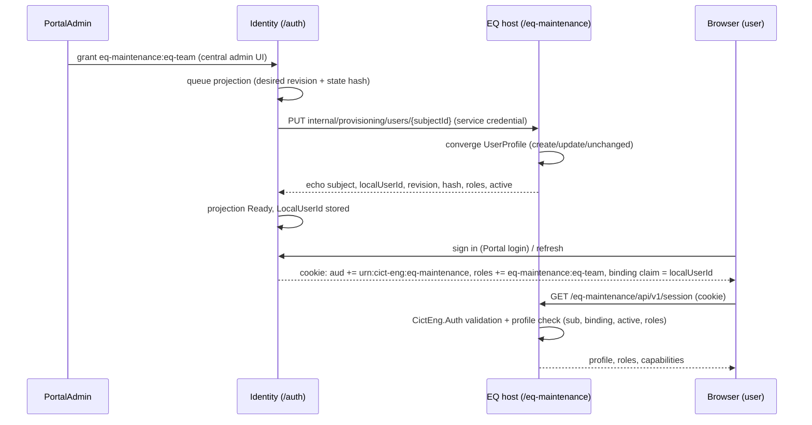
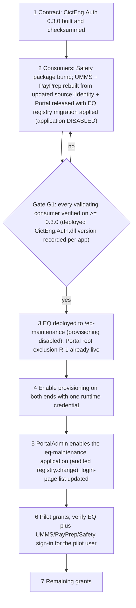

# Portal integration plan

Prepared in P01 on 21 October 2026 from a **read-only** inspection of `F:\CODEX\CICT-ENG_MAIN_PAGE` (branch `feature/option-b-provisioning-and-login-redesign`, commit `47f7bd9`, clean) and of the consumer projects in the UMMS, PayPrep and Safety repositories. Nothing outside `F:\CODEX\EQ_MAINTENANCE\docs` was changed. P05 implements this plan; P12 sequences the real rollout; R03 reviews it. Local source is not evidence of what is deployed (U-13).

## 1 Current contract (as read)

| Fact | Evidence (Portal repo unless noted) |
| --- | --- |
| Shared contract version 0.2.1, `net8.0`, JwtBearer 8.0.15; 0.2.0 added Safety without changing other values | `src/CictEng.Auth/CictEng.Auth.csproj`; `PACKAGE_README.md`; `HANDOVER.md` "Safety Phase 1 onboarding" |
| Explicit lists: 4 audiences (`portal`, `umms`, `payprep`, `safety`), 19 role codes, empty permission registry; binding claims for umms/payprep/safety | `src/CictEng.Auth/SharedAuthContract.cs` |
| `AddCictEngSharedJwtValidation` refuses at startup any `SharedAuth:Audience` not in `SharedAuthContract.Audiences` | `SharedAuthContract.cs` `ValidateConfiguration` |
| The profile validator rejects the **whole token** if any `aud` value or any role code is not in the consumer's compiled lists, and if a namespaced role lacks `urn:cict-eng:<prefix>`; it then keeps only the consuming app's roles on the principal | `src/CictEng.Auth/SharedAccessTokenProfileValidator.cs` `ValidatePayload`, `RestrictAuthorizationClaims` |
| One access token per session (5 min, RS256, `at+jwt`), in one shared HttpOnly cookie; `aud` = portal + every enabled app where the user holds an enabled role and (for binding apps) a Ready projection; no app audiences at all while a password change is pending | `src/CictEng.Identity/Authentication/IdentityAccessTokenService.cs` |
| Binding claim value comes only from the Identity projection ledger (`ApplicationAccountProjections.LocalUserId`), never from configuration | same file; comment in `SharedAuthContract.cs` |
| Desired-state convergence: `PUT internal/provisioning/users/{subjectId}`, full state each call, revision + state hash echo checks, Conflict/Validation/NotSupported/Retryable classification | `src/CictEng.Identity/Provisioning/IAppProvisioningConnector.cs`, `HttpAppConvergenceConnector.cs`, `ApplicationProjectionService.cs` |
| Connectors registered per app with default-off options; disabled apps get `DisabledProvisioningConnector` | `Authentication/IdentityRuntimeExtensions.cs` lines 45-105; `Provisioning/SafetyProvisioningOptions.cs` |
| Registry rows (applications, roles) come from `IdentityCatalogSeeder`, which runs in tests, the local dev seed tool and the one-time production bootstrap (it refuses a non-empty Users table) - there is **no** path that adds a new application to an existing production Identity database | `Persistence/IdentityCatalogSeeder.cs`; `docs/PRODUCTION_BOOTSTRAP_RUNBOOK.md`; `tools/CictEng.Identity.ProductionBootstrap` |
| Launcher: `GET /auth/applications` lists enabled apps with an enabled grant and a Ready projection; `GET /auth/applications/{code}/access-status` reports signed-out / password-change-required / denied etc.; the Portal `ApplicationLaunch` uses the first return-path segment as the application code | `Endpoints/IdentityAdministrationEndpoints.cs` lines 66-190; `src/portal-web/src/App.tsx` lines 226-293 |
| Return-URL allow-list is hard-coded (`/umms`, `/payprep`, `/safety`) and rejects `%`, `#`, `\`, `//` and control characters | `Security/IdentityReturnUrlValidator.cs` |
| Audit writer only accepts application codes in a hard-coded set; an onboarded app missing there fails every audited operation naming it | `Persistence/AuditEventWriter.cs` lines 48-51 |
| Delegated grants exist only for `umms` and `payprep` admins; Safety roles are not delegable | `IdentityAdministrationEndpoints.cs` `DelegatedAdministratorRoles`; seeder `delegated:` flags |
| Same-origin local routing is the Portal Vite proxy table (Identity `/auth`, each app's API before its SPA) | `src/portal-web/vite.config.ts` |
| Production deploy mirrors the root site with `robocopy /MIR` and excludes only the child folders `auth`, `umms`, `payprep`, `safety` | `scripts/deploy-production-release.ps1` line 57 and 241; `scripts/build-production-packages.ps1` line 1068 |
| CSRF/Origin contract and service-credential filter for provisioning in a relying app | `src/CictEng.Auth/SharedBrowserRequestSecurity.cs`; Safety `src/Cict.Safety.Api/Security/SafetyRequestSecurityMiddleware.cs` |
| Local profile authorization: binding claim + subject + active + role-set equality | Safety `src/Cict.Safety.Api/Security/SafetyAccessAuthorization.cs` |

## 2 Identifiers for EQ

| Item | Value |
| --- | --- |
| Application code / path | `eq-maintenance` / `/eq-maintenance` (no collision in the registry seed, return-path list, proxy table or deploy scripts) |
| Display name / icon key | `EQ Maintenance` / `maintenance` (D-38) |
| Audience | `urn:cict-eng:eq-maintenance` |
| Roles | `eq-maintenance:admin` (EQ Maintenance Admin), `eq-maintenance:eq-team` (EQ Team), `eq-maintenance:management` (Management, read-only) - none delegable (D-37) |
| Binding claim | `cict:binding:eq-maintenance:local_user_id` |
| Sort order | 50 (after Safety's 40) |
| Committed registry state | application **disabled** (`IsEnabled = false`) until the rollout gate in s6 (D-41) |

The validator derives the required audience from the role prefix (`eq-maintenance` -> `urn:cict-eng:eq-maintenance`), so the hyphenated code is consistent with the existing rules; P05 adds a test for it.

## 3 Touchpoint inventory

Every item below is a P05 change unless marked. "Portal" = `F:\CODEX\CICT-ENG_MAIN_PAGE`; "EQ" = this repository. Other repositories stay read-only (Master control).

### 3.1 Shared contract `CictEng.Auth` (Portal)

| ID | File | Change |
| --- | --- | --- |
| A-1 | `src/CictEng.Auth/SharedAuthContract.cs` | Add audience `urn:cict-eng:eq-maintenance`; three role codes; `ApplicationCodeForAudience` case `eq-maintenance`; constant `EqMaintenanceLocalUserIdClaim`; `TryGetLocalUserIdClaimForAudience` case. No check is removed or relaxed |
| A-2 | `src/CictEng.Auth/CictEng.Auth.csproj`, `PACKAGE_README.md` | Version 0.3.0 with a note that the EQ values were added and existing values are unchanged |
| A-3 | `scripts/pack-cicteng-auth.ps1` (run, not changed unless needed) | Produce `CictEng.Auth.0.3.0.nupkg` locally; copy into `EQ/packages/` with its sha256 recorded. **No publishing** |
| A-4 | `tests/CictEng.Auth.Tests/SharedAuthContractTests.cs` | Update the registry test; add RC-4 to RC-8 (s5) |
| A-5 | new `tests/CictEng.Auth.CompatibilityTests/` (PackageReference `CictEng.Auth` 0.2.1 from a local copy) | RC-1 to RC-3: old validator against tokens from the new issuer |

### 3.2 Identity (Portal)

| ID | File | Change |
| --- | --- | --- |
| I-1 | `src/CictEng.Identity/Persistence/IdentityCatalogSeeder.cs` | Application row (new fixed GUID chosen in P05) with `IsEnabled = false`; three roles (fixed GUIDs, `delegated: false`) |
| I-2 | new `Provisioning/EqMaintenanceProvisioningConnector.cs`, `EqMaintenanceProvisioningOptions.cs` | Copy of the Safety connector/options pattern: section `EqMaintenanceProvisioning`, `Enabled` default false, base address `.../eq-maintenance/`, runtime credential >= 32 chars, header `X-CICT-Provisioning-Credential`; `ProvisionAttributes = []` |
| I-3 | `Authentication/IdentityRuntimeExtensions.cs` | Register the EQ connector when enabled, else `DisabledProvisioningConnector("eq-maintenance")` |
| I-4 | `Security/IdentityReturnUrlValidator.cs` | Add `/eq-maintenance` to `RegisteredApplicationPaths` |
| I-5 | new Identity migration `AddEqMaintenanceApplicationRegistry` | Idempotent `IF NOT EXISTS` inserts of the application (disabled) and three roles, so an **existing** Identity database (production included, later and only when authorized) receives the registry rows through the normal reviewed migration script. Down migration removes the rows only if no grant/projection references them |
| I-6 | `Persistence/AuditEventWriter.cs` | Add `eq-maintenance` to `AllowedApplicationCodes` |
| I-7 | `Endpoints/IdentityAdministrationEndpoints.cs` | **No change** to `DelegatedAdministratorRoles` (D-37); add a test that `umms:admin`/`payprep:admin` cannot grant EQ roles |
| I-8 | `appsettings.json` | `EqMaintenanceProvisioning: { "Enabled": false }` with no credential or address values |
| I-9 | `Program.cs` health | No change; `supportedAudiences` becomes 5 automatically; tests asserting 4 are updated |
| I-10 | `tests/CictEng.Identity.IntegrationTests/` new `EqMaintenancePortalOnboardingTests.cs` (+ factory registration) | RC-9 to RC-16 |

### 3.3 Portal web and host (Portal)

| ID | File | Change |
| --- | --- | --- |
| W-1 | `src/portal-web/src/portalApi.ts` | `bindableApplicationCodes` add `eq-maintenance`; `applicationHealthPaths` add `'eq-maintenance': '/eq-maintenance/health/live'`. `isSafePortalReturn` needs no change (it already accepts any non-reserved first segment) |
| W-2 | `src/portal-web/src/App.tsx` | `applicationIcon` maps `maintenance` to a dedicated icon (D-38). The static `LOGIN_APPLICATIONS` list is **not** changed in P05; it is updated in the release that enables EQ (s6 step 5) |
| W-3 | `src/portal-web/vite.config.ts` | Proxy `/eq-maintenance/api` -> `VITE_EQ_API_PROXY_TARGET` (default `http://127.0.0.1:5310`) before `/eq-maintenance` -> `VITE_EQ_PROXY_TARGET` (default `http://127.0.0.1:5311`, `isAppRoot: true`). `/eq-maintenance/internal` is not proxied |
| W-4 | `src/portal-web/src/App.test.tsx` | Tests for the tile icon, the `/eq-maintenance/...` return path and the health path |
| H-1 | `src/Portal.Host` | No change (it only reports the audience count); update any test that asserts 4 |

### 3.4 Runner and deployment scripts (Portal)

| ID | File | Change |
| --- | --- | --- |
| R-1 | `scripts/deploy-production-release.ps1` | Add `eq-maintenance` to `$childApplications`, so a root `/MIR` deploy can never delete `C:\inetpub\CictEngPortal\eq-maintenance`. Must be in place before EQ's first deployment and in every later Portal root release |
| R-2 | `scripts/build-production-packages.ps1` | Add `eq-maintenance` to the root rollback `/XD` list (line 1068) and to the untouched-apps note (line 934). Whether this script also learns to package EQ is a P12 decision; EQ packages itself from its own repository |
| R-3 | `scripts/ssh-deploy/*.ps1` | P05 inspects their child-application handling and adds the same exclusion where a mirror is used |
| R-4 | `scripts/portal-local.ps1` | Optional, only if the Portal owner prefers it over R-5: an opt-in switch that adds EQ services. The default behaviour of the stock runner must not change |
| R-5 | EQ `tools/eq-portal-local.ps1` (EQ repo, preferred) | Starts only Identity and portal-web from the Portal repo plus the EQ host/Vite, with an isolated Identity database, isolated EQ database and generated local-only credentials (s7). Does not start or seed UMMS, PayPrep or Safety |

### 3.5 EQ repository (P05)

| ID | Change |
| --- | --- |
| E-1 | `NuGet.config` + `packages/CictEng.Auth.0.3.0.nupkg` (checksum recorded); host references `CictEng.Auth` 0.3.0 and `Microsoft.AspNetCore.Authentication.JwtBearer` 10.0.x; prove the net8.0 library validates correctly under ASP.NET Core 10 (D-03) |
| E-2 | `AddCictEngSharedJwtValidation` with `SharedAuth` options from runtime configuration (issuer `<origin>/auth`, JWKS `<origin>/auth/.well-known/jwks.json`, audience `urn:cict-eng:eq-maintenance`, cookie name per transport, `AllowInsecureHttpForDevelopment` only for local HTTP) |
| E-3 | `EqAccessAuthorizationHandler` (DATA_CONTRACT s7) and policies `EqRead`/`EqWrite`/`EqAdmin` |
| E-4 | Browser request verification middleware (CSRF + canonical origin) with only the provisioning path exempt |
| E-5 | `EqProvisioning` options, credential filter and `PUT /eq-maintenance/internal/provisioning/users/{subjectId}` convergence (API_CONTRACT s5) |
| E-6 | `GET /session`, SPA session client (memory-only CSRF, single refresh, access-status states, `/login?returnUrl=`), deep-link restore |
| E-7 | EQ integration tests: wrong/missing audience, malformed token, two credentials, missing binding claim, subject mismatch, inactive profile, role mismatch, stale/conflicting provisioning, CSRF failures, Management write denials |

## 4 EQ-side identity flow

Failure states shown by the SPA (via `access-status` values or EQ 403 codes): `signed-out` -> Portal login with return URL; `password-change-required` -> Portal; `denied` -> "You do not have EQ Maintenance access"; `pending` -> "Access is being prepared"; `failed`/`conflict` -> "Access could not be prepared; contact the Portal administrator" with the correlation ID; `access_not_ready` from EQ -> same as `pending` with a correlation ID.

## 5 Token compatibility analysis and regression cases

### 5.1 Consumer matrix (local source, 21 October 2026)

| Consumer | Repository | How it gets `CictEng.Auth` | Validates shared tokens | Effect if the issuer emits EQ claims while this consumer runs 0.2.1 |
| --- | --- | --- | --- | --- |
| Identity (issuer and Portal-audience validator) | Portal | project reference | yes (`urn:cict-eng:portal`) | Upgraded in the same release as the issuer change |
| Portal.Host | Portal | project reference | no (reads the audience count for health only) | none |
| UMMS API | `F:\CODEX\EAM_emmergancy_mat_tracker_WEBAPP` | source `ProjectReference` to `..\CICT-ENG_MAIN_PAGE\src\CictEng.Auth` | yes (`umms`) | **every EQ-role user is rejected by UMMS** until UMMS is rebuilt from the updated Portal source and redeployed |
| PayPrep API | `F:\CODEX\PAYMENT_AUTOMATION_V2\PayPrep_Assistant` (plus four snapshot folders with the same reference) | source `ProjectReference` | yes (`payprep`) | same as UMMS |
| Safety API | `F:\CODEX\RECTIFICATION_PROGRESS_TRACKER` | `PackageReference CictEng.Auth 0.2.1` from its local `packages/` folder | yes (`safety`) | same; needs a package bump in the Safety repo (outside P05's write boundary) |
| EQ | this repository | `PackageReference CictEng.Auth 0.3.0` | yes (`eq-maintenance`) | n/a (cannot start on 0.2.1) |

Users who do not hold an EQ role are unaffected in every case, because their tokens do not change. The hazard is real for the intended users: EQ Team members and managers may also use UMMS, PayPrep or Safety. Therefore **no zero-impact claim is made**; compatibility depends on rollout order.

Because UMMS and PayPrep compile the contract from Portal source, a local rebuild of them after P05 silently includes 0.3.0. That is useful for local testing but does not change what is deployed; the deployed version of each consumer must be checked (U-13) before step 4 of s6.

Safety patch proposal (P05 prepares, does not apply): in `F:\CODEX\RECTIFICATION_PROGRESS_TRACKER`, copy `CictEng.Auth.0.3.0.nupkg` into `packages/`, change `src/Cict.Safety.Api/Cict.Safety.Api.csproj` to `Version="0.3.0"`, rebuild, run its test suite, and redeploy through its owner's release process. No Safety source change is expected because its code references only existing contract members.

### 5.2 Regression cases (implemented in P05, reviewed in R03)

| ID | Case | Expected |
| --- | --- | --- |
| RC-1 | 0.2.1 validator (any audience) + token from the new issuer carrying EQ audience/role | Rejected - documents why s6 ordering is mandatory |
| RC-2 | 0.2.1 validator + new-issuer token for a user without EQ grants | Accepted, identical principal to today |
| RC-3 | 0.2.1 validator + new-issuer token for a user **with** EQ grants and Ready projection while the EQ application is disabled | Accepted (the registry gate prevents EQ claims) |
| RC-4 | 0.3.0 validator for `portal`, `umms`, `payprep`, `safety` + EQ-bearing token | Accepted; each principal holds only its own app's roles (no EQ role leaks) |
| RC-5 | 0.3.0 validator for EQ + token without EQ audience (no grant, no projection, or password change pending) | 401 |
| RC-6 | 0.3.0 + token with an `eq-maintenance:*` role but no EQ audience | Rejected (namespace rule kept) |
| RC-7 | 0.3.0 + token with an unregistered audience (e.g. `urn:cict-eng:unknown`) | Rejected (strictness kept) |
| RC-8 | 0.3.0 + token with an unregistered role (e.g. `eq-maintenance:superuser`) | Rejected |
| RC-9 | Issuer: EQ grant without a Ready projection | No EQ audience, role or binding claim |
| RC-10 | Issuer: Ready projection but application disabled | No EQ claims |
| RC-11 | Issuer: password change pending | No app audiences (unchanged behaviour) |
| RC-12 | Issuer: duplicate or malformed ledger binding | EQ audience omitted, other audiences unaffected |
| RC-13 | EQ host configured with `CictEng.Auth` 0.2.1 | Startup fails (unregistered audience) - fail closed |
| RC-14 | `umms:admin`/`payprep:admin` delegated grant of an EQ role; EQ Admin attempting any central grant | Refused |
| RC-15 | Return URL `/eq-maintenance/equipment/<uuid>?part=<uuid>&mode=technical` | Accepted by Identity and portal-web; a value containing `%` falls back to `/` |
| RC-16 | Launcher and access-status for: no grant, grant + pending/failed/conflict projection, Ready, disabled application | Tile only when Ready **and** enabled; access-status returns the existing values `denied`, `pending`, `failed`, `conflict`, `ready` (plus `signed-out`, `password-change-required`); for a disabled application it must not return `ready` (see PI-6) |
| RC-17 | Root deploy plan with `eq-maintenance` present | robocopy exclusion includes the EQ folder (script dry-run or generated-argument test) |

AUTH07 is satisfied only when RC-1 to RC-8 pass and the deployed-version matrix for the intended rollout is recorded; P05 can complete the local part, the deployed part stays an explicit unmet exit until checked.

## 6 Rollout sequence (P12 prepares; execution needs later explicit authorization)

- Steps 1-2 are safe in any order among consumers because the application stays disabled: the issuer emits no EQ claims, so every old or new consumer sees today's token shape (RC-3).
- Gate G1 is the condition that must hold before step 5. Evidence is per deployed app (for example the file version of `CictEng.Auth.dll` in each IIS folder plus a sign-in check), not a source build.
- Rollback order is the reverse: revoke EQ grants and disable the application first (new tokens lose EQ claims; existing tokens expire within the 5-minute access lifetime plus refresh), then disable provisioning, then remove or roll back the EQ app, and only then roll back consumers. **Never roll a consumer back below 0.3.0 while the EQ application is enabled.** An older Identity binary that lacks the EQ contract does not emit EQ claims even if registry rows remain, because the issuer filters by its compiled contract.

## 7 Local same-origin integration for P05

| Item | Plan |
| --- | --- |
| Processes | Identity (5180) and portal-web (5174) from the Portal working tree; EQ host (5310) and EQ Vite (5311). UMMS, PayPrep and Safety are not started; their compatibility is covered by RC-1 to RC-8 at validator level |
| Identity database | New isolated database `EqMaintenanceDisposable_Identity_<runid>` created by migrations, never `CictEngIdentityLocalPreview`, `CictEngIdentityDev` or any other existing database; dropped after the run |
| EQ database | `EqMaintenanceDisposable_P05_<runid>` with the EQ marker (D-23) |
| Signing key / secrets | Generated local-only signing material and provisioning credential under the ignored `tmp/p05-runtime/` folder; never printed, logged or committed |
| Synthetic users | Created through Identity's own admin endpoints: `eq-admin-demo`, `eq-team-demo`, `eq-team-demo-2`, `eq-mgmt-demo`, `no-eq-demo` (no real names or credentials) |
| Walkthrough | Portal sign-in -> tile -> EQ session; direct deep link reload; return navigation; Management write denial; no-EQ user denial; wrong-audience token; logout; password-change-required user |
| Evidence | `docs/evidence/P05/` (commands, test results, screenshots with no secrets), exact changed files per repository, package checksum |

## 8 Delegated administration (D-37)

The central mechanism supports app-scoped delegation (`DelegatedAdministratorRoles`, `IsDelegatedGrantAllowed`). Stage 1 does not enable it for EQ, mirroring Safety: PortalAdmin grants the three EQ roles. Enabling it later would add `["eq-maintenance"] = "eq-maintenance:admin"` and mark `eq-team`/`management` as delegable, which stays within EQ authority; it needs a user decision and is not required by S01-S17.

## 9 Risks and open items

| ID | Risk / item | Handling |
| --- | --- | --- |
| U-13 | Deployed `CictEng.Auth` version per consumer unknown | Gate G1 evidence before step 5 |
| PI-1 | Seeder overwrites `IsEnabled` on every run (local/test only) | Local scripts enable EQ explicitly after seeding; production uses the I-5 migration and the audited admin toggle |
| PI-2 | Portal root deploy could delete the EQ folder | R-1/R-2 before EQ's first deployment |
| PI-3 | `CictEng.Auth` (net8.0) inside a net10.0 host | E-1 tests; fallback is a multi-targeted 0.3.x package (Portal change, still within P05) |
| PI-4 | Access tokens keep EQ claims up to their 5-minute lifetime after disabling | Accepted and documented in rollback |
| PI-5 | Safety package bump is outside P05's write boundary | Patch proposal (s5.1); G1 stays unmet until applied by its owner |
| PI-6 | `GET /auth/applications/{code}/access-status` checks the role's `IsEnabled` but not the application's, so while EQ is disabled (rollout steps 1-4) a granted, provisioned user would be told `ready` although the issuer emits no EQ claims and EQ answers 401 | P05 adds the application-enabled condition (returns `denied`) with a test; a narrow Identity change that also benefits existing apps when an admin disables one |
